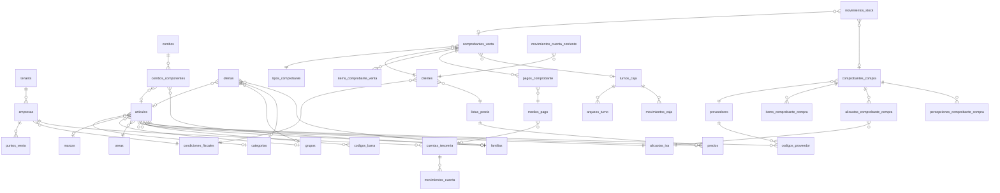

# 10 — Modelo de datos normalizado

> Reemplaza el schema propuesto en el [doc 03](03-modelo-destino-postgres.md). El doc 03
> sigue siendo la referencia del **mapeo legacy → destino** para la migración de datos;
> este documento define el modelo definitivo del producto, pensado para venderse a
> terceros. Todo se define acá de entrada, aunque se implemente por etapas (ver final).

## Principios

1. **Scoping según doc 09.** Toda tabla declara su categoría: catálogo
   (`id_tenant` + `id_empresa NULL`), operativa (`id_tenant` + `id_punto_venta`)
   o global. En los SQL de abajo el scoping se indica con `-- [catálogo]`,
   `-- [operativa]`, `-- [global]` y no se repite en cada columna.
2. **Convención de nombres del doc 03** (castellano, `snake_case`, plural,
   `items_x`, `movimientos_x`) con la forma de PK del doc 08: `id_articulo`, no
   `articulo_id`.
3. **`EntidadBase`**: `created_at`, `updated_at`, `deleted_at` (soft delete con
   unique parciales `WHERE deleted_at IS NULL`) en todas las tablas.
4. **Los padrones son datos, no enums.** El legacy murió por `tipo=95` y `c1..c6`.
   Enum nativo de Postgres solo para estados de máquina de estados (`estado_turno`);
   catálogo editable por el usuario → tabla.
5. **`numeric(14,2)`** para importes, `numeric(12,3)` para cantidades (pesables).
6. **Los comprobantes son inmutables una vez emitidos.** Todo lo que el comprobante
   necesita para reimprimirse igual dentro de cinco años (descripción, precio,
   alícuota, condición fiscal) se guarda como *snapshot* en el item, aunque sea
   redundante con el catálogo.
7. **Nada de saldos sin libro.** Todo saldo cacheado (cliente, stock) tiene su tabla
   de movimientos que lo reconstruye y audita.
8. **Extensiones y funciones de base.** `citext` (comparación sin mayúsculas en columnas de
   texto) y `unaccent`, más la función `public.sin_acentos(text)` (`IMMUTABLE`, envoltorio de
   `unaccent`). Toda búsqueda de texto del servidor compara
   `lower(sin_acentos(columna)) LIKE lower(sin_acentos(patrón))`, así "jose" encuentra
   "José"; `unaccent` mapea ñ a n. Ver `BusquedaSinAcentos` (Application).

---

## 1. Padrones auxiliares

> **Estado (Etapa 1, stage-1-organization-and-catalogs):** `areas`, `categorias`, `marcas`,
> `grupos` y `medios_pago` tienen tabla, RLS y ABM completo (React, máquina genérica de
> catálogo — ADR-11 de `openspec/changes/stage-1-organization-and-catalogs/design.md`).
> `condiciones_fiscales`, `alicuotas_iva` y `tipos_comprobante` tienen tabla y RLS, pero son
> de solo lectura para el tenant en esta etapa: la API solo expone `GET`, sin ABM — las
> mantiene la plataforma. La organización (`tenants`/`empresas`/`puntos_venta`) también quedó
> completa en Etapa 1: alta vía aprovisionamiento (`POST /api/plataforma/tenants`, un tenant +
> empresa + punto de venta + plantilla + admin en una transacción) y, desde el batch 11 de la
> etapa 4 (`ServicioDeOrganizacion`/`OrganizacionEndpoints`), lectura/edición de datos
> descriptivos + suspender/reactivar un tenant: `GET`/`PUT` de tenants (plataforma-only),
> `GET`/`PUT` de empresas y puntos de venta (plataforma ve/edita cualquiera, un admin de
> tenant solo los propios) y `POST .../suspender`/`.../reactivar`. La asimetría que existió
> entre el batch 10 y el 11 de la etapa 4 (alta sin listado/edición) está resuelta — el gap
> se cerró como extensión de alcance autorizada de la misma etapa, no en una etapa aparte.

### Dominios por tenant (rebanada 0 de la tienda online)

Cada tenant puede apuntar dominios propios al sistema; el servidor resuelve el tenant desde el host
de la request antes de que haya sesión (doc 09 "Dominios por tenant", doc 08 "Login").

```sql
dominios (                    -- [organización] id_tenant, doc 09 (como empresas)
    id_dominio     integer GENERATED BY DEFAULT AS IDENTITY PRIMARY KEY,   -- pk_dominios
    id_tenant      integer NOT NULL REFERENCES tenants,                    -- fk_dominios_tenant
    host           text NOT NULL,           -- minúscula, sin puerto ni esquema, nombre de DNS válido
    es_principal   boolean NOT NULL DEFAULT false,
    verificado_en  timestamptz NULL,        -- NULL = sin verificar: no resuelve
    created_at, updated_at, deleted_at      -- baja siempre lógica
);
-- UNIQUE (host) WHERE deleted_at IS NULL                        -- ux_dominios_host
-- UNIQUE (id_tenant) WHERE es_principal AND deleted_at IS NULL  -- ux_dominios_principal_por_tenant
-- INDEX (id_tenant)                                             -- ix_dominios_tenant (soporte de la FK)
-- CHECK (host en minúscula, hasta 253 caracteres, etiquetas de DNS de 1 a 63)
--                                                               -- ck_dominios_host_formato
```

- **Host único entre los vivos**: dar de baja un dominio libera el host para volver a cargarlo. Un
  host resuelve a un solo tenant.
- **RLS**: `dominios_tenant` (estándar, `HabilitarRlsDeTenant`) más `dominios_login_lectura`
  (`FOR SELECT USING (app_modo() = 'login')`), porque el host se resuelve antes de la sesión.
- **Backstops** (`ManejadorDeErrores`): `ux_dominios_host` → `409 host_duplicado`;
  `ux_dominios_principal_por_tenant` → `409 dominio_principal_duplicado` (inalcanzable por la API:
  el alta mueve la marca bajo un lock por tenant); `ck_dominios_host_formato` → `400 host_invalido`
  (la API ya normaliza y valida con `Dominio.NormalizarHost`).
- **Escritura**: solo `ServicioDeDominios` (plataforma), sin reintento
  (`FabricaDeEstrategiaSinReintento`), bajo el mismo `pg_advisory_xact_lock` por tenant que las
  bajas de organización.
- **Baja de tenant**: tabla `marcado` en el inventario de dependientes (guard de uso de la
  etapa 20): bloquea la baja del tenant, aunque el dominio esté dado de baja.

### Vitrinas (landing del comercio)

La identidad pública de una empresa: lo que muestra la landing del dominio del comercio (doc 09
"Modo de acceso público"). Una por empresa; a lo sumo una publicada por tenant.

```sql
vitrinas (                    -- [empresa] id_tenant + id_empresa NOT NULL, como certificados_fiscales
    id_vitrina           integer GENERATED BY DEFAULT AS IDENTITY PRIMARY KEY,   -- pk_vitrinas
    id_tenant            integer NOT NULL REFERENCES tenants,                    -- fk_vitrinas_tenant
    id_empresa           integer NOT NULL,                                       -- fk_vitrinas_empresa
    publicada            boolean NOT NULL DEFAULT false,
    tagline              text NULL,           -- hasta 120 caracteres
    descripcion          text NULL,           -- hasta 2000 caracteres
    color_acento         text NULL,           -- #rrggbb en minúscula; NULL = el naranja de Ways
    tema                 text NOT NULL DEFAULT 'oscuro',   -- 'claro' | 'oscuro'
    id_lista_precio      integer NULL,        -- lista de precios de la tienda; NULL = la default compartida
                                              -- fk_vitrinas_lista_precio (id_lista_precio, id_tenant) -> listas_precio
    logo                 bytea NULL,          -- PNG, JPEG o WebP, hasta 1 MB; nunca SVG
    logo_content_type    text NULL,           -- lo decide el contenido, no el encabezado
    logo_actualizado_en  timestamptz NULL,    -- origen del ETag y de logoVersion
    created_at, updated_at, deleted_at        -- baja siempre lógica
    FOREIGN KEY (id_empresa, id_tenant) REFERENCES empresas (id_empresa, id_tenant)
);
-- UNIQUE (id_empresa) WHERE deleted_at IS NULL                  -- ux_vitrinas_empresa
-- UNIQUE (id_tenant) WHERE publicada AND deleted_at IS NULL     -- ux_vitrinas_publicada_por_tenant
-- INDEX (id_tenant), INDEX (id_empresa, id_tenant)              -- ix_vitrinas_tenant / ix_vitrinas_empresa (soporte de las FKs)
-- INDEX (id_lista_precio, id_tenant)                            -- ix_vitrinas_lista_precio (soporte de fk_vitrinas_lista_precio)
-- CHECK tema IN ('claro', 'oscuro')                             -- ck_vitrinas_tema
-- CHECK color_acento IS NULL OR color_acento ~ '^#[0-9a-f]{6}$' -- ck_vitrinas_color_acento
-- CHECK char_length(tagline) <= 120 / char_length(descripcion) <= 2000
--                                                               -- ck_vitrinas_tagline_largo / ck_vitrinas_descripcion_largo
-- CHECK logo, logo_content_type y logo_actualizado_en: los tres NULL o los tres con valor; el logo de 1 a
--       1048576 bytes y el tipo en ('image/png', 'image/jpeg', 'image/webp')   -- ck_vitrinas_logo
```

- **RLS**: `vitrinas_tenant` (estándar, `HabilitarRlsDeTenant`) más `vitrinas_publico_lectura`
  (`FOR SELECT USING (app_modo() = 'publico' AND id_tenant = app_tenant_publico() AND publicada AND
  deleted_at IS NULL)`). Las otras dos tablas de la landing que lee el modo público son `empresas` y
  `puntos_venta`, con `{tabla}_publico_lectura` sin la parte de publicación; la tienda suma seis más (doc 09,
  "Modo de acceso público").
- **Lo que expone el modo público**: la lectura es de filas enteras, así que el lector
  (`LectorDeVitrinaPublica`) proyecta columna por columna. `GET /api/publico/vitrina` devuelve el nombre
  (`nombre_fantasia` o, si falta, `razon_social`), los textos, el tema, `tieneLogo`, `logoVersion` y, por
  sucursal, nombre, domicilio, horario, WhatsApp, Instagram, Facebook y web. Nada más de `empresas` ni de
  `puntos_venta`.
- **Backstops** (`ManejadorDeErrores`): `ux_vitrinas_publicada_por_tenant` → `409 vitrina_ya_publicada`
  (es el camino normal de ese 409: la API no hace pre-chequeo, serializa las escrituras del tenant con el
  lock de las bajas de organización y la segunda publicación llega al índice); `ux_vitrinas_empresa` →
  `409 vitrina_duplicada` (inalcanzable por la API); los CHECK → `400` con `tema_invalido`,
  `color_invalido`, `texto_demasiado_largo` y `logo_no_admitido`. Son backstops de esquema para una
  escritura cruda: la API valida antes con `Vitrina.Normalizar*` y `Vitrina.ValidarLogo` y nunca llega a
  ellos. En particular, `ValidarLogo` contesta `413 logo_demasiado_grande` y `415 logo_no_admitido`, y el
  CHECK `ck_vitrinas_logo` (que nadie alcanza por la API) contesta `400 logo_no_admitido`.
- **Escritura**: solo `ServicioDeVitrinas` (admin del tenant o plataforma, `GestionDeOrganizacion`), sin
  reintento (`FabricaDeEstrategiaSinReintento`). El logo se sube como cuerpo crudo de la request y se
  valida por sus primeros bytes: 413 `logo_demasiado_grande` por encima de 1 MB, 415 `logo_no_admitido`
  para cualquier otra cosa. `DELETE /api/empresas/{id}/vitrina` es la baja lógica de la fila (la
  despublica) y es idempotente: sin vitrina también contesta 204.
- **Lectura**: pública (`GET /api/publico/vitrina` y `/logo`, solo de un tenant que puede operar: uno
  suspendido contesta 404 como un comercio sin vitrina) y del admin (`GET /api/empresas/{id}/vitrina` y
  `/vitrina/logo`, esta última también para una vitrina sin publicar, con `Cache-Control: private,
  no-store`). Los dos logos llevan ETag derivado de `logo_actualizado_en` y contestan 304 a un
  `If-None-Match` que coincide sin leer la columna `logo`.
- **Baja de tenant y de empresa**: tabla `marcado` en el inventario de dependientes (guard de uso de la
  etapa 20): una empresa o un tenant con vitrina cargada no se puede dar de baja, igual que con dominios.
- **Lista de precios de la tienda** (`id_lista_precio`): `PUT /api/empresas/{id}/vitrina` la acepta y reemplaza como
  los demás campos (ausente = `NULL` = la default compartida del tenant). Tiene que existir, estar viva y activa,
  ser del tenant de la empresa y ser compartida o de esa empresa; si no, `400 lista_invalida`, después del 404 de
  la empresa y bajo el lock del tenant (la lista se toma `FOR KEY SHARE`, así que su baja o llega antes y la vitrina
  no la referencia, o espera y el guard de uso la ve). La FK entra al inventario de dependientes: una lista que
  usa una vitrina no se puede dar de baja (`409 *_en_uso`). `fk_vitrinas_lista_precio` → `400 lista_invalida` es el
  backstop de una escritura cruda. La lista se valida **solo cuando cambia** respecto de la guardada (una vitrina nueva
  siempre valida): una vitrina cuya lista se desactivó después por una escritura que no pasó por la guarda de abajo
  se sigue pudiendo editar o despublicar mandando la misma lista; mandar otra lista inactiva sigue siendo `400`.
- **La lista en uso no se desactiva ni se mueve**: `PUT /api/catalogos/listas-precio/{id}` que la desactiva o le cambia
  `id_empresa` mientras la usa una vitrina no dada de baja (publicada o no) es `409 lista_en_uso_por_vitrina`, con el
  nombre de la empresa en el mensaje; hay que cambiarle la lista a la tienda primero. Esa edición toma `FOR UPDATE`
  sobre la lista (sin reintento) y recién bajo el lock mira las vitrinas: choca con el `FOR KEY SHARE` de
  `PUT .../vitrina`, así que o ve la vitrina comiteada, o espera y la vitrina ve la lista ya inactiva (`400
  lista_invalida`). Una vitrina dada de baja no cuenta; renombrar o cambiar otros campos no pide el lock.
- **Contrato del `PUT` de la vitrina**: reemplaza `idListaPrecio` como el resto de los campos. Un cliente que no manda
  el campo lo deja en `NULL` y la tienda vuelve a la lista default compartida. Por eso la pantalla de la vitrina (T2)
  tiene que enviarlo siempre, con el valor leído del `GET`.

### Clasificación de artículos

```sql
areas       (id_area, nombre, orden, activo)                        -- [catálogo]
categorias  (id_categoria, id_categoria_padre NULL, nombre, orden, activo)  -- [catálogo]
marcas      (id_marca, nombre, activo)                              -- [catálogo]
grupos      (id_grupo, nombre, margen numeric(5,2) NULL, activo)    -- [catálogo]
```

Cuatro clasificadores, cuatro propósitos — no se pisan:

| Padrón | Para qué existe |
|---|---|
| `areas` | El **rubro operativo** (Almacén, Verdulería, Cigarrillos…). Corta los totales de caja y reportes por rubro. Plano, pocos valores |
| `categorias` | La **taxonomía comercial**, jerárquica (`id_categoria_padre`): Bebidas → Gaseosas → Cola. Para navegación, filtros y reportes finos |
| `marcas` | La marca comercial. Ya no arrastra `proveedor_id`/`grupo_id` como en el legacy: una marca puede venir de varios proveedores |
| `grupos` | El **agrupador de ofertas y márgenes**: "todas las latas 473cc a 3x2". Es el destino de las ofertas de grupo |

### Fiscal

```sql
condiciones_fiscales (        -- [global] — las define la plataforma, no el tenant
    id_condicion_fiscal, codigo citext,      -- RI, MONOTRIBUTO, EXENTO, CF, NO_RESP
    nombre, codigo_afip smallint NULL, activo
)

alicuotas_iva (               -- [global]
    id_alicuota_iva, nombre,                 -- 21%, 10.5%, 27%, 0%, Exento, No gravado
    porcentaje numeric(5,2), codigo_afip smallint NULL, activo
)

tipos_comprobante (           -- [global]
    id_tipo_comprobante,
    clase           clase_comprobante,       -- enum: venta | compra
    codigo          citext,                  -- FA, FB, FC, NCA, NCB, NCC, NDA…, TX, NCX, PRE, RC
    nombre,                                  -- "Factura A", "Nota de Crédito X", "Presupuesto"
    letra           char(1) NULL,            -- A, B, C, X; NULL para presupuesto y RC
    signo           smallint,                -- +1 suma a la cuenta, −1 resta (NC = −1)
    discrimina_iva  boolean,                 -- A: neto + IVA por alícuota; B/C/X: total
    es_fiscal       boolean,                 -- ¿reporta a AFIP/ARCA cuando exista FE?
    afecta_stock    boolean,                 -- presupuesto: no
    codigo_afip     smallint NULL,
    registra_libro_iva boolean NOT NULL DEFAULT false, -- ¿entra al libro IVA? true en C-FA/C-FB/C-FC
    activo
)
```

> **Estado (Etapa 19a — CERRADA):** `codigo_afip` de los tres
> catálogos de arriba deja de ser `NULL` a propósito y se puebla vía tres data statements
> idempotentes de la migración `FiscalArcaEtapa19a` (`WHERE codigo_afip IS NULL`) + sus tres
> seed nets gemelos en `InicializadorDeBaseDeDatos` (doble red, cada net probado
> independientemente). `tipos_comprobante`: `FA`→1, `NDA`→2, `NCA`→3, `FB`→6, `NCB`→8, `FC`→11,
> `NCC`→13. `condiciones_fiscales` (RG 5616 `CondicionIVAReceptorId`): `RI`→1, `EXENTO`→4,
> `CF`→5, `MONOTRIBUTO`→6, `NO_RESP`→15 (mapeo a la condición más cercana, la ÚNICA
> incertidumbre flaggeada — se confirma contra `FEParamGetCondicionIvaReceptor` en 19b; hasta
> entonces un receptor `NO_RESP` se rechaza por su código, no por este valor). `alicuotas_iva`
> (`FEParamGetTiposIva`): `0%`→3, `10.5%`→4, `21%`→5, `27%`→6 — `Exento`/`No gravado` quedan
> `codigo_afip NULL` **por regla**: no son alícuotas, sus importes van a `ImpOpEx`/`ImpTotConc`
> y jamás al array `Iva[]` de ARCA.

**`PRE` — desactivado desde la etapa 17 (el cierre del PRE latente).** `PRE` era un tipo
`activo`, `afecta_stock = false`, sin ningún camino de escritura propio — una venta fantasma
podía colarse por `POST /api/ventas` con `codigoTipoComprobante = "PRE"`, decrementar stock y
mover cuenta corriente exactamente como un `TX`. Cerrado con DOS redes independientes (proposal
decisión 2, migración `PresupuestosEtapa17`): **net 1**, un data statement idempotente
(`UPDATE tipos_comprobante SET activo = false WHERE codigo = 'PRE'`) que desactiva la fila en
toda base ya migrada; **net 1b**, un `Activo = false` explícito en
`InicializadorDeBaseDeDatos.TiposComprobanteBase` — sin él, una base FRESCA reabriría el hueco,
porque el seeder corre después de las migraciones, contra una tabla vacía, y net 1 solo toca
filas existentes. Los dos nets se prueban de forma independiente (mutation targets 10/11). Una
tercera red, en el resolver de `ServicioDeVentas` (`|| !tipo.AfectaStock`, slice 3), refuerza el
cierre contra cualquier tipo `afecta_stock = false` futuro, no solo `PRE`.

**`TXR` (etapa 17 — consolidación de remitos, doc 10 §4 "Remitos"):** mismo perfil que `RC`/`PRE`
— `letra 'X'`, `es_fiscal false`, `afecta_stock false`, `discrimina_iva false` —, pero `signo +1`
(el comprobante consolida N remitos SIN items por construcción, precedente `RC`). Nace `activo
true` pero **inemitible por mostrador**: `afecta_stock = false` lo bloquea el mismo guard del
resolver que cierra `PRE` (`ServicioDeVentas`, `|| !tipo.AfectaStock`, slice 3) — el único
escritor legítimo es `ServicioDeFacturacionDeRemitos` (slice 6), nunca `POST /api/ventas`. Se
siembra dos veces: en la lista de arriba para una base nueva y, de forma idempotente, dentro de
la migración `RemitosEtapa17` para una base ya migrada — este seed corre solo cuando la tabla
está vacía.

**`RC` (etapa 7 — pago a cuenta, doc 10 §8):** mismo perfil que `PRE` — `letra NULL`,
`es_fiscal false`, `afecta_stock false`, `discrimina_iva false` —, pero `signo +1` porque el
dinero entra (el signo negativo vive en el movimiento de cuenta corriente, nunca en el total
del comprobante). Se siembra dos veces: en la lista de arriba para una base nueva y, de forma
idempotente, dentro de la migración `CuentaCorrienteEtapa7` para una base ya migrada — este
seed corre solo cuando la tabla está vacía.

**`C-FA`/`C-FB`/`C-FC` (etapa 8 — comprobantes de compra, doc 10 §5):** `clase compra`,
`letra` A/B/C, `signo +1` (entran mercadería), `discrimina_iva` solo en `C-FA` (el costo del
proveedor es neto de IVA), `es_fiscal false` (el sistema nunca *emite* la factura del
proveedor — la flag distingue si reporta a AFIP/ARCA como emisor, no si hay crédito de IVA),
`afecta_stock true`. El prefijo `C-` es **obligatorio, no cosmético**:
`ux_tipos_comprobante_codigo` es UNIQUE sobre `codigo` solo (sin `clase`), así que un código
de compra sin prefijo podría colisionar con uno de venta existente y quedar resuelto por el
camino equivocado. No se siembran notas de crédito de proveedor — la anulación es la única
reversión de una compra confirmada (proposal decisión 10). Mismo mecanismo de siembra doble
que `RC`: en la lista de arriba para una base nueva y, de forma idempotente, dentro de la
migración `ComprasYTransferenciasEtapa8` para una base ya migrada.

**`C-RM` (remito / comprobante no fiscal de compra, doc 10 §5):** `clase compra`, `letra X`,
`signo +1`, `discrimina_iva false`, `es_fiscal false`, `afecta_stock true`,
`registra_libro_iva false`. Es el documento de un proveedor que no emite factura (un remito, un
comprobante informal): vive en `comprobantes_compra` como cualquier otro, con o sin artículos.
Mismo mecanismo de siembra doble que `C-FA`: en la lista de arriba para una base nueva y, de
forma idempotente (guard `AND EXISTS`), dentro de la migración `ComprasRemitoYAlicuotas` para una
base ya migrada, de modo que todos los tenants existentes lo reciben.

**`registra_libro_iva`:** distingue las facturas (que se declaran en el libro IVA) de todo lo
demás. Vale `true` en `C-FA`, `C-FB` y `C-FC` y `false` en el resto, ventas incluidas: el libro de
ventas no lee este flag, entran los comprobantes con `es_fiscal` y CAE aprobado (ver "Libro IVA" en
§5). En compras cumple además otra función: un tipo que registra libro IVA es
una factura y su letra fija si discrimina IVA; un tipo que no lo registra deja esa decisión a quien
carga el comprobante (ver `comprobantes_compra.discrimina_iva` en §5).

**Regla de la letra** (se implementa en dominio, no en tablas): la letra sale del cruce
`condición fiscal de la empresa emisora × condición fiscal del cliente`. RI → RI emite A;
RI → CF/monotributo emite B; monotributista emite C a todos; el ticket no fiscal de hoy
es X. El comprobante guarda el `id_tipo_comprobante` ya resuelto: el cruce decide en el
momento de emitir, nunca se re-deriva.

- `empresas`, `clientes` y `proveedores` ganan `id_condicion_fiscal`.
- `empresas` gana las alícuotas de percepción que los proveedores le aplican (ver
  "Percepciones" en §5):

```sql
empresas (
    ...,
    alicuota_percepcion_iibb numeric(6,3) NULL,   -- una sola jurisdicción por ahora
    alicuota_percepcion_iva  numeric(6,3) NULL    -- NULL = no se conoce
);
-- CHECK ck_empresas_alicuotas_percepcion_rango: cada una NULL o entre 0 y 100.
```
- El legacy completo mapea a: ticket X (`tipo=1`), nota de crédito X (`tipo=2`).

### Medios de pago

```sql
medios_pago (                 -- [catálogo]
    id_medio_pago,
    nombre          citext,                  -- Efectivo, Tarjeta débito, Crédito, QR/MP,
                                             -- Transferencia, Cuenta corriente…
    comportamiento  comportamiento_medio_pago,
                    -- enum: efectivo | electronico | cuenta_corriente
                    -- efectivo:         participa del arqueo físico y admite vuelto
                    -- electronico:      no admite vuelto, pide referencia
                    -- cuenta_corriente: exige cliente identificado y mueve su saldo
    admite_vuelto   boolean,                 -- default según comportamiento, editable
    requiere_referencia boolean,             -- nro de cupón / operación
    recargo_porcentaje  numeric(5,2) NULL,   -- p.ej. crédito +10%
    porcentaje_facturacion numeric(5,2) NOT NULL DEFAULT 0,
                    -- parte (0..100) de lo vendido con este medio que debe facturarse
                    -- fiscalmente; CHECK ck_medios_pago_porcentaje_facturacion
    id_cuenta_tesoreria integer NULL,        -- cuenta (§7) donde entra lo cobrado con este medio;
                    -- FK compuesta (id_cuenta_tesoreria, id_tenant) a cuentas_tesoreria, RESTRICT
    comision_porcentaje            numeric(6,3) NOT NULL DEFAULT 0,  -- comisión de la plataforma
    retencion_iibb_porcentaje      numeric(6,3) NOT NULL DEFAULT 0,
    retencion_iva_porcentaje       numeric(6,3) NOT NULL DEFAULT 0,
    retencion_ganancias_porcentaje numeric(6,3) NOT NULL DEFAULT 0,
    orden, activo
)
```

Mata las columnas fijas `efectivo/tarjetas/c_corriente` del legacy. Un pago es una fila
(ver `pagos_comprobante`), la caja totaliza por medio, y agregar "QR" es un INSERT del
tenant, no una migración.

`porcentaje_facturacion` solo se guarda y se expone (ABM y copia offline del POS); la
decisión de qué tickets se facturan es de una etapa posterior.

> **Cuenta, comisión y retenciones (cuentas de tesorería).** El ABM del catálogo (`/api/catalogos/medios-pago`)
> guarda y devuelve `id_cuenta_tesoreria` y los cuatro porcentajes (`idCuentaTesoreria`, `comisionPorcentaje`,
> `retencionIibbPorcentaje`, `retencionIvaPorcentaje`, `retencionGananciasPorcentaje`); el listado trae además el
> nombre de la cuenta y si está inactiva (esos campos solo los recibe el Admin; para Supervisor y Vendedor, que leen este
> listado, vienen en `null`; mismo mecanismo que los costos, pero esos también los ve el Supervisor), y trata una cuenta dada de baja como "sin cuenta". La instantánea del POS no los
> lleva. Una edición que omite un campo conserva lo guardado (igual que `porcentaje_facturacion`); uno enviado se aplica,
> incluidos la cuenta en `null` y un porcentaje en `0`. Cada porcentaje va de 0 a 100 con hasta 3 decimales y los cuatro
> suman a lo sumo 100. La cuenta y los porcentajes distintos de cero solo existen con `comportamiento = 'electronico'`:
> enviar una cuenta o un porcentaje distinto de cero a un medio que no lo es se rechaza (400
> `cuenta_solo_electronico`), y cambiar el comportamiento sin enviarlos los limpia (cuenta en `NULL`, porcentajes en 0) y la
> respuesta ya lo muestra. Tres CHECK de respaldo: `ck_medios_pago_porcentajes_cuenta_rango`,
> `ck_medios_pago_porcentajes_cuenta_suma` y `ck_medios_pago_cuenta_solo_electronico`, traducidas a los mismos códigos
> que el servicio (`porcentaje_cuenta_invalido`, `porcentajes_cuenta_suma_invalida`, `cuenta_solo_electronico`); la FK
> compuesta a la cuenta sale como 400 `referencia_invalida`. Índice de soporte de la FK: `ix_medios_pago_cuenta_tesoreria`.
> Lo que la base no valida lo valida `ServicioDeMediosPago` al asignar una cuenta: existe en el tenant (400
> `referencia_invalida`, sin distinguir otro tenant de inexistente), es de la empresa del medio (400
> `cuenta_tesoreria_de_otra_empresa`), un medio de todo el tenant solo la toma en un tenant de una sola empresa (400
> `cuenta_tesoreria_requiere_empresa`) y no está inactiva (400 `cuenta_tesoreria_inactiva`; un medio que ya apuntaba a una
> cuenta desactivada después se guarda sin cambiarla). La asignación toma `FOR KEY SHARE` sobre la fila viva de la
> cuenta, que choca con el `FOR UPDATE` de su baja: una cuenta no queda dada de baja con un medio apuntándole.

---

## 2. Entidades comerciales

**Decisión: `clientes` y `proveedores` son tablas separadas.** El patrón unificado
(*party model*) ahorra dos campos fiscales repetidos a cambio de un join extra en cada
consulta del POS y de volver al pecado original del legacy: `usuarios` conteniendo
cosas distintas discriminadas por un número mágico. Comparten *convenciones*
(identificación fiscal, condición fiscal, auditoría), no tabla.

```sql
clientes (                    -- [catálogo]
    id_cliente,
    numero              integer,             -- el "número de cliente" visible (4 dígitos hoy)
    nombre, apellido,
    razon_social        citext NULL,         -- si es empresa
    tipo_documento      tipo_documento,      -- enum: dni | cuit | cuil | pasaporte | otro
    numero_documento    citext NULL,
    id_condicion_fiscal integer NOT NULL,    -- default: Consumidor Final
    nacimiento date NULL, domicilio, telefono, celular, email, observaciones,
    id_lista_precio     integer NOT NULL,    -- qué lista le rige (default: la general)
    limite_credito      numeric(14,2) NOT NULL DEFAULT 0,
    credito_ilimitado   boolean NOT NULL DEFAULT false,
    saldo               numeric(14,2) NOT NULL DEFAULT 0,  -- cache; el libro es
                                             -- movimientos_cuenta_corriente
    activo
);
-- El Consumidor Final es una fila por tenant (numero = 1), seed automático.

proveedores (                 -- [catálogo]
    id_proveedor,
    razon_social citext, nombre_fantasia citext NULL,
    cuit varchar(13) NULL,
    id_condicion_fiscal integer NOT NULL,
    domicilio, telefono, email,
    vendedor, celular_vendedor, supervisor, celular_supervisor,   -- los contactos del legacy
    margen numeric(5,2) NULL,               -- margen sugerido de la línea
    observaciones, activo,
    percibe_iibb        boolean NOT NULL DEFAULT false,  -- sus facturas suelen traer percepción
    percibe_iva         boolean NOT NULL DEFAULT false,
    precios_incluyen_iva boolean NOT NULL DEFAULT false, -- sus precios ya traen el IVA
    saldo numeric(14,2) NOT NULL DEFAULT 0  -- cache; el libro es
                                             -- movimientos_cuenta_corriente_proveedor (§8, Etapa 15)
);

personal (                    -- [catálogo]
    id_personal,
    nombre citext, documento citext NULL, telefono citext NULL, observaciones,
    valor_hora          numeric(14,2) NOT NULL DEFAULT 0,  -- CHECK >= 0; valor por defecto de la
                                             -- próxima carga de horas, no el de cargas ya hechas
    saldo               numeric(14,2) NOT NULL DEFAULT 0,  -- cache; positivo: la empresa le debe al
                                             -- empleado. El libro es movimientos_personal (§8c)
    id_usuario          integer NULL,        -- FK simple a usuarios; único entre filas vivas
    id_cliente          integer NULL         -- FK compuesta (id_cliente, id_tenant) a clientes;
                                             -- único entre filas vivas; nunca el Consumidor Final
);
-- Los dos vínculos son opcionales e independientes. El nombre evita "empleado" porque
-- `id_empleado` ya significa el usuario que opera. Unicidad: `ux_personal_usuario` y
-- `ux_personal_cliente`, parciales `WHERE deleted_at IS NULL`.
```

---

## 3. Artículos, listas de precio y ofertas

### Artículo: solo información intrínseca

> **Modelo de disponibilidad (decisión de producto, 2026-08-02):** los artículos son
> **del tenant** — no usan el patrón `id_empresa NULL` de los padrones. Un artículo tiene
> un código interno único por tenant y N códigos de barra (cada código pertenece a UN solo
> artículo del tenant, sin overrides). Lo que varía por empresa es la **disponibilidad**:
> `disponible_para_todas = true` (default) significa todas las empresas del tenant,
> incluidas las que se creen después — automáticamente, porque no hay filas que backfillear;
> `false` acota a las empresas listadas en `articulos_empresas`.

```sql
articulos (                   -- [tenant-wide: id_tenant, SIN id_empresa]
    id_articulo,
    codigo_interno   citext NOT NULL,        -- el código corto tipeable (< 7 dígitos);
                                             -- decisión resuelta: obligatorio, autogenerado
                                             -- desde el contador por tenant cuando se omite
                                             -- en el alta (supersede la marca NULL anterior)
                                             -- UNIQUE (id_tenant, codigo_interno) WHERE deleted_at IS NULL
    nombre           citext,
    descripcion      text NULL,
    id_area, id_categoria NULL, id_marca NULL, id_grupo NULL,
    id_proveedor_habitual integer NULL,      -- para reposición; no exclusivo
    id_alicuota_iva  integer NOT NULL,
    unidad_venta     unidad_venta,           -- enum: unidad | peso | importe  (pesables: cantidad 12,3;
                                             -- importe: rubro sin detalle cobrado por el monto que escribe el
                                             -- cajero, cantidad siempre 1; solo ALTER TYPE ... ADD VALUE)
    unidades_por_bulto numeric(10,2) NULL,
    es_producto      boolean,                -- false = servicio: no toca stock
    controla_lote    boolean NOT NULL DEFAULT false, -- exige lote en todo movimiento de stock (§ lotes)
    acumula_en_venta boolean NOT NULL DEFAULT true,  -- true: agregar de nuevo suma cantidad en una línea;
                                             -- false: cada alta es una línea nueva (lo aplica el carrito)
                                             -- CHECK ck_articulos_importe_no_acumula:
                                             --   unidad_venta <> 'importe' OR acumula_en_venta = false
    costo_lista      numeric(14,2) NULL,     -- lista del proveedor, tal como se cargó (ver costo_lista_por / _incluye_iva)
    costo_lista_por  text NOT NULL DEFAULT 'Unidad', -- base del costo_lista: 'Unidad' | 'Bulto'
                                             -- CHECK ck_articulos_costo_lista_por; 'Bulto' exige unidades_por_bulto > 0
    costo_lista_incluye_iva boolean NOT NULL DEFAULT true, -- el costo_lista se cargó con IVA incluido
    descuento_proveedor numeric(5,2) NULL DEFAULT 0, -- el servidor guarda 0 cuando no se carga; la lectura
                                             -- devuelve null solo a quien no ve costos
    costo_nominal    numeric(14,2) NULL,     -- costo por unidad, con IVA y neto del descuento: el servidor lo
                                             -- calcula en el alta y cuando una edición cambia alguna entrada del
                                             -- cálculo; la compra lo pisa con el costo efectivo
    disponible_para_todas boolean NOT NULL DEFAULT true,
    activo,
    disponible_online boolean NOT NULL DEFAULT true, -- se ofrece en la tienda online (§3, "Tienda online");
                                             -- por artículo: no es un campo compartido de la familia
    disponible_venta boolean NOT NULL DEFAULT true,  -- false = de uso interno: se compra y se stockea, pero no se
                                             -- vende (POS, tienda ni venta); tampoco es un campo de la familia
    id_familia       integer NULL,           -- familia a la que pertenece (§3, "Familias de artículos");
                                             -- FK compuesta (id_familia, id_tenant), NULL = sin familia
    tecla_atajo      text NULL               -- tecla de función del POS de un artículo por importe: F5..F8;
                                             -- NULL = sin atajo. Por artículo: no es un campo compartido de la familia
                                             -- CHECK ck_articulos_tecla_atajo: tecla_atajo IN ('F5', 'F6', 'F7', 'F8')
                                             -- CHECK ck_articulos_tecla_atajo_solo_importe:
                                             --   tecla_atajo IS NULL OR unidad_venta = 'importe'
);
-- ux_articulos_tecla_atajo UNIQUE (id_tenant, tecla_atajo) WHERE deleted_at IS NULL AND tecla_atajo IS NOT NULL
-- (23505 -> 409 tecla_atajo_duplicada). Un artículo por importe nunca acumula (importe_no_acumula), solo él tiene
-- tecla (tecla_atajo_solo_importe) y no puede ser componente de un combo (combo_componente_por_importe). Se rechaza,
-- no se corrige: el alta sin acumula_en_venta toma false si es por importe; la edición exige mandar la tecla en
-- null al pasar a otra unidad (null = sin atajo, a diferencia de acumula_en_venta). Con alcance de familia, cambiar
-- la unidad compartida a una que no es por importe mientras OTRO miembro tiene tecla es 409
-- familia_miembro_con_tecla_atajo, y agrupar un artículo con tecla contra una referencia que no es por importe es
-- 409 articulo_con_tecla_atajo.
-- ix_articulos_disponible_online (id_tenant) WHERE disponible_online AND disponible_venta AND activo AND deleted_at IS NULL

articulos_empresas (          -- solo tiene filas cuando disponible_para_todas = false
    id_articulo, id_empresa, id_tenant,
    PRIMARY KEY (id_articulo, id_empresa),
    -- FKs compuestas con id_tenant a articulos y empresas
);

codigos_barra (id_codigo_barra, id_articulo, codigo citext, activo)   -- [tenant-wide]
-- UNIQUE (codigo, id_tenant) WHERE deleted_at IS NULL — N códigos por artículo,
-- cada código pertenece a exactamente un artículo del tenant.

codigos_proveedor (id_codigo_proveedor, id_articulo, id_proveedor, codigo citext)   -- [tenant-wide]
-- Código con el que un proveedor identifica el artículo en sus facturas (el editor de compras
-- busca por él). N códigos por (artículo, proveedor).
-- UNIQUE (id_tenant, id_proveedor, codigo) WHERE deleted_at IS NULL — un código de un proveedor
-- apunta a un único artículo vivo.
-- CHECK codigo = btrim(codigo) AND codigo <> ''
-- FKs compuestas con id_tenant a articulos y proveedores. Baja lógica (deleted_at).

familias (                    -- [tenant-wide: id_tenant, SIN id_empresa]
    id_familia,
    nombre citext NOT NULL,                  -- hasta 150 caracteres, como articulos.nombre
    activo boolean NOT NULL DEFAULT true
);
-- ux_familias_nombre UNIQUE (id_tenant, nombre) WHERE deleted_at IS NULL.
-- ak_familias_id_familia_id_tenant UNIQUE (id_familia, id_tenant): destino de la FK compuesta.
-- articulos.fk_articulos_familia (id_familia, id_tenant) → familias, MATCH SIMPLE (NULL = sin
-- familia), RESTRICT. ix_articulos_familia (id_familia, id_tenant) WHERE id_familia IS NOT NULL.
-- RLS estándar (HabilitarRlsDeTenant) — sin desvío. Sin backfill: todo artículo existente
-- queda con id_familia NULL.
```

El artículo **no tiene precio de venta**: el precio vive en las listas. Se acabaron
`precio`, `precioEmp`, `precioOferta` y `precioCant` como columnas.

### Tienda online

Qué artículos y combos muestra la tienda del dominio de un comercio, con qué precio y con qué imagen. Todo está en la
tienda salvo lo que se destilda: `articulos.disponible_online`, `ofertas.disponible_online` y `combos.disponible_online`
nacen en `true` (la migración `DisponibilidadOnlineYVenta` reemplazó `publicado_web`, que nacía en `false`, y dejó
todas las filas existentes en `true`: la columna nueva tiene un default constante, así que la migración no escribe
datos). `articulos.disponible_venta` (default `true`) marca los artículos de uso interno: no se venden, ni en la
tienda ni en la caja (ver "Disponible a la venta" abajo). La disponibilidad online vale para todo el tenant; en qué
empresa se ve un artículo lo decide la disponibilidad de siempre (`disponible_para_todas` + `articulos_empresas`).
Ninguna de las dos banderas es un campo compartido de la familia: apagarla en un miembro no la apaga en los demás, y
editar a la familia no la toca.

```sql
imagenes_articulo (           -- [tenant-wide: id_tenant, SIN id_empresa], como el artículo del que cuelga
    id_imagen_articulo integer GENERATED BY DEFAULT AS IDENTITY PRIMARY KEY,   -- pk_imagenes_articulo
    id_tenant          integer NOT NULL REFERENCES tenants,                    -- fk_imagenes_articulo_tenant
    id_articulo        integer NOT NULL,                                       -- fk_imagenes_articulo_articulo
    contenido          bytea NOT NULL,        -- PNG, JPEG o WebP, hasta 1 MB; nunca SVG
    content_type       text NOT NULL,         -- lo decide el contenido, no el encabezado
    actualizado_en     timestamptz NOT NULL,  -- origen del ETag y de imagenVersion
    created_at, updated_at, deleted_at        -- deleted_at ya no se escribe: la imagen se borra (ver abajo)
    FOREIGN KEY (id_articulo, id_tenant) REFERENCES articulos (id_articulo, id_tenant)
);
-- UNIQUE (id_articulo) WHERE deleted_at IS NULL     -- ux_imagenes_articulo_articulo: una imagen viva por artículo
-- INDEX (id_tenant), INDEX (id_articulo, id_tenant) -- ix_imagenes_articulo_tenant / _articulo (soporte de las FKs)
-- CHECK octet_length(contenido) BETWEEN 1 AND 1048576 y content_type en ('image/png', 'image/jpeg', 'image/webp')
--                                                   -- ck_imagenes_articulo_contenido
```

- **RLS**: `imagenes_articulo_tenant` (estándar, `HabilitarRlsDeTenant`) y, para el modo público, una policy
  `{tabla}_publico_lectura` en diez tablas: `articulos` (`disponible_online AND disponible_venta AND activo AND
  deleted_at IS NULL`), `ofertas` y `combos` (`disponible_online AND activo AND deleted_at IS NULL`),
  `articulos_empresas`, `ofertas_listas` y `combos_componentes` (solo el tenant: no tienen baja lógica) y `listas_precio`,
  `precios`, `categorias` e `imagenes_articulo` (con `deleted_at IS NULL`). Todas `FOR SELECT` y con `id_tenant =
  app_tenant_publico()`; qué deja ver cada una y qué decide la consulta en lugar de la policy, en doc 09 "Modo de
  acceso público".
- **Imagen**: una por artículo vivo. Subir reemplaza la fila viva (mismo `id`, nuevo `actualizado_en`); quitar **borra
  la fila** (`DELETE`, no baja lógica: es un derivado sin historia que valga la pena conservar y guardarla dejaría hasta
  1 MB por artículo sin uso) y una subida posterior inserta una fila nueva. Dar de baja el artículo
  (`ServicioDeArticulos.EliminarAsync`) borra su imagen en la misma transacción, bajo el mismo `FOR UPDATE` del artículo.
  La columna `deleted_at` queda en la tabla (es de `EntidadBase`, sin migración) pero ningún camino la escribe; el
  inventario de dependientes la sigue marcando `marcado`. Las valida `ValidadorDeImagen`, la misma regla que el logo de la vitrina: `413 imagen_demasiado_grande`
  por encima de 1 MB y `415 imagen_no_admitida` para cualquier otra cosa o un tipo declarado que no coincide.
- **Escritura** (`ServicioDeCatalogoWeb`, `GestionDeCatalogo` como editar el artículo, sin reintento): `PUT
  /api/articulos/{id}/disponibilidad` con `{ disponibleVenta, disponibleOnline }` (los dos obligatorios: `400
  disponible_venta_requerido` / `400 disponible_online_requerido`; idempotente, pedir el estado actual no escribe) y `PUT/DELETE /api/articulos/{id}/imagen` con la imagen como cuerpo crudo. Las tres toman
  `FOR UPDATE` sobre la fila del artículo antes de leer lo que mutan y, ya bajo el lock, comprueban que sigue vivo
  (404 si la baja ganó): es el único lock que toman, no entran al protocolo de locks de familias. El 404 de un artículo
  que no se ve va primero, antes del cuerpo. `GET /api/articulos/{id}/imagen` es la vista previa del admin: `Cache-Control:
  private, no-store`, ETag de `actualizado_en` y `304` sin leer `contenido`, aunque el artículo no esté en la tienda.
  El listado, el detalle, el alta, la edición y la grilla del artículo informan `disponibleOnline`, `disponibleVenta` y
  `tieneImagen`. Las ofertas y los combos guardan su `disponibleOnline` por su POST y su PUT de siempre: el alta lo toma
  como `true` si falta y la edición lo deja como estaba si falta (opcional en el PUT, omitido = sin cambios; solo lo
  cambia si viene), de modo que un cliente anterior al campo sigue editando sin sacar nada de la tienda.
- **Backstops** (`ManejadorDeErrores`): `ux_imagenes_articulo_articulo` → `409 imagen_duplicada` (inalcanzable por
  la API: la subida lee la imagen bajo el lock del artículo); `ck_imagenes_articulo_contenido` → `400
  imagen_no_admitida`.
- **Catálogo público** (`GET /api/publico/catalogo?buscar=&idCategoria=&pagina=1&tamano=24`, anónimo, tenant del
  host, `Cache-Control: public, max-age=60`; `404 vitrina_no_publicada` si el host no tiene vitrina publicada o el
  tenant no puede operar). Un artículo aparece si está disponible online y a la venta, activo y vivo (la policy), disponible para la
  empresa de la vitrina (`disponible_para_todas` o una fila en `articulos_empresas` de esa empresa) y con un precio
  vigente en la lista de la tienda. La lista es la de la vitrina (`id_lista_precio`) o, si no tiene, la default
  compartida (`id_empresa IS NULL AND es_default`, la misma de la grilla del back-office); si no sirve (inactiva, de
  otra empresa, derivada sin porcentaje o sin base fija, o ninguna default) el catálogo sale vacío en vez de fallar.
  Precio vigente: la fila con `vigente_desde <= ahora` y `vigente_hasta` nulo o futuro; en una lista derivada, el de
  su base con `ResolvedorDePrecios.ResolverPrecioDerivado` (el redondeo del POS). **No se reusa el motor del POS**
  (`ServicioDeInstantaneaDePos`/`ServicioDeOfertas`): resuelven clientes y escalones y leen tablas que el modo público
  no ve; la existencia del precio se decide en SQL antes de paginar y el monto se resuelve solo para la página. El stock
  no se mira (es de los pedidos). **Ofertas**: sobre el precio de lista de cada artículo de la página corre el
  resolvedor puro del dominio (`ResolvedorDeOfertas`) a cantidad 1, con las ofertas que la policy deja ver
  (`disponible_online`, activas), sus listas objetivo (`ofertas_listas`), la cadena de categorías y la hora local del
  servidor. La lista que se le pasa es la ORIGINAL de la vitrina, también si es derivada, así que una oferta dirigida a
  una lista derivada aplica y una dirigida a su base no. Cada artículo lleva `precio` (el final) y, solo si una oferta
  lo baja, `precioOriginal` y `oferta` (el nombre de la aplicada de mayor prioridad que descuenta); sin oferta las dos
  claves faltan. Es una vista previa por artículo: una oferta con cantidad mínima mayor que 1 no aplica, y las
  escalonadas y de familia a nivel carrito son del checkout. **Combos**: el catálogo suma `combos` solo en la primera
  página sin `buscar` ni `idCategoria` (`pagina = 1` ya acotada), vacío en cualquier otra consulta;
  `GET /api/publico/combos` (anónimo, mismo `Cache-Control` y mismo `404 vitrina_no_publicada`) los devuelve siempre:
  `[{ id, nombre, precio, componentes: [{ idArticulo, nombre, cantidad, imagenVersion }] }]` ordenados por
  nombre, con el precio fijo del combo redondeado al peso entero (el que cobra el motor de la venta: un combo de 199,40 se lista a
  199) y sin imagen propia (sin el `codigo` del combo: es el atajo de la caja y la tienda
  no lo muestra). Un combo aparece si está disponible online, activo y vivo
  (la policy), es de todo el tenant o de la empresa de la vitrina, y TODOS sus componentes son artículos (sin familia)
  disponibles online y a la venta, activos, disponibles para esa empresa, con precio vigente en la lista de la tienda y
  de `UnidadVenta.Unidad` (la única que el motor de combos de la venta online acepta; los componentes pesables dependen de
  que aterrice el programa de combos pesables), y además ahorra: su precio redondeado al peso es estrictamente menor que
  la suma de los precios de tienda de sus componentes por su cantidad (lista de la vitrina con la oferta online aplicada,
  a cantidad 1), que es la condición con la que `ResolvedorDeCombos` lo aplica; uno que no ahorra no se ofrece. Divergencia
  conocida: el motor de la venta calcula las ofertas con la cantidad real del carrito, así que un combo que gana contra el
  precio a cantidad 1 puede no ganar contra una oferta escalonada, y al revés.
  `buscar` coincide solo con el nombre (el código interno no se publica en la respuesta, así que buscarlo sería un
  oráculo sobre un dato que la tienda no muestra), sin mayúsculas ni acentos (`BusquedaSinAcentos`); se le quitan los
  caracteres de control (un NUL llegaría a Postgres como error), se recorta y se acota a 100 caracteres, y un término que
  queda vacío es "sin búsqueda". `pagina` se acota a 1..10.000 (`PaginaMaxima`): sin tope el desplazamiento
  desbordaba y Postgres rechazaba el `OFFSET` negativo; una página más allá del final sale vacía con el `total` real.
  `tamano` se acota a 1..60; el orden es por nombre. `categorias` son las categorías visibles
  (activas, vivas, compartidas o de la empresa de la vitrina) de los artículos que coinciden con la búsqueda, con su
  cuenta, **ignorando** `idCategoria` para que los chips conserven sus cuentas con uno seleccionado; el `total` y la
  página sí lo aplican. Un artículo cuya categoría no es visible sale con `idCategoria` nulo y filtrar por una categoría
  invisible no encuentra nada (`dangling-fk-read-models`). `GET /api/publico/articulos/{id}/imagen`: `Cache-Control:
  public, max-age=3600`, ETag y `304` sin leer `contenido`, `404 imagen_no_encontrada` si el artículo no está
  disponible online y a la venta, activo y disponible para la empresa de la vitrina o no tiene imagen.
- **Disponible a la venta** (`articulos.disponible_venta = false`, un artículo de uso interno): se compra, se stockea y
  figura en los reportes, pero no se vende. Queda afuera de la instantánea del POS (web y escritorio la comparten), así
  que un combo que lo lleva como componente tampoco viaja (la regla de "todos los componentes vendibles" ya miraba los
  artículos de la instantánea; un componente familia sigue viajando mientras algún miembro se venda); de `GET
  /api/articulos/escaneo` (salvo con `incluirNoVendibles=true`, la salida de una devolución: ver abajo); de los candidatos de `GET /api/combos/{id}/cargable`; de la búsqueda de la caja
  (`GET /api/articulos?soloVendibles=true`: el parámetro es opcional y su ausencia deja el listado de siempre, que
  usan las compras y el back-office); y de la tienda (la policy de `articulos`). `ReglaDeArticuloVendible` rechaza con `409
  articulo_no_vendible` (con el nombre del artículo) una línea de venta (`ServicioDeVentas.EmitirAsync`), de presupuesto
  o de remito al guardar el borrador, y otra vez cuando el documento se concreta, para que un borrador viejo no la
  esquive: al convertir un presupuesto en venta, y al emitir un remito (facturar remitos ya emitidos no la
  vuelve a exigir: la mercadería ya salió y la liquidación no se frena por un cambio de bandera posterior). Quedan fuera de la regla en la venta,
  como ya lo hace la de cantidades por unidad de venta, la que un dispositivo ya cobró offline (`NumeroPreasignado`) y la
  devolución (signo negativo): cambiar la bandera no reescribe lo ya vendido. Como una devolución puede ser de un
  artículo que después pasó a uso interno, `GET /api/articulos/escaneo` y la búsqueda de la caja
  (`soloVendibles=true`) aceptan `incluirNoVendibles=true`, que devuelve el artículo igual (el back-office lo usa para
  una nota de crédito; no abre artículos inactivos). La instantánea del POS sigue excluyéndolo siempre: una devolución
  offline de un artículo de uso interno no se puede hacer en el dispositivo y se resuelve desde el back-office.
  Compras, stock y reportes no la miran.
- **Baja de tenant**: `imagenes_articulo` entra al inventario de dependientes como `marcado` (un tenant con una
  imagen cargada no se puede dar de baja, igual que con vitrinas).

### Familias de artículos

Una **familia** agrupa artículos que son **siempre idénticos** en sus campos compartidos. La
familia no guarda ningún valor: sus miembros son la fuente de verdad, así que los lectores
(listados, POS, ventas, reportes) siguen leyendo cada artículo tal cual. La carga es de los
**escritores**: todo cambio de un campo compartido o de un precio debe replicarse a todos los
miembros en la misma transacción. El esquema no fuerza la igualdad; la sostienen los escritores.

> **Estado (familias de artículos):** implementados el modelo (tabla `familias`, columna
> `articulos.id_familia`, regla pura `ValoresCompartidosDeFamilia`) y cuatro escritores que respetan el
> protocolo de locks y replican a la familia en su propia transacción: el de **precios** ("Precios con
> alcance de familia", abajo; también lo usa aplicar el precio sugerido de una compra), la **edición de
> artículos** ("Edición con alcance de familia"), el **alta de un artículo dentro de una familia** ("Alta
> dentro de una familia", y "Alta con una familia nueva", que crea la familia con el artículo como único miembro) y la **confirmación de una compra**, que replica `costo_nominal` ("Compras y
> familias"). La **baja lógica** de un artículo también cambia quién es miembro (`deleted_at`) y no sigue ese
> protocolo: no toma el lock de membresía sino el `FOR UPDATE` de la fila del artículo, y los escritores que
> bloquean miembros reevalúan `deleted_at IS NULL` sobre cada fila bajo su propio lock de fila, así que un
> miembro dado de baja a mitad de camino queda fuera de lo que escriben. Tres operaciones de gestión cambian la
> pertenencia y siguen el protocolo con el lock de membresía exclusivo ("Gestión de familias"): **agrupar
> artículos** —crear una familia con un artículo de referencia y agregar artículos que ya existen a una
> familia—, que los ALINEA con la referencia en los quince campos compartidos y en los precios ("Alinear"), y las dos
> que solo SACAN miembros, **sacar un artículo de su familia** y **disolver la familia**, que no cambian ningún
> campo compartido ni ningún precio. El alta de un artículo con `idFamilia` agrega un miembro NUEVO; agrupar suma
> artículos que ya existen.

| | Campos |
|---|---|
| **Compartidos** (quince columnas de `articulos`) | `id_area`, `id_categoria`, `id_grupo`, `id_proveedor_habitual`, `id_alicuota_iva`, `unidad_venta`, `unidades_por_bulto`, `es_producto`, `controla_lote`, `acumula_en_venta`, `costo_lista`, `costo_lista_por`, `costo_lista_incluye_iva`, `descuento_proveedor`, `costo_nominal` — más el estado de precios de **cada lista fija** (precio vigente y precio pendiente o programado) |
| **Propios** de cada artículo | `nombre`, `descripcion`, `codigo_interno`, códigos de barra, `id_marca`, `activo`, `disponible_para_todas` (con `articulos_empresas`) |

- **"Solo este"** significa que el artículo **sale de la familia** (`id_familia = NULL`) con el
  valor nuevo. No hay excepciones dentro de una familia: o es idéntico a sus miembros, o no es
  miembro.
- **Miembro** es todo artículo con `id_familia = F` y `deleted_at IS NULL`. Un artículo dado de
  baja no cuenta como miembro para ningún efecto.
- La regla pura de qué es compartido y qué es propio vive en `ValoresCompartidosDeFamilia`
  (Domain): una columna nueva en `articulos` obliga a clasificarla.

**Precios con alcance de familia.** `POST /api/articulos/{id}/precios` y
`POST /api/articulos/{id}/precios/programados` aceptan un `alcance` opcional (`Familia` o `SoloEste`):

| `alcance` | Artículo sin familia | Artículo miembro |
|---|---|---|
| ausente | se escribe solo | `409 alcance_requerido` (el mensaje nombra la familia y cuántos artículos vivos tiene); no se escribe nada |
| `Familia` | `409 familia_cambio` | el precio se aplica a **todos** los miembros vivos |
| `SoloEste` | `409 familia_cambio` | el artículo **sale de la familia** y se escribe solo él |

Un **ordinal** que no es el de ninguno de los dos (el JSON acepta el ordinal además del nombre; los
valores son `Familia = 1` y `SoloEste = 2`, así que el `0` tampoco vale) es `400 alcance_invalido`. Un
**texto** que no se lee ni como el nombre de un valor ni como un ordinal no llega al servicio: lo rechaza
el binding JSON del framework, como a cualquier otro enum de la API, con `400 cuerpo_invalido` en vez de
`alcance_invalido`.
La escritura es **todo o nada**: una sola transacción, y un conflicto de cualquier miembro
(`precio_pendiente_existe` sin `confirmarReemplazo`, `vigente_desde_invalido`) la aborta entera, incluida
la salida de la familia de "solo este". Todos los miembros comparten el mismo "ahora" y cada uno
registra su propia auditoría `precio.cambio`. Los llamadores internos que no tienen a quién preguntar
(aplicar el precio sugerido de una compra) piden "familia si corresponde": un miembro se escribe con
su familia y quien no lo es, solo.

**Edición con alcance de familia.** `PUT /api/articulos/{id}` acepta el mismo `alcance` opcional. Lo que
decide qué se escribe es si el pedido **cambia algún campo compartido**: se comparan los quince valores
compartidos del pedido con los **actuales** del artículo, leídos bajo los locks (nunca una lectura previa).
El pedido puede omitir `acumula_en_venta` (`null` conserva el valor guardado): su valor en el pedido es
entonces el guardado en el artículo editado, leído bajo esos mismos locks, así que no cuenta como cambio y,
con `Familia`, es el que se aplica a todos los miembros vivos.
`costo_lista_por` y `costo_lista_incluye_iva` siguen la misma regla (`null` conserva el guardado). `costo_nominal` no viaja
en el pedido, ni en el alta ni en la edición. En la edición el servidor lo recalcula (costo de lista, su base, el
descuento y la alícuota del pedido) solo si cambia alguna entrada del cálculo respecto de lo guardado: `costo_lista`,
`costo_lista_por`, `costo_lista_incluye_iva`, `descuento_proveedor`, `unidades_por_bulto` (mientras la base es bulto,
antes o después) o el porcentaje de la alícuota (mientras el costo se guarda sin IVA, antes o después). Si ninguna
cambia conserva el guardado, que puede ser el costo efectivo de una compra, y ese valor es el que se compara con la
familia y el que se aplica a sus miembros. Un alta común siempre lo calcula; un alta dentro de una familia hereda el
de la referencia y `costo_nominal` nunca es motivo de `familia_valores_distintos` por sí solo.

**Sugerencia de precio** (`GET /api/articulos/{id}/sugerencia-precio?idEmpresa=`, nunca se aplica sola). El precio
sugerido es `costo base × (1 + margen / 100)`, con el margen del grupo del artículo o, si no tiene, el de su
proveedor habitual; sin costo base o sin margen no hay sugerencia (`precioSugerido: null`). El costo base es el
`costo_nominal` guardado o, si el artículo no lo tiene, el que sale de normalizar `costo_lista` (por unidad, con IVA
y neto del descuento, con la misma regla de `costo_nominal`); sin unidades por bulto en un costo por bulto, o sin la
alícuota, tampoco hay costo base. El resultado se redondea al múltiplo más cercano del parámetro
`redondeo_sugerencia_precio` (decimal, default `100`, a nivel empresa): 2896 se sugiere como 2900 y el empate se
redondea lejos de cero (2950 → 3000). Si el múltiplo más cercano es cero (el precio no llega a la mitad del múltiplo)
o el parámetro es menor o igual que cero, se redondea a 2 decimales. `idEmpresa` es opcional: sin él se usa el default
del parámetro; con una empresa inexistente o de otro tenant responde `404`. El parámetro no valida rango al guardarse
(solo que sea un decimal).

| `alcance` | Artículo sin familia | Miembro, sin cambio de campos compartidos | Miembro, con cambio de campos compartidos |
|---|---|---|---|
| ausente | se edita solo | se escriben solo los campos propios del artículo | `409 alcance_requerido` (el mensaje nombra la familia y cuántos artículos vivos tiene); no se escribe nada |
| `Familia` | `409 familia_cambio` | se escriben solo los campos propios (no hay nada que replicar) | los quince campos compartidos del pedido se aplican a **todos** los miembros vivos y los campos propios solo al artículo editado |
| `SoloEste` | `409 familia_cambio` | el artículo **sale de la familia** y se escriben sus campos propios | el artículo **sale de la familia** y se escribe todo, solo en él |

Los campos propios (`nombre`, `descripcion`, `id_marca`, `activo`, `disponible_para_todas` con su
`articulos_empresas`) son siempre del artículo editado: ningún otro miembro los recibe. El `alcance` inválido
(un ordinal que no es el de ninguno de los dos valores) es `400 alcance_invalido`, y el 404 de un artículo
inexistente sigue precediendo a cualquier validación del pedido. La edición es **todo o nada**: una sola
transacción sin reintento, y todo rechazo (`alcance_requerido`, `familia_cambio`, `referencia_invalida` y las
demás validaciones) ocurre antes de mutar ninguna entidad. Cuando `controla_lote` pasa de `false` a `true` en
varios miembros, la reconciliación de lotes corre **por cada miembro** que cambió, después del commit y en
orden ascendente de id; mantiene el contrato de fallo parcial de siempre —el cambio ya está comiteado—, así que
si una falla, los miembros siguientes quedan con el valor nuevo y sin reconciliar (se recupera con
`POST /api/stock/lotes/reconciliacion`). Las lecturas (`GET /api/articulos`, `GET /api/articulos/{id}` y la
respuesta de la edición) exponen `idFamilia` tal como está guardado, sin tratarlo como `NULL` cuando la fila
de la familia está dada de baja: los escritores definen la pertenencia por `id_familia` y la baja del propio
artículo, y un lector que lo anulara discreparía con ellos sobre quién es miembro.

**Alta dentro de una familia.** `POST /api/articulos` acepta un `idFamilia` opcional: el artículo nace como
miembro de esa familia. Entrar es un cambio de pertenencia: el alta toma el lock de membresía **exclusivo**
como primera sentencia de su transacción —antes que los locks de los catálogos del pedido—, y bajo él, después de
los chequeos de catálogo del pedido (una referencia inexistente es `400 referencia_invalida` aunque el pedido además
difiera de la familia):

1. la familia tiene que existir y estar viva (si no, `404`; también la de otro tenant) y estar **activa**
   (`409 familia_inactiva`). Se lee y se bloquea `FOR SHARE`, que serializa el alta con cualquier `UPDATE` de la
   fila de la familia, sea una baja lógica o un cambio de `activo`;
2. tiene que tener al menos un artículo vivo (`409 familia_sin_articulos`); la **referencia** es el miembro vivo
   de menor `id_articulo`, leído una sola vez bajo esos locks;
3. los quince campos compartidos del pedido tienen que ser idénticos a los de la referencia: si no,
   `409 familia_valores_distintos`, que nombra las columnas que difieren. El pedido que no trae
   `acumula_en_venta` lleva su valor por defecto (`true`, o `false` en un artículo por importe) y se compara como cualquier otro. Los rechazos se evalúan en ese orden
   (inactiva, sin artículos, valores distintos) y siempre antes de insertar nada;
4. se inserta el artículo con `id_familia = F` y, en la misma transacción y con el mismo "ahora", se copia el
   estado de precios de la referencia en cada lista fija: el precio vigente a ese instante (la fila nueva
   arranca en el "ahora" del alta) y, si la referencia tiene un precio pendiente, el vigente se cierra donde
   empieza el pendiente y se abre una fila pendiente con su misma fecha. La historia cerrada de la referencia no
   se copia. Cada fila insertada lleva su fila de auditoría `precio.cambio`, sin valor anterior.

`ServicioDePrecios` sigue siendo el único escritor de `precios`: la copia es
`CopiarEstadoDePreciosAlNuevoMiembroAsync`, que corre dentro de la transacción del alta, toma los locks de par
del artículo nuevo en orden ascendente de su clave después de las filas y solo inserta. Los campos propios del
artículo son los del pedido. Un fallo al guardar —también el de las filas de precio— revierte el artículo entero,
y el alta no se reintenta. Sin `idFamilia` el alta no cambia: no toma el lock de membresía y no copia nada.

**Alta con una familia nueva.** `POST /api/articulos` acepta también un `nombreFamiliaNueva` opcional: el artículo y la
familia con ese nombre se crean en UNA transacción y el artículo es su único miembro y su referencia. No hay valores
compartidos que comparar ni precios que copiar, y ni el alta de artículos ni la creación de una familia escriben auditoría
propia, así que no se agrega ninguna fila de auditoría. Es **excluyente** con `idFamilia`: los dos a la vez son
`400 familia_existente_y_nueva`, sin elegir ninguno en silencio. Con el campo ausente o en `null` el alta no cambia. Presente,
el nombre se normaliza como el de cualquier familia (`NombreDeFamilia.Normalizar`): una cadena vacía o de solo espacios es
`400 nombre_requerido` y una de más de 150 caracteres, `400 nombre_muy_largo`; un campo aceptado nunca se descarta. Un
nombre en uso entre las familias vivas del tenant (sin distinguir mayúsculas) es `409 familia_nombre_duplicado`: el
pre-chequeo corre antes de abrir la transacción y es solo de mejor esfuerzo; el respaldo es `ux_familias_nombre`, cuyo
`23505` se produce al insertar la familia cuando la carrera se pierde y la API traduce al mismo `409`. Un fallo en cualquier
punto revierte la transacción entera y no deja ni el artículo ni la familia. La respuesta es la del alta
(`ArticuloListado`), con el `idFamilia` de la familia creada. Orden de locks: el de membresía **exclusivo** es la primera
sentencia, igual que con `idFamilia`; después los chequeos de catálogo; la familia nueva se inserta (con su propio
`SaveChangesAsync`, que da el id) justo antes que el artículo. Una fila nueva no la puede bloquear nadie, así que no hay
fila de familia que bloquear ni filas de miembros ni locks de par.

**Compras y familias.** La confirmación de una compra (`ServicioDeCompras.ConfirmarAsync`) toma el lock de
membresía **compartido** como primera sentencia de su transacción, antes que el `UPDATE` del encabezado:
ningún alta ni salida de una familia puede intercalarse hasta el commit. El costo que escribe
(`costo_nominal`, solo con las líneas `actualiza_costo` con `costo_unitario > 0` y costo efectivo > 0: una
bonificación total, cuyo descuento iguala al importe bruto, no pone en cero el costo del artículo ni el de su
familia) se replica a **todos los miembros vivos** de la familia de cada línea: de las líneas de una misma
familia gana la de mayor `orden` —no la de mayor costo— y su costo efectivo es el de toda la familia; los
artículos sin familia conservan el dedupe por artículo. Las filas de los artículos a los que se escribe el
costo (los miembros vivos de cada familia ganadora y los artículos sueltos ganadores) se bloquean
`FOR NO KEY UPDATE` en un solo statement ordenado por id —paso (2) del protocolo—, después del stock y antes del
lock del proveedor, que sigue siendo el último lock de fila de la transacción, y recién entonces el costo se
escribe con un solo `UPDATE` para todas ellas. Si ninguna línea actualiza el costo, la confirmación no lee la
pertenencia ni bloquea ni escribe nada de este paso. La baja lógica de un artículo no toma el lock de
membresía sino el de su fila, así que puede comitear entre la lectura de la pertenencia y el bloqueo de las
filas: el bloqueo reevalúa `deleted_at IS NULL` cuando obtiene el lock de cada fila, de modo que el artículo
dado de baja no se devuelve en ese bloqueo ni recibe el costo de la familia, y los miembros vivos quedan
idénticos entre sí; uno dado de baja antes de confirmar, aunque conserve su `id_familia`, es un artículo
suelto y su línea solo lo escribe a él. Anular una compra nunca revierte el costo, tampoco el de una familia.

Aplicar el precio sugerido (`POST /api/compras/{id}/precios`) pide "familia si corresponde" para cada línea y,
como aplicar una línea de una familia llega a todos sus miembros, intenta **solo la de mayor `orden`** de cada
familia. Las demás líneas de esa familia salen en el resultado como no aplicadas (`aplicado = false`, sin
precio): no se intentan, y su motivo, en `error`, nombra la línea y el artículo que las superan y remite al
resultado de esa línea, que es el que dice si el precio se aplicó (si se rechaza, ni ella ni las superadas
escriben nada). Las líneas de artículos sueltos se intentan todas, en orden. El plan se arma con la
pertenencia leída antes de escribir, sin lock; cada línea se aplica en su propia transacción, que resuelve la
pertenencia de nuevo bajo el lock de membresía. Si la pertenencia cambia entre esa lectura y la escritura, el
plan puede no coincidir con ella: una línea superada nunca se intenta, así que si la que la supera se rechaza,
o su artículo salió de la familia, el precio de la compra no llega al artículo de la superada; y una línea que
se intenta se aplica con el alcance que su artículo tenga al escribirla —a toda su familia si ya es miembro,
aunque fuera suelto al armar el plan, o solo a él si dejó de serlo—. Cada escritura deja a la familia idéntica
en cualquier caso.

**Gestión de familias.** Las rutas de `/api/familias` son solo de admin (`GestionDeCatalogo`, la puerta del
alta y la edición de artículos), también las lecturas: el detalle trae los costos de la referencia. Las lecturas
no toman locks.

- `GET /api/familias`: las familias vivas del tenant, por nombre, cada una con `id`, `nombre`, `activo` y
  `cantidadArticulos`, que cuenta solo los miembros vivos.
- `GET /api/familias/{id}`: la familia, sus miembros vivos ascendentes por id (`id`, `codigoInterno`, `nombre`,
  `idMarca`, `activo`), los quince valores compartidos de la **referencia** (el miembro vivo de menor id) y su
  estado de precios —el precio vigente y, si lo hay, el pendiente con su fecha— en cada lista fija del tenant,
  también las que no tiene precios. Es lo que prellena el alta de un artículo dentro de la familia. Una familia sin
  miembros vivos no tiene referencia: `valores` es `null` y `precios` viene vacío. `404` si la familia no existe,
  está dada de baja o es de otro tenant. Un id de catálogo que apunta a una fila dada de baja viaja como `null`, igual
  que en la grilla de artículos: la `idMarca` de un miembro y el área, la categoría, el grupo y el proveedor
  habitual de la referencia.
- `POST /api/familias/previsualizacion` `{ idArticuloReferencia, idsArticulos }`: dice qué cambiaría si se agruparan
  esos artículos con la referencia como modelo, sin escribir nada, sin locks y sin transacción: es una foto. Los
  **destinos** son los ids pedidos sin repetir y sin la propia referencia, como máximo 100 (`400
  demasiados_articulos`); `400 id_articulo_referencia_requerido` si la referencia no es un id posible. Entre todos los
  destinos y las listas fijas del tenant hay además un tope de 1000 **pares** destino-lista fija: cada par es un lock
  advisory que el pedido real sostiene hasta el commit, la tabla de locks de Postgres es compartida por todas las
  conexiones, y los cien destinos solos no acotan los pares cuando el tenant tiene muchas listas fijas (con diez, cien
  destinos son mil pares; con cincuenta, caben veinte). Pasarse del tope es `400 demasiados_articulos` en el pedido real,
  con otro mensaje que nombra los dos factores, y en la previsualización es un problema más. Si la referencia ya es
  miembro de una familia, agrupar sería sumar a esa familia (`idFamilia`); si no, crear una nueva (`idFamilia: null`).
  Por cada destino que se puede alinear —no los inexistentes, ni los dados de baja, ni los que están en otra
  familia— trae las columnas compartidas que difieren, con los quince valores actuales y los de la referencia como los lee
  el detalle de una familia —un id de catálogo que apunta a una fila dada de baja viaja como `null`: una columna puede
  figurar entre las que difieren con `null` de los dos lados, porque el destino tiene un id colgante y la referencia
  ninguno, y la alineación se lo borra—, y por cada lista fija en la que su estado de precios cambia, el estado actual
  y el de la referencia; un destino ya idéntico trae `campos` y `precios` vacíos. Los `problemas` llevan el código de
  error de la API, en este orden: los de la familia de la referencia (`no_encontrado` si está dada de baja,
  `familia_inactiva`), `referencia_invalida` por cada artículo inexistente o dado de baja, `articulo_en_otra_familia`,
  `referencia_invalida` por cada catálogo de la referencia (la alícuota de IVA, el área, la categoría, el grupo y el
  proveedor habitual, en ese orden) que no existe o está dado de baja, `demasiados_articulos` si los pares pasan el
  tope y `familia_precio_inalineable` por cada par artículo-lista que no se puede alinear. Si la referencia no existe no
  hay con qué comparar: solo informa los artículos inexistentes.
- `POST /api/familias` `{ nombre, idArticuloReferencia, idsArticulos }`: **crea** la familia y la agrupa: la
  referencia y los destinos (los ids pedidos sin repetir y sin la propia referencia, como máximo 100) quedan como sus
  miembros, y los destinos, alineados con la referencia ("Alinear"). `201` con `Location: /api/familias/{id}` y
  `{ idFamilia, nombre, idArticuloReferencia, articulos }`, donde `articulos` trae, por cada destino ascendente por
  id, lo mismo que la previsualización del mismo pedido —`campos`, los valores `actual` y `nuevo` y los `precios` que
  cambiaron—, con `campos` y `precios` vacíos para el que ya estaba alineado. `idsArticulos` puede faltar o venir vacío: la
  familia nace con la referencia como único miembro. Los rechazos no escriben nada y se evalúan en este orden:
  `400 nombre_requerido`, `400 nombre_muy_largo`, `400 id_articulo_referencia_requerido` y `400
  demasiados_articulos`; `409 familia_nombre_duplicado`, que el chequeo previo adelanta —corre antes de abrir la
  transacción y no espera ningún lock— y que `ux_familias_nombre` sostiene en una carrera: dos pedidos al mismo nombre
  se serializan en el lock de membresía y el segundo recibe el 409 del respaldo; y, ya bajo los locks, `400
  referencia_invalida` (el menor id que no existe o está dado de baja entre la referencia y los destinos; también los de
  otro tenant), `409 articulo_en_otra_familia` (el menor id que ya es miembro de una familia, la referencia incluida:
  agrupar no mueve a nadie; el mensaje nombra la familia también si está dada de baja), `400 referencia_invalida` por
  el primer catálogo de la referencia que no existe o está dado de baja —la alícuota de IVA, el área, la categoría,
  el grupo y el proveedor habitual, en ese orden y con el código y el mensaje de la edición de artículos: los quince
  valores de la referencia son los que se copian a los demás—, `400 demasiados_articulos` si los pares destino-lista
  fija pasan los 1000 y `422 familia_precio_inalineable` (el mensaje nombra el artículo y la lista del primer par que no
  se puede alinear; lo que se había alineado antes de él no queda escrito).
- `POST /api/familias/{id}/articulos` `{ idsArticulos }`: **agrega** artículos que ya existen a la familia, alineados
  con su referencia: el miembro vivo de menor id, que no figura en `articulos`. `200` con el mismo cuerpo. Un artículo
  que ya es miembro de la familia se alinea igual, y si ya estaba alineado no se escribe nada: repetir un pedido no
  cambia nada. Rechazos, sin escribir nada: `400 articulos_requeridos` (lista ausente o vacía) y `400
  demasiados_articulos` si trae más de 101 ids distintos, antes de buscar la familia; `404` si la familia no existe,
  está dada de baja o es de otro tenant; `409 familia_inactiva`; `409 familia_sin_articulos` (sin un miembro vivo no hay
  referencia); y, como al crear, `400 referencia_invalida` (también por los catálogos de la referencia de la familia),
  `409 articulo_en_otra_familia`, `400 demasiados_articulos` por los pares y `422 familia_precio_inalineable`. La
  familia se resuelve antes que los artículos: la inactiva da su 409 aunque uno de los ids no exista. El tope de 100
  es sobre los destinos y la referencia de la familia —que puede figurar en la lista— no es uno: por eso la lista
  admite uno más, y el tope exacto se exige bajo el lock, cuando se la conoce y sale de la lista (101 ids que no la
  incluyen dan `400 demasiados_articulos` después de resolver la familia).
- `PUT /api/familias/{id}`: el nombre y el estado `activo`, los dos obligatorios (`400 nombre_requerido`,
  `400 nombre_muy_largo` —hasta 150 caracteres, sin espacios en los extremos— y `400 activo_requerido`: un `activo`
  ausente se rechaza, no se lee como `false`). El nombre es único entre las familias vivas del tenant sin distinguir
  mayúsculas (`ux_familias_nombre`): `409 familia_nombre_duplicado`, que sostiene la restricción también en una
  carrera y que el chequeo previo adelanta con un mensaje que nombra el nombre pedido; el nombre de una familia dada de
  baja se puede reutilizar. Una familia inactiva no admite miembros nuevos, ni por el alta de un artículo con
  `idFamilia` ni por agregarle artículos (`409 familia_inactiva`). Responde la familia como el listado. `404` si la
  familia no existe, está dada de baja o es de otro tenant: el servicio lo da antes de los tres `400` de arriba y del
  chequeo previo del nombre (`409 familia_nombre_duplicado`). Es una
  transacción sin reintento que lee la fila UNA vez, después de su `FOR UPDATE`; una familia dada de baja mientras
  esperaba ese lock da `404` y no se escribe nada. No toma el lock de membresía ni bloquea filas de artículos. Escribe
  la fila de la familia, que el alta de un artículo con `idFamilia` y agregar artículos leen `FOR SHARE`: un cambio de
  `activo` en curso hace esperar a esa operación, que lo ve.
- `DELETE /api/familias/{id}/articulos/{idArticulo}`: **saca** al artículo de la familia: queda sin familia
  (`id_familia = NULL`) con todos sus valores —los compartidos, los propios y sus precios— y los demás miembros no
  cambian. `204`. `404` si la familia no existe o está dada de baja, o si el artículo no existe o está dado de
  baja (también los de otro tenant); `409 familia_cambio` si el artículo existe pero no es miembro de esa familia.
  Es una transacción sin reintento: el lock de membresía exclusivo como primera sentencia y, bajo él, la fila del
  artículo `FOR NO KEY UPDATE` guardada por la familia pedida y por la baja lógica. Una familia que se queda sin
  miembros vivos sigue existiendo, vacía.
- `DELETE /api/familias/{id}`: **disuelve** la familia: sus miembros vivos quedan sin familia con todos sus
  valores y la familia se da de baja, en una sola transacción sin reintento y con un solo "ahora". Los artículos
  dados de baja conservan su `id_familia`. `204`; `404` si la familia no existe o ya está dada de baja (también la
  de otro tenant). Toma, en este orden, el lock de membresía exclusivo, la fila de la familia `FOR UPDATE` y las
  filas de los miembros vivos, ascendentes y `FOR NO KEY UPDATE`; el nombre de la familia disuelta se puede
  reutilizar. `409 familia_en_uso` si alguna oferta, viva o dada de baja, apunta a la familia (la misma política
  que la baja de un grupo): la guarda corre bajo los dos locks, después de leer la familia, y no cuenta a los
  artículos, que se sueltan en la misma transacción. El pre-chequeo de existencia de las
  ofertas no toma lock: queda el residual descrito en la sección de ofertas (§3).

**Alinear.** Alinear un artículo con el de referencia es dejarlo idéntico a él en los quince campos compartidos (los
propios no se tocan) y en el **estado de precios** de cada lista fija —el precio vigente y, si lo hay, el pendiente con su
fecha—. Dos estados se comparan por valor: vigente, y monto y fecha del pendiente. Un precio nunca se quita, así que hay
estados que no se pueden alinear:

| Referencia | Destino | Resolución |
|---|---|---|
| estado igual al del destino | — | sin cambios |
| vigente (con o sin pendiente) | cualquier otro estado | alinear |
| solo un pendiente | sin precio vigente | alinear (el pendiente propio, si lo hay, se reemplaza) |
| solo un pendiente | con precio vigente | rechazo: `familia_precio_inalineable` |
| sin ningún precio | con algún precio | rechazo: `familia_precio_inalineable` |

Un tercer rechazo del mismo código es un dato que la API no produce: un pendiente del destino que reemplaza a una fila
vigente que empieza en o después de "ahora". La regla es pura (`ReglaDeAlineacionDePrecios`).

**Escribir la alineación.** Agrupar es todo o nada: UNA transacción sin reintento (ni la familia ni las filas de precio
ni su auditoría tienen clave de idempotencia). Con el lock de membresía exclusivo como primera sentencia toma, en el
orden del protocolo, la fila de la familia `FOR SHARE` (al agregar), las filas de los artículos y los locks de par;
recién después lee "ahora", UNA vez, y planifica sin escribir —de ahí salen los rechazos, así que ninguno deja nada
escrito—; solo entonces escribe, con ese mismo "ahora":

- la familia, al crear, con `created_at` y `updated_at` en "ahora"; la referencia de una familia nueva recibe solo la
  pertenencia (`id_familia` y `updated_at`);
- cada destino recibe los quince campos de la referencia y, si no era miembro, `id_familia`; su `updated_at` pasa a
  "ahora" si entró o si cambió algún campo, y no se escribe si ya era miembro y estaba alineado;
- por cada par destino-lista que se alinea, `ServicioDePrecios` cierra la fila abierta del destino con las reglas de un
  cambio de precio —un pendiente se reemplaza cerrándolo en su propio inicio, y se vuelve a cerrar su predecesor en
  "ahora"— e inserta el estado de la referencia: el precio vigente desde "ahora", cerrado donde empieza el pendiente, y
  el pendiente con su fecha. Cada fila insertada lleva su fila de auditoría `precio.cambio`, con el estado inmediato
  anterior: la fila abierta que tenía el destino y, para la segunda fila, la primera. Un par que ya es igual no recibe
  nada.

Los locks de par se toman para TODOS los pares de los destinos y las listas fijas, antes de leer ningún precio: es el
superconjunto de lo que se puede escribir. La referencia no los toma, porque no se le escribe ningún precio, y la lista
derivada tampoco, porque no guarda filas. La familia se inserta en la fase de escrituras, después de "ahora" y de todos
los locks. Un fallo en cualquier paso revierte todo y suelta del contexto lo que la operación dejó rastreado. Cuando
`controla_lote` pasa de `false` a `true` en un destino, la reconciliación de lotes corre por cada uno, después del
commit y en orden ascendente de id; mantiene el contrato de fallo parcial de la edición de artículos —el cambio ya está
comiteado— y se recupera con `POST /api/stock/lotes/reconciliacion`.

**Protocolo de locks.** Toda transacción que escribe campos compartidos o precios, o que cambia la
pertenencia, toma, en este orden global: (1) el **lock de membresía** del tenant (`pg_advisory_xact_lock` de una
clave `bigint`, compartido para quien no cambia la pertenencia y exclusivo para quien la cambia: "solo este",
el alta de un artículo con `idFamilia`, sacar un artículo, disolver la familia y agrupar artículos),
como primera sentencia; (2) las **filas de `articulos`** de los miembros —y, al agrupar, de los artículos pedidos— en
orden ascendente de id (`SELECT … ORDER BY id_articulo FOR NO KEY UPDATE` en un solo statement, nunca
`FOR UPDATE` sobre varias filas: choca con el `FOR KEY SHARE` que toman las ventas por sus FK) o, en "solo este", la
del propio artículo; (3) los
**locks de par artículo-lista** en orden ascendente de su **clave de lock**
(`ServicioDePrecios.ClaveDeLockDePar`), no de `id_articulo`: la clave de pares de listas distintas
puede coincidir, y por id dos escrituras de familias distintas, cada una en su lista, podrían tomar las
mismas dos claves en orden opuesto y esperarse en ciclo; quien toma varios artículos en varias listas los toma todos
juntos en ese orden, sin agrupar por artículo ni por lista. La confirmación de una compra agrega dos tramos que
ningún otro escritor de familias toma: entre (1) y (2), las filas de la compra y de lo que mueve —encabezado,
orden de compra, lotes y stock—, y al final la fila del proveedor, el último lock de fila de su transacción.
Dos escritores de familias no se esperan en ciclo porque ninguno toma un lock de un tramo anterior después de
uno de un tramo posterior y, dentro de un mismo tramo, todos los que lo toman lo hacen en el mismo orden. Esa
garantía depende de que esos dos tramos sean solo de la confirmación —ningún otro escritor de familias toma
filas de compra, de stock ni de lotes, ni escribe la fila del proveedor— y de que el lock de membresía siga
siendo la primera sentencia de cada transacción; no cubre a las transacciones que no toman ese lock. Los
chequeos de catálogo (`FOR KEY SHARE`, incluido el del proveedor habitual de la edición, del alta y de agrupar, que
no choca con el `UPDATE` del proveedor de la confirmación) no chocan con ningún lock que tomen estos escritores y
no entran en el orden. La fila de la familia sí entra: el alta de un artículo la lee `FOR SHARE` después de los
chequeos de catálogo y antes de los locks de par; agregar artículos a una familia, la misma lectura, justo después
del lock de membresía y antes de las filas de los artículos; y la disolución la toma `FOR UPDATE` justo después de
ese lock y antes de las filas de los miembros. Las tres toman antes el lock de membresía en modo exclusivo, así que
no pueden esperarse entre sí por esa fila. La edición de la familia no toma el lock de membresía: toma solo esa fila
(`FOR UPDATE`), sin ningún otro lock de este protocolo, y por eso queda fuera del orden. Dos escrituras de la misma familia
no llegan a competir por los pares: se esperan antes, en (1) o en (2). La pertenencia que se lee después de (1) es
estable hasta el commit; un artículo sin familia no toma (2) en los precios, y en la edición de artículos
conserva su `FOR UPDATE` de siempre sobre la fila propia, después de la membresía. Lo implementan el escritor de
precios (`ServicioDePrecios.AbrirNuevoPrecioAsync`) y la edición de artículos
(`ServicioDeArticulos.ActualizarAsync`: exclusivo solo con `SoloEste`, compartido en cualquier otro caso; en
"solo este" bloquea solo la fila propia y en los demás casos todos los miembros, los 5 chequeos de catálogo
`FOR KEY SHARE` van después de las filas) y el alta con `idFamilia` o `nombreFamiliaNueva` (`ServicioDeArticulos.CrearAsync`:
exclusivo, antes de los catálogos; la familia `FOR SHARE`; sin filas de miembros que bloquear, porque el
artículo todavía no existe, y los locks de par del artículo nuevo al final) y la confirmación de una compra
(`ServicioDeCompras.ConfirmarAsync`: compartido, antes del encabezado; las filas de los artículos con costo
ascendentes después del stock; no toma locks de par, porque no escribe precios) y las dos operaciones que solo
sacan miembros (`ServicioDeFamilias.SacarArticuloAsync`: exclusivo y la fila del propio artículo, como "solo
este"; `ServicioDeFamilias.DisolverAsync`: exclusivo, después la fila de la familia `FOR UPDATE`, que ningún
otro escritor de este protocolo toma después de las filas de los artículos, y después las filas de los miembros;
ninguna toma locks de par, porque no escribe precios) y las dos operaciones que agrupan
(`ServicioDeAgrupacionDeFamilias.CrearAsync` y `AgregarArticulosAsync`, que comparten un solo camino: exclusivo; al
agregar, la fila de la familia `FOR SHARE` antes que las filas de los artículos; las filas de los artículos pedidos
y, al agregar, de todos los miembros, ascendentes y en un solo statement; los chequeos de catálogo de la referencia
—el área, la categoría, el grupo y el proveedor habitual `FOR KEY SHARE` y la alícuota de IVA, que es global y no se
bloquea— después de las filas, como en la edición de artículos; y los locks de par de todos los destinos en todas las
listas fijas, por clave ascendente, antes de leer ningún precio y con los pares ya acotados a 1000); todo escritor de
campos compartidos o de pertenencia tiene que respetarlo.

### Listas de precio, con historia

```sql
listas_precio (               -- [catálogo]
    id_lista_precio, nombre,
    es_default        boolean,               -- la lista del mostrador
    modo              modo_lista,            -- enum: fija | derivada
    id_lista_base     integer NULL,          -- si derivada: de cuál
    porcentaje        numeric(5,2) NULL,     -- si derivada: ±% sobre la base ("5% desc.")
    activo
);

precios (                     -- [catálogo]
    id_precio, id_articulo, id_lista_precio,
    precio          numeric(14,2),
    vigente_desde   timestamptz NOT NULL,
    vigente_hasta   timestamptz NULL         -- NULL = precio vigente
);
-- UNIQUE (id_articulo, id_lista_precio) WHERE vigente_hasta IS NULL AND deleted_at IS NULL
```

Un cambio de precio **cierra** la fila vigente y abre una nueva — nunca se pisa. Eso da
gratis: auditoría de precios, reportes de evolución, y la feature más particular del
legacy (F4: reliquidar el fiado a precio del día) consultando `precios` a una fecha en
lugar de recalcular a mano.

Las listas `derivadas` (ej. "10% descuento" sobre la general) no guardan filas en
`precios`: se resuelven al momento de vender y el item guarda el snapshot.

### Ofertas

```sql
ofertas (                     -- [catálogo]
    id_oferta,
    id_empresa integer NULL,                 -- NULL = toda empresa del tenant
    nombre          citext,                  -- lo que imprime el ticket (no único)
    -- alcance: exactamente uno
    id_articulo integer NULL, id_grupo integer NULL, id_categoria integer NULL,
    id_familia  integer NULL,                -- FK (id_familia, id_tenant) -> familias; los miembros se leen al resolver
    -- vigencia
    fecha_desde date NULL, fecha_hasta date NULL,
    hora_desde  time NULL, hora_hasta  time NULL,
    dias_semana smallint[] NULL,             -- {1..7}; NULL = todos
    -- disparador
    cantidad_minima numeric(12,3) NULL,      -- NULL = sin mínimo (oferta directa)
    -- beneficio: exactamente uno
    precio_unitario numeric(14,2) NULL,      -- "a $X la unidad" (ex precioOferta/precioCant)
    porcentaje      numeric(5,2)  NULL,      -- "X% de descuento"
    importe_fijo    numeric(14,2) NULL,      -- "$X de descuento" / "3x2 a $X"
    prioridad       int NOT NULL DEFAULT 0,  -- ante solapamiento gana la mayor;
    acumulable      boolean NOT NULL DEFAULT false,  -- ¿se suma a otras o excluye?
    activo,
    disponible_online boolean NOT NULL DEFAULT true  -- la tienda online la aplica a los precios que muestra (§3, "Tienda online")
);
CHECK (num_nonnulls(id_articulo, id_grupo, id_categoria, id_familia) = 1);
CHECK (num_nonnulls(precio_unitario, porcentaje, importe_fijo) = 1);
CHECK (fecha_hasta >= fecha_desde AND hora_hasta >= hora_desde);  -- tolerante a NULL por eje
CHECK (dias_semana IS NULL OR dias_semana <@ ARRAY[1,2,3,4,5,6,7]::smallint[]);

ofertas_listas (               -- [catálogo] junction, sin auditoría (PK-only)
    id_oferta, id_lista_precio, id_tenant
);
-- PK (id_oferta, id_lista_precio)
```

**DEVIATION (stage-4-ofertas, aprobado 2026-08-03):** la columna única
`id_lista_precio NULL` que este documento definía originalmente en `ofertas` se
reemplaza por la junction `ofertas_listas` de arriba. Cero filas para una oferta
significa que aplica a **todas** las listas del tenant (incluidas las `derivada`);
una o más filas la restringen a exactamente esas listas — un targeting multi-lista
que una sola columna nullable no podía expresar.

Cubre todo el motor del legacy (por fecha, por hora, por cantidad, de grupo directa y
por cantidad) más lo que le faltaba: días de semana, ofertas por categoría, ofertas
limitadas a un subconjunto de listas, y reglas explícitas de solapamiento en lugar del
`elseif` accidental de `funciones.php`. El descuento aplicado queda **en el item** que
lo generó (ver abajo), no como línea fantasma con barra `OF...`.

**Alcance por familia (ofertas-por-familia, aprobado 2026-10-10):** una oferta puede apuntar a una familia de
artículos (`id_familia`, el cuarto alcance exclusivo). La pertenencia es dinámica: la oferta aplica a un artículo si
y solo si `articulos.id_familia` es esa familia **al resolver** (un artículo dado de baja no es miembro), así que los
comprobantes ya emitidos no cambian. La precedencia sigue siendo solo `prioridad`/`acumulable`: no hay orden
automático por tipo de alcance. Una familia con `activo = false` no se valida ni al resolver ni al crear la oferta
(igual que los grupos). Disolver una familia que alguna oferta referencia está bloqueado (`409 familia_en_uso`).

Residual conocido: el pre-chequeo de existencia de la familia al crear o editar una oferta no toma lock, así que
un alta o edición que corre en paralelo con la disolución de esa familia puede dejar una oferta viva apuntando a
una familia disuelta. Es inerte (la familia ya no tiene miembros, así que el resolvedor nunca la empareja) y es el
mismo residual abierto que `GuardaDeReferencias` documenta para los grupos; cerrarlo
(`BloquearSiEstaVivaAsync` en el escritor) es un seguimiento pendiente para los escritores que todavía no lo
cierran, ofertas incluidas; los escritores de artículos ya lo tienen cerrado.

Migración `OfertasPorFamilia`: revertirla (`Down`) aborta con `23514` mientras alguna oferta tenga alcance por
familia, porque el CHECK anterior de tres columnas no admite esa fila; esas ofertas hay que eliminarlas o
reasignarles otro alcance antes de revertir.

### Combos

Un combo es un conjunto de dos o más unidades que se vende a un precio fijo (ej. 1 pancho $3.000 + 1 coca $2.500 =
$5.000). Cada componente es un artículo o una familia, con su cantidad. La venta nunca lleva una línea "combo": sigue
guardando las líneas de los artículos reales y el combo es un descuento repartido entre ellas, así que stock, IVA,
anulación y reportes siguen funcionando por artículo.

```sql
combos (                      -- [catálogo]
    id_combo,
    id_empresa integer NULL,                 -- NULL = toda empresa del tenant
    codigo     integer NOT NULL,             -- lo que se tipea tras la "C" en el POS
    nombre     citext,                       -- lo que imprime el ticket (no único)
    precio     numeric(14,2) NOT NULL,       -- precio fijo del conjunto, no depende de la lista de precios
    activo,
    disponible_online boolean NOT NULL DEFAULT true  -- la tienda online lo ofrece (§3, "Tienda online")
);
CHECK (codigo > 0);                          -- ck_combos_codigo_positivo
CHECK (precio > 0);                          -- ck_combos_precio_positivo
UNIQUE (id_tenant, codigo) WHERE deleted_at IS NULL;   -- ux_combos_codigo

combos_componentes (          -- [catálogo] hijo de combos, sin auditoría (PK propia)
    id_combo_componente, id_tenant, id_combo,
    id_articulo integer NULL,                -- FK (id_articulo, id_tenant) -> articulos (Restrict)
    id_familia  integer NULL,                -- FK (id_familia, id_tenant)  -> familias  (Restrict)
    cantidad    numeric(12,3) NOT NULL
);
CHECK (num_nonnulls(id_articulo, id_familia) = 1);   -- ck_combos_componentes_alcance_exclusivo
CHECK (cantidad > 0);                                -- ck_combos_componentes_cantidad_positiva
UNIQUE (id_combo, id_articulo) WHERE id_articulo IS NOT NULL;  -- ux_combos_componentes_articulo
UNIQUE (id_combo, id_familia)  WHERE id_familia  IS NOT NULL;  -- ux_combos_componentes_familia
-- FK (id_combo, id_tenant) -> combos (Cascade)
```

Reglas que el esquema no puede expresar y que viven en `ReglaDeCombos`: el conjunto tiene al menos dos
componentes, o uno solo con cantidad dos o más (`combo_unidades_insuficientes`), las cantidades son mayores a cero, de
hasta 3 decimales y no superan 999.999 (`combo_cantidad_invalida`), el precio es mayor a cero, tiene hasta dos
decimales y no supera 999.999.999.999,99 (`combo_precio_invalido`), para que ningún valor llegue a la base como 22003 ni
la respuesta muestre un precio sin redondear, y el combo tiene hasta 50 componentes (`combo_componentes_excedidos`,
`ReglaDeCombos.ComponentesMaximos`; cada uno cuesta un `FOR KEY SHARE` bajo el lock por tenant). Que la cantidad
sea la que admite la unidad de venta del artículo (entera para `Unidad`, hasta 3 decimales para `Peso`) NO lo valida
`ReglaDeCombos`, que no recibe la unidad de venta: lo exige `ServicioDeCombos` (`combo_cantidad_no_admitida`; ver "API"
más abajo). `ResolvedorDeCombos` (dominio puro) detecta los conjuntos completos en el
documento y reparte el ahorro entre las líneas consumidas:

- Un combo aplica tantas veces como conjuntos completos haya; cada unidad la consume un solo combo. El algoritmo es
  voraz y esta es su definición: en cada vuelta gana, entre los combos que caben, el de mayor ganancia real por
  aplicación (lo que cuestan esas unidades con sus ofertas menos el precio del combo, la misma cantidad que decide si
  el combo es aplicable), y a igual ganancia el de menor `id_combo`. Con la asignación de líneas de esa vuelta, el
  combo se aplica de una vez k veces, con k = mínimo entre las líneas asignadas de (unidades restantes / unidades
  tomadas por aplicación) redondeado hacia abajo, y recién entonces se reevalúa. El reparto por línea se calcula para
  una aplicación y se multiplica por k. No busca el óptimo global cuando varios combos se pisan.
- Dentro de un combo se cubren primero los componentes artículo y después los familia; entre líneas que pueden
  cubrir un mismo componente se elige por orden de documento (el orden de entrada). Por eso un combo puede
  descartarse aunque otro emparejamiento de las líneas del documento lo completaría.
- Las unidades consumidas se cobran a precio de lista menos su parte del combo; la oferta no se apila sobre ellas, y
  el combo solo aplica si queda estrictamente más barato que esas mismas unidades con su oferta. Las unidades de la
  misma línea que no entran al combo conservan su oferta.
- El ahorro de una aplicación (lista de las unidades consumidas − precio del combo) se reparte entre las líneas en
  proporción a su importe de lista, redondeado a centavos (`AwayFromZero`). La parte de cada línea queda entre cero y
  el importe de lista de las unidades que aporta: el resto de redondeo se coloca en la última línea que puede
  absorberlo y, si no cabe, retrocede a las anteriores. Las unidades consumidas de cada conjunto suman exactamente el
  precio del combo. Es un importe de línea, no unitario.
- Las líneas con cantidad no positiva, o cuya cantidad no admite su unidad de venta (fracción de un artículo por
  unidad), se ignoran en la detección. Los artículos pesables se detectan: el combo consume exactamente la cantidad del
  componente (hasta 3 decimales) y el resto de la línea queda a precio de lista. Qué cantidades valen lo decide la
  unidad de venta de la línea, nunca la forma del número.
- El cobro de una aplicación es el precio del combo redondeado al peso entero, exacto por aplicación. El importe de
  lista de lo que aporta cada línea se redondea a dos decimales en cada aplicación; como esa cuenta se repite k veces,
  el ahorro acumulado de una línea se acota por el importe de lista, redondeado a dos decimales, de todo lo que
  consumió, y la línea nunca queda cobrada en negativo.

#### Combos en la venta online

`ServicioDeVentas.EmitirAsync` aplica combos en la fase de decisión, después de resolver las ofertas y antes de los
totales, el FEFO y la validación de pagos. Solo en la venta online de signo positivo: quedan afuera la conversión de un
presupuesto (precios congelados), la venta con `NumeroPreasignado` (precios del dispositivo: el servidor detecta combos
solo para auditar, ver "Combos en el POS offline") y las notas de crédito, que
nunca detectan combos (la asociada a una venta con combo devuelve lo cobrado: ver "Nota de crédito de una venta con
combo" más abajo).
El combo nunca es una línea de la venta: la venta conserva las líneas de los artículos reales y el combo es un descuento
repartido entre ellas, así que stock (un movimiento por artículo), IVA (la alícuota de cada artículo sobre el total de
línea ya descontado) y anulación siguen funcionando por artículo.

- `items_comprobante_venta.id_combo` (FK compuesta `(id_combo, id_tenant)` → `combos`, `Restrict`, índice
  `ix_items_comprobante_venta_combo`, sin backfill) guarda el combo de la línea; si varios combos consumieron unidades
  de la misma línea se guarda el de menor `id_combo`. Es un snapshot: la venta emitida se lee igual aunque el combo se
  dé de baja después (la baja es lógica y la FK nunca queda colgada).
- El descuento de la línea es `round(descuento_de_oferta_unitario × unidades no consumidas) + parte del combo`
  (`CalculadorDeTotales`, campos `UnidadesConsumidasPorCombo` y `AhorroDeCombo` de `LineaParaCalcular`). Una línea cuyas
  unidades se consumieron todas no lleva `id_oferta` (no recibió ninguna oferta); si le quedan unidades fuera del combo,
  conserva su oferta y su `id_oferta`.
- El ajuste manual (`ajuste_manual_porcentaje`) se aplica sobre el neto de la línea que YA incluye la parte del combo:
  el precio del combo rige antes de los ajustes manuales. Con una coca de 2.500 que recibe 227,27 de un combo, un −10 %
  se calcula sobre 2.272,73 (−227,27), no sobre los 2.500 de lista; el neto, el ajuste y el total de la línea salen de la
  misma fórmula de `CalculadorDeTotales` con o sin combo, y el total de la venta deja de coincidir con el precio del
  combo en la medida del ajuste.
- Los candidatos se cargan con UNA consulta (combos vivos y activos de la empresa del punto de venta o de todo el tenant,
  unidos con sus componentes), salvo que todas las líneas sean de unidad `Unidad` y el documento sume menos de 2 (ahí no puede completarse
  ningún combo). La consulta trae solo los combos que tienen al menos un componente que el carrito puede satisfacer
  (un artículo del carrito, o su familia), pero de esos trae TODOS los componentes: el motor necesita el conjunto completo. Todo se decide antes de la
  transacción y viaja en el plan: un reintento de la escritura no vuelve a detectar combos.

##### Nota de crédito de una venta con combo

Una nota de crédito (NCX) nunca DETECTA combos, pero la que está asociada (`id_comprobante_asociado`) a una venta cuyos
items consumieron un combo devuelve lo que se cobró por esas unidades y no lo que cuestan hoy (decisión del dueño,
2026-10-11): devolver un pancho y una coca de un combo de 5.000 acredita 5.000, no 5.500. Se decide en la fase de decisión
de `EmitirAsync` (`DevolucionDeCombos`, pura); nada ocurre dentro de la lambda reintentable.

- **Compuerta.** La NCX es online (sin `NumeroPreasignado`), tiene comprobante asociado y ese comprobante tiene items con
  `id_combo` y cantidad positiva de alguno de los artículos devueltos. Si no, la NCX se precia como siempre, con el
  mismo plan y las mismas filas: la devolución de una venta sin combos sigue usando la lista y las ofertas de HOY y no lo
  cobrado (decisión aparte, no tomada). Una línea cuyo artículo no figura en un item de combo de la venta asociada
  también se precia como siempre. Un asociado que es a su vez una NCX no aporta items (sus cantidades son negativas).
- **Importe.** Para las unidades que toma de un item de combo, el crédito es lo cobrado por ese item en proporción a las
  unidades: devolver TODAS las unidades del item acredita exactamente su `total`; una devolución parcial acredita
  `round(total × devueltas / cantidad, 2)` (`AwayFromZero`). El `total` del item ya incluye la parte del combo, la oferta
  de las unidades que no entraron al combo y el ajuste manual de esa línea, así que el crédito devuelve el total
  cobrado, ajuste incluido. El consumo se acumula entre las líneas del mismo documento y el crédito de cada toma es
  `round(total × unidades acumuladas / cantidad, 2)` menos lo ya acreditado de ese item: como el redondeo es monótono,
  ninguna toma resulta negativa y repartir el item en varias líneas no pierde ni suma centavos del crédito del item (la
  suma de las tomas es exactamente su `total`). Esto vale para el crédito del item; el `ajuste_manual_porcentaje` que
  traiga la línea de la NCX se redondea aparte, por tramo (ver más abajo).
- **Ajuste manual positivo (recargo) en la línea original.** Si la línea vendida llevaba un recargo, su `total` supera al
  bruto y el crédito también: se devuelve lo que se pagó. El `descuento` persistido del item de la NCX tiene entonces el
  signo opuesto al de un descuento normal de NCX (positivo), porque `bruto − descuento = −crédito` con crédito mayor que
  el bruto (coca de 2.500 con +20 % sobre su parte del combo: total 2.727,28, `descuento` +227,28).
- **Línea resultante.** Cada tramo es un item de la NCX con el `precio_unitario` del item original, el `id_combo`, la
  `id_lista_precio` y el `id_oferta` del original, y la alícuota (`id_alicuota_iva` y `porcentaje_iva`) del original:
  el artículo pudo cambiar de alícuota desde la venta y el IVA de lo devuelto es el de lo cobrado. La diferencia entre
  el bruto (`−unidades × precio`) y el crédito es el `descuento` de la línea, con el signo de la cantidad (negativo,
  como todo descuento de una NCX): `bruto − descuento = −crédito`. Es el mismo mecanismo de importe de línea que la
  parte del combo de una venta (`UnidadesConsumidasPorCombo` y `AhorroDeCombo` de `LineaParaCalcular`). Una línea
  devuelta que cruza varios items de combo da un item de la NCX por tramo; stock y lote se reponen por item.
- **Un `ajuste_manual_porcentaje` en la línea de la NCX** sigue siendo válido y se aplica ENCIMA del neto devuelto, por
  tramo, con la misma fórmula de siempre (`−10 %` sobre un neto de −2.272,73 resta 227,27 de lo devuelto). No es lo
  mismo que el ajuste de la línea original, que ya está dentro del `total` que se devuelve.
- **Orden cuando el artículo está en varios items.** Las unidades de una línea devuelta se toman SOLO de items de combo,
  en orden creciente de `orden` del item (empate por menor `id_item`), y las líneas del mismo documento consumen en el
  orden en que vienen. Los items del mismo artículo fuera de un combo no se toman: si se devuelven más unidades que las
  vendidas en combo, el excedente se precia como siempre (lista y ofertas de hoy, sin detectar combos). Así una NCX nunca
  acredita por una unidad de combo más que su `total` y, mientras el precio de hoy no supere lo cobrado, tampoco más que
  el total de la venta.
- **Tope por documento, no por venta.** El sistema no lleva cuenta de lo devuelto por NCX anteriores asociadas a la misma
  venta ni valida las cantidades contra las de la venta: una segunda NCX de la misma venta vuelve a partir de los items
  originales. El tope es el de un solo documento (nunca acredita más unidades de combo que las del item). Queda como
  decisión de producto abierta.
- **Costo de consultas.** UNA consulta más (los items de combo de la venta asociada, de los artículos devueltos), solo en la
  NCX asociada: una sin comprobante asociado no la paga, y una asociada a una venta sin combos la paga y recibe el
  resultado vacío. La nota de crédito no tiene un techo de consultas fijado en `VentasCheckoutTests`.

##### Vista previa del carrito (`POST /api/ofertas/resolver-con-combos`)

El POS en línea muestra el mismo total que el servidor cobrará. Recibe el mismo cuerpo que `POST /api/ofertas/resolver`
(`SolicitudDeResolucion`) pero responde un objeto y no un arreglo, así que vive en su propia ruta: cambiar la forma de
`/resolver` rompería a los POS ya instalados, que siguen recibiendo el arreglo de siempre sin ninguna clave nueva
(`combo` se omite cuando es `null`). Misma policy que `/resolver` (`OperacionDePos`); no escribe nada.

```jsonc
{
  "lineas": [   // en el orden de la solicitud; cada una es un ResultadoDeResolucion de siempre
    { "idArticulo": 1, "idListaPrecio": 1, "precioOriginal": 3000, "precioFinal": 3000, "descuentoUnitario": 0,
      "aplicadas": [],
      "combo": { "unidadesConsumidas": 1, "ahorro": 272.73, "idCombo": 7 } }  // solo si un combo consumió unidades
  ],
  "combos": [   // combos aplicados al documento, ascendentes por idCombo; [] si ninguno
    { "idCombo": 7, "codigo": 1, "nombre": "Pancho + coca", "veces": 1, "ahorro": 500 }
  ]
}
```

- `combo.unidadesConsumidas` son las unidades de la línea que entraron a un combo; `combo.ahorro` es la parte del combo como
  IMPORTE DE LÍNEA (no unitario) y `combo.idCombo` el combo que la venta guardará en `id_combo` (el de menor id entre los
  que consumieron la línea). El neto de la línea es `round(cantidad × precioOriginal) − (round(descuentoUnitario ×
  (cantidad − unidadesConsumidas)) + ahorro)`, la fórmula del checkout, y el del documento la suma de las líneas.
  `combos[].ahorro` es el ahorro de una aplicación (importe de lista de las unidades consumidas menos el precio del combo)
  por `veces`; coincide con la suma de lo repartido a las líneas por ese combo porque `ResolvedorDeCombos` reparte el ahorro
  de cada aplicación entre las líneas para que sume exacto (cada conjunto completo cobra el precio del combo) y multiplica
  cada parte por las veces. `combo.ahorro` de una línea suma las partes de todos los combos que la consumieron. `veces` es
  cuántos conjuntos completó.
- Es el mismo código que la venta online: ambos llaman a `CombosEnVenta.DetectarAsync`, que arma las líneas a partir de la
  resolución de ofertas y carga los candidatos con `ServicioDeCombos.CargarCandidatosParaVentaAsync`. Mismas exclusiones
  (líneas sin precio vigente, descuento de oferta negativo), mismo mínimo (dos componentes, o uno solo con cantidad
  de 2 o más), mismo combo de menor id por línea. La paridad la fija `CombosPrevisualizacionTests`: el neto por línea y el total
  que calcula la vista previa son los que `POST /api/ventas` persiste para varios carritos.
- `agregacion: PorLinea` no es un documento y nunca devuelve combos (`lineas` como en `/resolver`, `combos: []`); un valor de
  agregación inválido da `400 agregacion_invalida`.
- Empresa y lista (REQUISITO del contrato): la vista previa toma la empresa y la lista de lo que el cliente ENVÍA en cada
  línea, mientras que la venta usa la empresa del punto de venta y la lista del cliente. Para que la vista previa sea el
  total de la venta, el cliente envía en TODAS las líneas la `idEmpresa` del punto de venta y la `idListaPrecio` del cliente.
  Si omite la `idEmpresa`, solo participan los combos de todo el tenant y un combo propio de la empresa no aparece en la
  vista previa aunque la venta lo aplique (lo fija `CombosPrevisualizacionTests.SiElClienteOmiteLaEmpresaLaVistaPreviaNoMuestraUnComboPropioQueLaVentaSiAplica`).
  El servidor solo rechaza lo que es incoherente dentro del documento: líneas con empresas distintas (incluida la mezcla
  de con y sin empresa) dan `400 empresa_inconsistente` y líneas con listas distintas dan `400 lista_inconsistente`;
  `/resolver` no rechaza ninguna mezcla porque filtra las ofertas línea por línea, y los combos se detectan sobre el
  documento entero. Que los valores enviados sean los del punto de venta y el cliente no lo verifica el servidor.
- Costo: las 5 consultas de la resolución más UNA de candidatos de combos, que se omite solo si todas las líneas son de unidad `Unidad` y el
  documento suma menos de 2 (6 y 5 respectivamente, fijado en `CombosConsultasTests`). Los combos aplican en un documento de signo positivo; la vista previa no sabe de notas de crédito.

##### Combos en el POS offline

**Instantánea (`GET /api/pos/instantanea?version=2`).** Trae `combos[]`: los combos vivos y activos del punto de venta (de su
empresa o de todo el tenant) que el dispositivo puede completar con los artículos de esa misma instantánea, ascendentes por
`idCombo`. Cada uno es `{ idCombo, codigo, nombre, precio, componentes[] }` y cada componente `{ idArticulo | idFamilia,
cantidad }` (viaja exactamente uno de los dos ids, el otro se omite), con los artículos primero y las familias después, cada
grupo ascendente por id. El componente familia se empareja con `articulos[].idFamilia`, que la instantánea ya trae. La clave
`combos` se omite (no se manda `[]`) si no hay ninguno: una instantánea sin combos y su ETag son los de antes de la
funcionalidad. El ETag es el hash del contenido serializado, así que cambia cuando cambia un combo, su precio o un componente
(o un artículo que deja un combo sin poder completarse), y no cambia por nada que no figure en la respuesta (tocar
`updated_at`, por ejemplo). El formato original (sin `version=2`) no lleva combos. Cuesta UNA consulta más, solo en `version=2`
(`CombosConsultasTests` cuenta las consultas a `combos`: 1 en `version=2`, 0 en el formato original).

Un combo viaja ENTERO o no viaja (`ArmadorDeInstantanea.ArmarCombos`): uno parcial haría creer al dispositivo que puede
armarlo. Se descarta si algún componente no se puede vender con esta instantánea: un componente artículo tiene que figurar
en ella (activo y con precio en alguna lista; un artículo dado de baja ya no figura) y su unidad de venta tiene que admitir la
cantidad del componente (entera para `Unidad`, hasta 3 decimales para `Peso`, como en la venta online); un componente
familia necesita al menos un artículo vendible de esa familia en la instantánea cuya unidad admita la cantidad (la misma
regla de emparejamiento que la venta online, que compara la familia del artículo; una familia dada de baja deja de contar
cuando sus artículos dejan de figurar). Es la
lectura de la regla de `dangling-fk-read-models` para este caso: una referencia que apunta a algo no vendible se trata igual
que una ausente, y como el motor del dispositivo necesita el conjunto completo, la ausencia descarta el combo y no solo el
componente.

**Venta offline (`POST /api/ventas` con `NumeroPreasignado`).** `LineaDeVenta` suma tres campos opcionales, válidos solo
junto al precio offline de la línea: `unidadesConsumidasPorCombo` (entero por unidad, hasta 3 decimales por peso), `ahorroDeCombo` (importe de línea) e `idCombo`. El
servidor los graba tal cual: el descuento de la línea es `round(descuentoUnitario × (cantidad − unidadesConsumidasPorCombo)) +
ahorroDeCombo` (`CalculadorDeTotales`) y el combo queda en `items_comprobante_venta.id_combo`; una línea con todas sus
unidades en el combo no lleva `id_oferta`, una con unidades fuera del combo conserva la oferta. Validación
(`ExigirPreciosOfflineValidos`): sin `precioUnitario` en la línea `400 combo_offline_no_admitido`; los tres o ninguno
(`400 combo_offline_incompleto`); unidades mayores a cero, hasta la cantidad de la línea y admitidas por la unidad de venta del artículo, ahorro entre 0 y el bruto de las unidades
consumidas con a lo sumo dos decimales, e id positivo (`400 combo_offline_invalido`); una nota de crédito no admite combos
(`400 combo_offline_no_admitido`). El camino online
nunca los admite: sin precio offline son siempre un rechazo.

- **Id de combo inexistente.** La venta ya ocurrió y el ticket está en manos del cliente: nunca se la deja varada. Si el id no
  existe en el tenant (la FK lo rechazaría), se conservan los importes, `id_combo` queda en `null` y la línea se audita con
  `combo_cobrado.inexistente = true`. Un combo dado de baja después de que el dispositivo lo sincronizó SÍ existe (la baja es
  lógica): la venta conserva su `id_combo`. Cuesta UNA consulta, solo si alguna línea trae `idCombo`.
- **Auditoría.** El servidor detecta combos sobre el carrito offline con su propio motor, SOLO para comparar (los importes del
  dispositivo siguen siendo los que se graban): `NetoDeLinea` ahora calcula el neto esperado con `CalculadorDeTotales` incluyendo
  la parte del combo, de modo que un combo bien calculado no es una discrepancia y uno mal calculado, o ausente, sí (el
  dispositivo no lo detectó, la parte no coincide, o el combo ya no existe o está inactivo para el servidor). Cada item auditado
  en `venta.discrepancia` suma `combo_cobrado` y `combo_esperado` (`{ unidades, ahorro, id_combo, inexistente }`, `null` si no hay).
  Se compara el neto, no el id: dos combos que dan el mismo neto no son una discrepancia. Cuesta UNA consulta de candidatos más
  en la venta offline, salvo que todas las líneas sean de unidad `Unidad` y sumen menos de 2 (la misma de la venta online). `CombosConsultasTests` fija el costo de la venta
  offline: sin datos de combo, 19 consultas con una unidad y 20 con dos (las 16 de la venta online de una línea más 3 propias
  del camino de dispositivo con número pre-asignado, y los candidatos); con datos de combo en un carrito de dos unidades, 21
  (los candidatos y la lectura de ids).
- **Despliegue.** Un dispositivo que no aplica combos (una versión vieja del POS o una instantánea vieja) y vende un
  carrito que coincide con un combo activo queda registrado por lo que cobró, sin combo, y se audita como discrepante
  (`PrecioDiscrepante = true`, `combo_cobrado = null`). Es lo esperado hasta que el dispositivo se actualice; no es un error
  de la venta ni la bloquea.
- **Dispositivo (POS web y de escritorio).** El dispositivo porta el mismo motor a TypeScript (`pos/motorDeCombos.ts`, con
  los casos de `ResolvedorDeCombosTests` espejados) y lo aplica sobre `combos[]` de la instantánea DESPUÉS de resolver el
  precio vigente de cada línea, con las exclusiones del servidor: cualquier artículo, con una cantidad que admita su unidad de venta (una unidad ausente en una
  instantánea vieja cuenta como pesable), y sin las líneas sin precio. La vista previa, el payload
  encolado y el ticket sintético salen de una única función (`resolverDocumentoOffline`); el payload se arma al encolar y se
  reenvía literal, nunca se recalcula al drenar. Una instantánea guardada sin `combos` sigue siendo válida; una con `combos`
  malformado también lo es: la instantánea no se descarta, se sanea al adoptarla o leerla (cada combo malformado se descarta,
  un `combos` que no es una lista cuenta como ausente, y `codigo`, un rótulo que el motor no lee, puede faltar). Si la parte de
  combo de alguna línea tuviera más de dos decimales (solo con precios de fracción de centavo), el servidor la rechazaría con
  `combo_offline_invalido`: el dispositivo cotiza, encola e imprime ese documento sin combos.
- **Reenvío idempotente.** Los tres campos NO forman parte del "mismo contenido" de `ExigirMismoContenido`, igual que el precio y
  el descuento de la línea: son dinero que calculó el dispositivo, no la identidad de lo vendido. Un reenvío con otra parte de
  combo bajo el mismo número devuelve el comprobante ya emitido sin pisarlo, y no duplica la auditoría. Todo se decide antes de
  la transacción; nada se calcula dentro de la lambda reintentable.

Un artículo o una familia que un combo referencia no se puede borrar (`Restrict`); borrar físicamente el combo borra
sus componentes (`Cascade`). La baja de negocio del combo es lógica (`deleted_at`) y borra físicamente sus componentes
en la misma transacción: la guarda de referencias cuenta cualquier fila que exista, así que un combo dado de baja no
bloquea la baja de las familias que usaba.

#### API (`/api/combos`)

Lecturas con la policy de `/api/ofertas` (`OperacionDePos`); escrituras con `GestionDeCatalogo` (Admin).

- `GET /api/combos` lista los combos vivos ordenados por `codigo`; `GET /api/combos/{id}` devuelve uno. Cada combo trae
  `{ id, codigo, nombre, precio, idEmpresa, activo, componentes[] }` y cada componente
  `{ idArticulo, idFamilia, nombre, cantidad, disponible }`. Si el artículo o la familia de un componente fue dado de baja
  después, el componente sigue en el combo con `nombre = null` y `disponible = false` (el id se conserva para poder
  quitarlo); un PUT que lo repita se rechaza con `referencia_invalida`.
- `POST` y `PUT /api/combos/{id}` reciben `{ codigo?, nombre, precio, idEmpresa?, activo, componentes[] }` con
  componentes `{ idArticulo?, idFamilia?, cantidad }`. El PUT reemplaza todo, incluido el conjunto de componentes, en una
  transacción. `activo` omitido en el alta vale `true`; en el PUT es obligatorio (`400 activo_requerido`), para que
  omitirlo no reactive un combo inactivo en silencio. `codigo` omitido: en el alta el servidor asigna el máximo `codigo` vivo del
  tenant + 1 (los combos dados de baja no cuentan, así que su código se reutiliza); en el PUT se conserva el actual.
  `codigo` informado tiene que estar entre 1 y 999.999 (`ReglaDeCombos.CodigoMaximo`). `DELETE` da la baja lógica.
- Un PUT o DELETE sobre un id inexistente, dado de baja o de otro tenant responde `404` antes de validar el cuerpo.
- Errores `400`: los de `ReglaDeCombos` (`combo_precio_invalido`, `combo_componente_invalido`, `combo_cantidad_invalida`,
  `combo_componente_duplicado`, `combo_unidades_insuficientes`, `combo_componentes_excedidos`), `activo_requerido`
  (solo PUT), `combo_codigo_invalido`, `nombre_requerido`,
  `nombre_muy_largo` (150), `referencia_invalida` (artículo, familia o empresa que no existe, está dada de baja o es de
  otro tenant) y `combo_cantidad_no_admitida` (la cantidad de un componente no la admite la unidad de venta del artículo, o la de
  algún miembro vivo de la familia; los servicios, `es_producto = false`, sí se aceptan). `409`: `combo_codigo_duplicado` (código en
  uso por otro combo vivo) y `combo_codigo_agotado` (alta sin código con el 999.999 ya ocupado).
- Toda escritura toma un lock advisory por tenant como primera sentencia de su transacción: serializa la asignación del
  código, el pre-chequeo de código y el reemplazo del conjunto. Cada artículo o familia referenciado se toma `FOR KEY
  SHARE` sobre su fila viva en esa transacción, de modo que una baja que ya tiene la fila hace fallar el alta o la
  edición con `referencia_invalida` en vez de dejar un componente colgante. Que la cantidad sea admitida por la unidad de venta se comprueba
  en ese momento y solo en ese momento: cambiar después la unidad de un artículo componente, o sumar a una familia que ya
  usa un combo un artículo que no admite su cantidad, no se bloquea (en la venta ese miembro deja de ser candidato). La ruta de venta decide si una línea es candidata por la unidad de venta
  del artículo, no por la forma de la cantidad.
- Respaldos de esquema (`ManejadorDeErrores`): `ux_combos_codigo` → `409 combo_codigo_duplicado`;
  `ux_combos_componentes_articulo` y `ux_combos_componentes_familia` → `409 combo_componente_duplicado`. Solo una
  escritura fuera de banda las alcanza, porque el lock por tenant serializa las del servicio.
- Disolver una familia que es componente de un combo vivo responde `409 familia_en_uso` ("tiene combos"). La baja de un
  artículo que es componente de un combo vivo responde `409 articulo_en_uso` ("tiene combos"); la de un combo dado de
  baja no bloquea.

El back office tiene su pantalla en `/combos` (solo Admin, entrada "Combos" del grupo Catálogo): lista los combos vivos,
también los inactivos, con el código como `C<n>` (lo que se tipea en la caja), el precio y los componentes, y marca el que
tiene un componente con `disponible = false`. El formulario valida en el cliente, para que los errores comunes no viajen:
nombre obligatorio (150), precio mayor a cero con hasta dos decimales, código entero entre 1 y 999.999 si se informa,
cantidades de 1 a 999.999 (enteras para un artículo por unidad, hasta 3 decimales para uno pesable), al menos dos componentes (o uno solo con cantidad de 2 o más), hasta 50 componentes, ningún artículo ni familia repetidos
y ningún componente `disponible = false` (hay que quitarlo o reemplazarlo antes de guardar). El buscador de artículos
ofrece todos los artículos activos, los pesables rotulados; una cantidad que la unidad de venta de un artículo, o de algún
miembro de una familia, no admite solo la rechaza el servidor (`combo_cantidad_no_admitida`), que sigue siendo la autoridad: cada código de error de arriba se traduce a un mensaje junto
al campo o a la sección de componentes que corresponde.

#### Cargar un combo en el POS

Un combo nunca es una línea de la venta: cargarlo en el carrito agrega las MISMAS líneas de artículo que se agregarían
escaneándolas por separado, por el camino del escaneo (`acumulaEnVenta`, reglas de cantidad y resolución de precios
idénticas), y es el carrito el que después detecta el combo por sí mismo. Hay dos entradas:

- El botón "Buscar combo" (atajo F4, junto a "Buscar artículo" F2): un modal con los combos activos del punto de venta
  (`C<codigo>`, nombre, precio, resumen de componentes), filtro por nombre o código, flechas y Enter. Un combo con un
  componente sin artículos vendibles se muestra deshabilitado con el motivo. El atajo respeta las mismas compuertas que el
  botón (no abre con un escaneo o una lectura de combo en vuelo, con un cobro en curso ni sobre otro modal) y es la única
  tecla cuyo comportamiento por defecto del navegador se evita. Por qué F4 y no F3: el legacy usa F1 (buscar cliente), F2
  (insertar código), F3 (dirección de entrega), F9, F10 y F12 (abrir caja), y `docs/05` obliga a conservarlos; F4-F8 y F11
  eran un `alert` sin implementar. F3 queda para la dirección de entrega y F4 es la primera tecla libre tanto en el legacy
  como en esta pantalla.
- Escribir `C` + dígitos en el input de código. Solo el texto canónico `^[cC]([1-9]\d{0,5})$` (de 1 a 999999, sin ceros a la
  izquierda) toma este camino; cualquier otra (`C0`, `C012`, `C001`, `C1000000`, `C12X`, `3*C7`) va directo a la búsqueda de
  artículos y no hace ninguna lectura de combos: un artículo codificado con relleno de ceros no queda tapado por un combo.
  Se busca primero un combo activo con ese número (D7); si no hay, la búsqueda de artículos sigue con el texto ORIGINAL tal
  como se tipeó, porque el `codigo_interno` de un artículo es libre y puede ser `C12`. La caja es local-first: un escaneo
  nunca espera a la red si la instantánea puede responder. Con una instantánea utilizable y conexión el orden es (1) un
  combo con ese número en la instantánea: se carga, sin ninguna llamada; (2) si no, un ARTÍCULO que la instantánea resuelve
  con el texto tipeado (la misma búsqueda local de un escaneo común): se agrega, sin ninguna consulta de combos; (3) si la
  instantánea no conoce ni uno ni otro, se le pregunta a la API por un combo con ese número y después sigue la búsqueda de
  artículos de siempre. Consecuencia del paso (2): si un combo con ese número existe solo en el servidor (la instantánea es
  anterior a su alta) y la instantánea tiene un artículo con ese mismo código, gana el artículo hasta la próxima
  sincronización. Ese sondeo está acotado: vence a los 5 s (`TIEMPO_LIMITE_DE_RED_MS`) y cuenta como lectura fallida, y
  tras no encontrar un combo con un código no se vuelve a preguntar por ese mismo código durante 60 s (se olvida al abrir
  "Buscar combo"). Sin conexión solo cuenta la instantánea y no hay ninguna llamada. Sin instantánea (web) el orden es la
  lista de combos de la API (guardada en memoria) y después la búsqueda de artículos. Un combo guardado que figura como no
  cargable se vuelve a leer una vez antes de rechazarlo, y un detalle que responde 404 (el combo se dio de baja) se olvida y
  sigue como «no hay combo con ese número». Solo la búsqueda por código está protegida así: si falla (red, 500, tiempo
  agotado) la búsqueda de artículos también sigue, pero si el artículo tampoco aparece el aviso agrega «No se pudieron leer
  los combos.». Un combo que existe y no se puede leer o cargar (motivo propio, detalle que falla, cobro que empezó mientras
  tanto) avisa el motivo y NO cae a artículos; cada camino en que el combo se descarta deja un aviso, nunca un descarte
  silencioso. El atajo F4 se ignora con Alt, Ctrl o Meta apretadas (Alt+F4 cierra la ventana).

Todo o nada: el combo entra entero o no entra. Una familia con un solo candidato se agrega directo; con varios, un único
selector reparte la cantidad de cada componente de familia entre sus miembros y "Agregar combo" queda deshabilitado hasta
que cada total sea exactamente la cantidad del componente. Cancelar (botón, Escape o ×) no agrega ni una línea, tampoco las
de los componentes que no necesitaban elegir.

Fuente de datos: con una instantánea utilizable del punto de venta (POS de escritorio) la lista, la búsqueda por código y
los candidatos salen de la instantánea, también sin conexión: un candidato es un artículo cuya unidad de venta admite la cantidad del componente (una unidad ausente es
`Peso`) con precio en la lista del cliente, y los miembros de una familia se buscan por el `idFamilia` de cada artículo.
Sin instantánea (web) salen de la API: `GET /api/combos` para la lista y el endpoint de abajo para los candidatos.

La instantánea no es la última palabra cuando hay conexión. Un combo creado después de la última sincronización no está en
ella, así que con conexión una búsqueda por código `C<n>` que la instantánea no resuelve (o una instantánea sin la clave
`combos`) prueba la API para ese código antes de caer a la búsqueda de artículos. Sin conexión el comportamiento no cambia:
solo la instantánea, cero pedidos. El modal no mezcla fuentes: lista los combos de la instantánea cuando esta trae la
clave `combos` (aunque sea vacía) y los de la API cuando con conexión la instantánea no la trae. La fuente de la API
guarda su lista en memoria mientras la pantalla esté montada: abrir el buscador siempre la vuelve a pedir y una búsqueda
por código que no la encuentra en lo guardado la refresca una sola vez antes de decidir; un escaneo común (que no tiene
forma de código de combo) no pide nada.

Las dos fuentes pueden rotular distinto una misma familia: sin API (instantánea) la etiqueta del componente se arma con los
nombres de sus primeros miembros, y con la API es el nombre de la familia. Tampoco coincide el filtro de precio: con la
instantánea un candidato necesita precio en la lista del cliente (la misma regla con que el carrito offline cotiza), y con
la API el servidor no mira el precio y lo resuelve el carrito, igual que al escanear el artículo suelto.

`GET /api/combos/{id}/cargable?idEmpresa=` (`OperacionDePos`, como las demás lecturas; es un GET, no entra en la lista de
excepciones de `SuperficieDeAutorizacionTests`): devuelve `{ id, codigo, nombre, precio, componentes[] }` con cada
componente `{ idArticulo, idFamilia, nombre, cantidad, candidatos[] }` en el orden en que se armó el combo. Un candidato
tiene la forma del escaneo (`ArticuloEscaneado` con `cantidad = 1` y sin código de barra): para un componente de artículo,
ese artículo; para uno de familia, sus miembros vivos y activos cuya unidad de venta admite la cantidad del componente, ordenados por nombre. Es lo que el
escaneo resuelve (artículo vivo y activo) más esa unidad; no mira el precio, que se resuelve aparte como en
cualquier línea. Un componente colgante (artículo o familia dada de baja, artículo inactivo o cuya unidad no admite la cantidad, familia sin miembros
vendibles) vuelve con `candidatos = []` y el cliente muestra el combo como no cargable. `404 no_encontrado` para un id
inexistente, dado de baja, inactivo, de otro tenant o de una empresa distinta de `idEmpresa` (sin `idEmpresa` solo vale un
combo de todo el tenant, igual que en la venta). Tres consultas sin importar la cantidad de componentes o miembros.

---

## 4. Comprobantes de venta

```sql
comprobantes_venta (          -- [operativa]
    id_comprobante_venta,
    id_tipo_comprobante integer NOT NULL,    -- FB, TX, NCX…
    numero              bigint  NOT NULL,    -- correlativo de numeraciones_comprobante (doc 09)
    -- visible: "PPPP-NNNNNNNN" (punto de venta + numero)
    fecha               timestamptz NOT NULL,
    id_punto_venta, id_turno_caja integer NULL,
    id_empleado, id_cliente,
    id_comprobante_asociado integer NULL,    -- NC/ND → el comprobante que corrigen
    -- totales (redundantes con items, verificados por dominio)
    subtotal, descuento_total,
    descuento_manual_total numeric(14,2) NOT NULL DEFAULT 0,  -- Σ de los descuentos manuales de línea
    recargo_manual_total   numeric(14,2) NOT NULL DEFAULT 0,  -- Σ de los recargos manuales de línea
    total,                                   -- subtotal − descuento_total − descuento_manual_total + recargo_manual_total
    neto_gravado NULL, iva_total NULL,       -- solo si discrimina_iva
    -- entrega
    direccion_entrega text NULL, observaciones text NULL,
    estado  estado_comprobante NOT NULL,     -- enum: emitido | anulado
    -- Etapa 19a: aditivas, las cuatro NULL ⇒ "no es un comprobante fiscal" (TX/NCX/TXR/RC)
    cae                    varchar(14) NULL,
    cae_vencimiento        date        NULL,
    resultado_fiscal       resultado_fiscal NULL,  -- enum: pendiente|aprobado|aprobado_con_observaciones|rechazado
    observaciones_fiscales jsonb       NULL         -- [{ "codigo": int, "mensaje": string }]
);
-- UNIQUE (id_punto_venta, id_tipo_comprobante, numero)

items_comprobante_venta (
    id_item, id_comprobante_venta, orden,
    id_articulo integer NULL,                -- NULL solo en líneas de concepto libre
    -- snapshot: el ticket se reimprime igual aunque el catálogo cambie
    descripcion text, codigo_barra text NULL,
    id_area,
    cantidad        numeric(12,3),
    precio_unitario numeric(14,2),           -- de la lista aplicada, ya resuelto
    id_lista_precio integer,                 -- con qué lista se vendió
    id_oferta       integer NULL,            -- si una oferta tocó esta línea
    id_combo        integer NULL,            -- combo que consumió unidades de la línea (FK compuesta, Restrict)
    descuento       numeric(14,2) NOT NULL DEFAULT 0,   -- importe descontado en la línea (oferta + parte del combo)
    ajuste_manual_porcentaje numeric(5,2) NULL,         -- con signo: negativo = descuento, positivo = recargo
    ajuste_manual   numeric(14,2) NOT NULL DEFAULT 0,   -- monto con signo del ajuste, sobre el neto de la línea
    id_alicuota_iva integer, porcentaje_iva numeric(5,2),  -- snapshot
    total           numeric(14,2)            -- cantidad × precio − descuento + ajuste_manual
);

pagos_comprobante (
    id_pago, id_comprobante_venta,
    id_medio_pago, importe numeric(14,2),
    referencia text NULL,                    -- cupón, nro de operación
    vuelto numeric(14,2) NOT NULL DEFAULT 0  -- solo medios que admiten vuelto
);
```

Cambios de fondo respecto del legacy:

| Legacy | Nuevo |
|---|---|
| `ventas.articulos` string serializado | `items_comprobante_venta` |
| Descuento como línea fantasma `OF...` | `descuento` + `id_oferta` **en el item** |
| Precio cambiado a mano en caja, sin rastro | `ajuste_manual_porcentaje` + `ajuste_manual` **en el item** |
| Columnas `efectivo/tarjetas/c_corriente/vuelto` | N filas en `pagos_comprobante` |
| `tipo` 1/2 (venta/devolución) | `tipos_comprobante` con `signo` (ticket X / NC X) |
| `tipo` 3/4/5 metidos en `ventas` | `movimientos_cuenta_corriente` (§8) |
| `eliminado = 1` | `estado = anulado` + contramovimientos de stock auditados |
| Tolerancia $10 / vuelto máx $20 hardcodeados | parámetros por punto de venta (§9) |

**Anular** un comprobante no lo borra ni edita: lo marca `anulado`, genera los
`movimientos_stock` inversos y el contramovimiento de cuenta corriente si lo hubo.
El bug de "restaurar suma stock" muere por diseño: el stock solo se mueve por
movimientos, y los movimientos no se editan.

> **Estado (Etapa 9, stage-9-costo-congelado): implementada.** `items_comprobante_venta`
> gana dos columnas adicionales al esquema de arriba, agregadas por la migración
> `CostoCongeladoEnVentaEtapa9`: `costo_unitario numeric(14,2) NULL` — snapshot de
> `articulos.costo_nominal` al emitir, por unidad, **sin signo** (igual que
> `precio_unitario`: el signo vive en `cantidad`) y con IVA incluido; `NULL` = costo
> desconocido, nunca se colapsa a `0` — y `costo_es_estimado boolean NOT NULL DEFAULT
> false`, en `true` únicamente en filas completadas por el backfill de la propia migración.
> Dos CHECKs nuevas: `ck_items_comprobante_venta_costo_no_negativo` (`costo_unitario IS
> NULL OR costo_unitario >= 0`) y `ck_items_comprobante_venta_estimado_con_costo` (`NOT
> costo_es_estimado OR costo_unitario IS NOT NULL`). El backfill de filas preexistentes
> corre en modo plataforma (`SET LOCAL app.acceso = 'plataforma'`, dentro de la misma
> migración) porque la tabla está bajo `FORCE ROW LEVEL SECURITY` y el rol de aplicación no
> tiene `BYPASSRLS`; es idempotente por construcción. El costo **nunca** se expone en
> `ItemEmitido`/`ComprobanteEmitido` ni en ningún payload del POS — es un dato server-side
> para el margen de la etapa 10.
>
> **Estado (Etapa 17, slice 1 — schema + backstops):** `comprobantes_venta` gana
> `id_presupuesto_origen integer NULL` — ALTER aditivo, metadata-only en PG 11+, sin rewrite
> de tabla. FK 23 `fk_comprobantes_venta_presupuesto_origen` compuesta
> `(id_presupuesto_origen, id_tenant)` contra `presupuestos`, RESTRICT, MATCH SIMPLE (el
> default): con `id_presupuesto_origen` NULL la constraint no se chequea — el 100% del
> tráfico anterior a esta etapa, permanentemente legítimo. Índice 29
> `ux_comprobantes_venta_presupuesto_origen` — **UNIQUE PARCIAL**
> `WHERE id_presupuesto_origen IS NOT NULL` — es a la vez el soporte de FK 23 y la garantía
> de base de que a lo sumo un comprobante liga a cada presupuesto (1:1 de conversión). Ninguna
> CHECK ata esta columna a nada: el acuerdo presupuesto↔venta (mismo tenant/cliente, no
> vencido, todavía `enviado`) es una regla cross-table que el esquema no puede expresar — la
> aplica el `UPDATE` guardado de `EscriturasDePresupuesto.MarcarConvertidoAsync` (slice 3, ver
> "Presupuestos" más abajo). `ComprobanteEmitido` gana `IdPresupuestoOrigen` en el
> round-trip (`dto-contract-honesty` regla 2).
>
> **Estado (Etapa 19a — CERRADA, regla 19):** `comprobantes_venta` gana las cuatro columnas de
> arriba (migración `FiscalArcaEtapa19a`), aditivas puras — CERO statement extra en una venta no
> fiscal.
> `ck_comprobantes_venta_fiscal_coherente` (4 conjuntos): o las cuatro son `NULL`, o
> `resultado_fiscal` está seteado con `cae`/`cae_vencimiento` llegando juntos y presentes SII
> `resultado_fiscal` es una de las dos aprobaciones (`aprobado`/`aprobado_con_observaciones` —
> una aprobación CON observaciones **es** una factura válida, I3 de la máquina CAE la trata
> como terminal). `ck_comprobantes_venta_cae_digitos` exige 14 dígitos. Índice PARCIAL
> `ix_comprobantes_venta_fiscal_pendientes` `WHERE resultado_fiscal = 'pendiente'` — su
> consumidor (resolución de pendientes/reintento, invariante I2) llega en slice 5. Sin columna
> nueva para el número fiscal: `numero` ya lo lleva, alimentado por la serie fiscal
> (`numeraciones_fiscales`, ver "Fiscal ARCA" más abajo) en vez de la interna — disjuntas por
> tipo de comprobante. `observaciones_fiscales` sigue el precedente `jsonb` de `Auditoria` —
> nunca la respuesta cruda de ARCA (persistiría `Token`/`Sign`, una credencial portadora, sin
> cifrado). El camino de escritura fiscal es `ServicioDeFacturacionFiscal` (slice 5) — el único
> escritor de estas cuatro columnas, vía la guarded `UPDATE` U2 (`WHERE … AND resultado_fiscal =
> 'pendiente'`).
>
> **Estado (ajuste manual de precio en ventas): implementada**, migración `AjusteManualEnVentas`
> (solo DDL, sin backfill: los valores por defecto cubren las filas existentes).
> `items_comprobante_venta` gana `ajuste_manual_porcentaje numeric(5,2) NULL` — porcentaje con
> signo que el operador aplica a mano sobre el **neto de la línea** (bruto menos `descuento` de
> oferta): negativo = descuento, positivo = recargo, `NULL` = sin ajuste — y `ajuste_manual
> numeric(14,2) NOT NULL DEFAULT 0`, el monto resultante con el signo del porcentaje. Dos CHECKs:
> `ck_items_comprobante_venta_ajuste_manual_porcentaje_valido` (`NULL`, o distinto de cero y
> entre −100 y 100) y `ck_items_comprobante_venta_ajuste_manual_con_porcentaje` (sin porcentaje
> el monto es 0). El total de línea pasa a ser `round(cantidad × precio) − descuento +
> ajuste_manual`. `comprobantes_venta` gana `descuento_manual_total` y `recargo_manual_total`
> (ambos `numeric(14,2) NOT NULL DEFAULT 0`): la suma de los ajustes de las líneas de
> porcentaje negativo y positivo respectivamente, separados a propósito para que un recargo en
> una línea no pueda ocultar un descuento en otra; el total del encabezado es `subtotal −
> descuento_total − descuento_manual_total + recargo_manual_total`. La clasificación depende del
> signo del **porcentaje**, no del monto, de modo que una línea de NCX (cantidad negativa) sigue
> la misma convención de signo que `descuento_total`. El cliente envía únicamente el porcentaje
> (`ajusteManualPorcentaje`, `400 ajuste_manual_invalido` si es 0, está fuera de ±100 o trae más
> de dos decimales); todo importe lo calcula `CalculadorDeTotales`, en el camino online y en el
> offline. Sin tablas nuevas: ambas columnas viven en tablas operativas que ya tienen
> `id_tenant` y RLS.

> **Estado (artículos por importe — venta): implementada.** El único cambio de esquema es
> `items_comprobante_venta.por_importe boolean NOT NULL DEFAULT false` (sin backfill: ninguna fila anterior se vendió por
> importe): el snapshot de cómo se vendió la línea. La línea ya guarda `precio_unitario`; el artículo puede cambiar de
> unidad después de la venta, así que la reliquidación y la devolución asociada deciden por esta columna y no por la
> `unidad_venta` de hoy. Un artículo `unidad_venta = 'importe'` se vende por el monto que escribe el cajero. La línea del
> request (`LineaDeVenta`) y la de la vista previa (`LineaDeResolucion`, `POST /api/ofertas/resolver` y
> `resolver-con-combos`) suman `importe` (`decimal?`): **obligatorio** en un artículo por importe (`400
> importe_requerido`) y **rechazado** en cualquier otro (`400 importe_no_admitido`, en vez de ignorarse); mayor a cero,
> con a lo sumo 2 decimales y dentro de `numeric(14,2)` (`400 importe_invalido`, `ReglaDeImporteDeVenta`); la cantidad es
> exactamente 1 (`400 cantidad_importe_invalida`) y junto a `precioUnitario` no tiene destino (`400
> importe_con_precio_no_admitido`). `ServicioDeOfertas` resuelve la línea sin mirar lista, ofertas ni combos: precio
> original = precio final = importe, descuento 0, sin ofertas aplicadas (`articulo_sin_precio_vigente` no aplica). La
> venta persiste el item como cualquier otro: `cantidad` 1, `precio_unitario` = importe, `descuento` 0, `id_oferta`
> NULL, `id_combo` NULL, `id_lista_precio` la del cliente. El ajuste manual (`ajusteManualPorcentaje`) se aplica encima y
> el total de la línea sigue la regla de peso entero de `CalculadorDeTotales`: un importe con centavos conserva el
> precio unitario tipeado (150,50) y el total de la línea sale al peso (151).
>
> - **Offline.** La línea por importe lleva `importe` y nunca `precioUnitario`/`descuentoUnitario`; el "todas o ninguna" del
>   precio offline se mide solo sobre las líneas de lista, así que una venta solo de importes y una mixta se aceptan. No es
>   una discrepancia de precio. Una línea que el dispositivo ya cobró con precio de lista para un artículo que hoy es por
>   importe se honra (no se le exige `importe`).
> - **Devolución (NCX).** Cada línea por importe lleva el importe devuelto; con comprobante asociado tiene que existir en él
>   una línea por importe (`por_importe`, cantidad positiva) de ese artículo con ese precio unitario y ese mismo
>   `ajuste_manual_porcentaje` (`400 importe_devolucion_inexistente`): el neto reembolsado no puede superar el cobrado por la
>   línea vendida. No se lleva
>   la cuenta de lo ya devuelto, igual que las cantidades de una devolución común. Una devolución offline (con número
>   pre-asignado) no se compara.
> - **Escaneo.** `GET /api/articulos/escaneo?entrada=150*500` sobre un artículo por importe responde `cantidad` 1 e
>   `importe` 150; con el código solo, sin `importe` (la clave se omite) y el cliente lo pide. El prefijo de un artículo por
>   importe se lee estricto (solo dígitos y punto decimal): uno vacío, cero, negativo, ilegible, con coma, con más de 2
>   decimales o fuera de rango es `400 importe_invalido`, en vez de caer a "cantidad 1" como en los demás artículos.
> - **Instantánea del POS.** El artículo por importe viaja siempre con `preciosPorLista` vacío (aunque conserve un precio de
>   lista, que el dispositivo no debe usar).
> - **Reenvío con número pre-asignado.** El importe de una línea por importe entra en la identidad del contenido: otro
>   importe bajo el mismo número es `409 numero_preasignado_con_otro_contenido`.
> - **Ofertas por familia.** Una línea por importe no suma a la cantidad agregada de su familia.
> - **Reliquidación de cuenta corriente.** La línea vendida por importe (`por_importe`) conserva el monto tipeado: no se reprecifica, el detalle la
>   marca como omitida con su motivo y el delta es cero.
> - **Presupuestos y remitos** rechazan un artículo por importe (`400 articulo_por_importe_no_admitido`). **Tienda online:**
>   no se puede ofrecer (encender `disponible_online` da `400 articulo_por_importe_no_publicable`; apagarla, o cambiar solo
>   `disponible_venta` con la bandera ya encendida, sigue siendo válido) y el catálogo público no lo lista.

### Fiscal ARCA (Etapa 19a)

El núcleo fiscal buildable sin credenciales (`openspec/changes/stage-19-fiscal-arca/`, slice 1
— schema): el certificado activo es el gate estructural, no un feature flag — sin uno, el
camino fiscal devuelve 409 y realiza **cero** llamadas de red (invariante I4). `resultado_fiscal`
y `ambiente_fiscal` son enums nativos nuevos, **enteramente creados por `CREATE TYPE`** — CERO
`ALTER TYPE … ADD VALUE`, así que esta sub-etapa no deja ningún artefacto irreversible tras un
`Down()` (a diferencia de las etapas 12/17).

```sql
certificados_fiscales (         -- [id_tenant + id_empresa NOT NULL] — DESVIACIÓN del catálogo,
                                 -- ver doc 09: un certificado es de UN CUIT, nunca compartido
    id_certificado, id_tenant, id_empresa,
    ambiente               ambiente_fiscal NOT NULL,  -- enum: homologacion | produccion
    alias                  varchar(60)  NOT NULL,     -- etiqueta humana ("Homo 2026")
    cuit_titular            varchar(11) NOT NULL,      -- CUIT al que ARCA emitió el certificado
    certificado_pem         text        NOT NULL,      -- parte PÚBLICA: no es secreto
    clave_privada_cifrada   bytea       NOT NULL,      -- AES-256-GCM
    nonce                   bytea       NOT NULL,      -- 12 bytes
    tag_autenticacion       bytea       NOT NULL,      -- 16 bytes
    id_clave_maestra        varchar(30) NOT NULL,      -- versión de la clave maestra (rotación)
    huella_sha256           varchar(64) NOT NULL,      -- fingerprint: trazar sin descifrar
    vigencia_desde, vigencia_hasta timestamptz NOT NULL,  -- del propio X.509
    activo                  boolean     NOT NULL
    -- EntidadBase completa (created_at/updated_at/deleted_at) — la rotación da de baja lógica
    -- la fila superada
);
-- UNIQUE (id_tenant, id_empresa, ambiente) WHERE activo AND deleted_at IS NULL
--   ⇒ a lo sumo UN certificado activo por empresa+ambiente

numeraciones_fiscales (         -- [operativa] id_tenant + id_punto_venta, PK-only sin auditoría
                                 -- (mismo criterio que numeraciones_comprobante, doc 09)
    id_punto_venta integer  NOT NULL,   -- el interno; su numero_fiscal es UNIQUE (ver arriba)
    codigo_afip    smallint NOT NULL,   -- CbteTipo de ARCA (1, 3, 6, 8, 11, 13, …)
    id_tenant      integer  NOT NULL,
    proximo_numero bigint   NOT NULL DEFAULT 1,
    ultimo_autorizado_arca bigint      NULL,   -- de FECompUltimoAutorizado; 0 = serie sin usar
    sincronizado_en         timestamptz NULL   -- par del anterior (IRelojDelSistema)
    -- PK (id_punto_venta, codigo_afip)
);
```

**Estado (Etapa 19a — CERRADA, DB CHANGE GATE ratificado por el orquestador).** Creadas por la
migración `FiscalArcaEtapa19a`, junto con los tres ALTERs
aditivos de arriba (`empresas`, `puntos_venta`, `comprobantes_venta`) y las dos nuevas `CREATE
TYPE`. RLS estándar (`ENABLE` + `FORCE`) en ambas tablas. `certificados_fiscales`: `EntidadBase`
**SÍ** — key material que se rota, nunca se edita in place. `numeraciones_fiscales`:
`EntidadBase` **NO** — mismo criterio exacto que `numeraciones_comprobante` (doc 09), necesita
filtro de tenant escrito a mano (`WaysDbContext.AplicarFiltroDeTenantEnNumeracionFiscal`) y un
guard de rechazo de escritura por `SaveChangesAsync` — su único escritor legítimo es
`AsignadorDeNumeroFiscal` (slice 4), con SQL crudo, **disciplina OPUESTA** a
`AsignadorDeNumeroComprobante`: toma el número DENTRO de la transacción de emisión (nunca en una
transacción propia previa) porque en una serie de ARCA un número quemado no abre un hueco
legítimo — **detiene la serie** (error 10016 de ARCA). El `codigo_afip` de los tres catálogos
(`tipos_comprobante`, `condiciones_fiscales`, `alicuotas_iva`) queda poblado por esta misma
migración vía tres data statements idempotentes + sus tres seed nets gemelos en
`InicializadorDeBaseDeDatos` (doble red de la etapa 17) — sin ningún `ALTER`, las tres tablas ya
tenían `codigo_afip smallint NULL` desde la etapa 1. Los caminos de escritura de negocio llegaron
en slices posteriores: `AsignadorDeNumeroFiscal`/`ServicioDeCertificados` (slice 4) y
`ServicioDeFacturacionFiscal` — la emisión end-to-end contra mocks, primer y único caller real de
`ResolvedorDeLetraComprobante` — (slice 5, cierre de la sub-etapa).

### Presupuestos (Etapa 17)

La intención comercial colocada sobre un cliente ANTES de que exista un `comprobantes_venta`
(doc-11:307-324). Estructural mirror de `ordenes_compra` (etapa 16, proposal decisión 1): el
checkout queda byte-idéntico por construcción porque un presupuesto vive en su propia tabla,
nunca en `comprobantes_venta`. Greenfield: doc-01 y `alsina/` muestran cero hits para
`presupuesto` (explore.md:15) — cada regla acá es una decisión, no un port.

```sql
presupuestos (                 -- [operativa]
    id_presupuesto, id_tenant, id_punto_venta,
    id_cliente,                                    -- Consumidor Final por defecto, como la venta
    id_empleado,                                   -- quién lo creó
    numero                 bigint      NULL,       -- correlativo propio por PV, serie 'PRES';
                                                    -- se asigna únicamente al ENVIAR
    fecha_emision           timestamptz NOT NULL,   -- IRelojDelSistema, sin DEFAULT now()
    fecha_envio             timestamptz NULL,       -- par de `numero`
    vencimiento             date        NULL,       -- NOT NULL desde 'enviado' (CHECK 1)
    observaciones,
    subtotal, descuento_total, total,
    estado estado_presupuesto NOT NULL             -- enum: borrador | enviado | convertido
                                                    --     | anulado
);

items_presupuesto (
    id_item, id_tenant, id_presupuesto, orden,
    id_articulo,                        -- NOT NULL: una línea sin artículo no puede convertirse
                                         -- en una línea de venta que mueve stock
    descripcion text,                   -- snapshot: el cliente lee un nombre
    cantidad         numeric(12,3),
    precio_unitario  numeric(14,2),     -- congelado al guardar el borrador — la provisión que
                                        -- la conversión reutiliza, nunca re-resuelta
    descuento        numeric(14,2) NOT NULL DEFAULT 0,
    total            numeric(14,2),
    id_lista_precio  integer,           -- procedencia del precio ofrecido, congelada
    id_oferta        integer NULL,
    id_alicuota_iva  integer, porcentaje_iva numeric(5,2)
    -- SIN id_area, SIN codigo_barra, SIN costo_unitario/costo_es_estimado, SIN id_lote:
    -- deliberadamente más angosta que items_comprobante_venta (un presupuesto no reserva
    -- stock ni congela un costo).
);
```

**Estado (Etapa 17, DB CHANGE GATE ejercido y aprobado en slice 1):
implementada — etapa completa (PRs #1-#8).** Creadas por la migración
`PresupuestosEtapa17`, junto con el ALTER de `comprobantes_venta` (§4) y el data statement 1
del cierre del PRE (§1). `EntidadBase`: **SÍ** en las dos tablas — un presupuesto es mutable
durante `borrador` (replace-set completo bajo `SELECT … FOR UPDATE`) y se edita de nuevo en
`enviar`/`anular` — hereda el filtro de tenant estándar y `EstamparTenant()`, sin filtro
clonado, mismo criterio que `ordenes_compra`. `ux_presupuestos_numero` es **UNIQUE PARCIAL**
`WHERE numero IS NOT NULL` — un borrador no tiene número; `ck_presupuestos_envio_completo`
exige que `numero`/`fecha_envio`/`vencimiento` lleguen juntos, salvo `anulado` (un borrador
puede anularse antes de enviarse). `estado_presupuesto` se registra únicamente vía
`npgsql.MapEnum<EstadoPresupuesto>` en `DependencyInjection.cs`/`WaysDbContextFactory.cs` —
nunca también con `HasPostgresEnum`. `ManejadorDeErrores.cs` gana 5 ramas exactas: 3 `23505`
(`ux_presupuestos_numero` → `numero_de_presupuesto_duplicado`, **cuarta ocurrencia** del
ordering trap, resuelta por encima de `ClasificarUnicidad`;
`ux_comprobantes_venta_presupuesto_origen` → `presupuesto_ya_convertido`;
`ux_items_presupuesto_orden` → `orden_de_item_duplicado`) + 2 `23514` (las dos CHECKs de este
slice). `ReglaDePresupuestos` (`Ways.Domain.Ventas`, sin base de datos) es la única autoridad
de `EstaVencido`/`EsConvertible` — `vencimiento < hoy` (nunca `<=`), resuelto siempre en la
zona horaria del punto de venta. `ServicioDePresupuestos` (draft CRUD, `enviar` con la serie
`'PRES'`, `anular`, la lectura con `vencido` derivado) es slice 2; la conversión dentro de la
transacción de venta (`EscriturasDePresupuesto`, el guard en `ServicioDeVentas`) es slice 3;
`Presupuestos.tsx`/`Presupuesto.tsx` + la entrada de conversión en `Pos.tsx` son slice 7 —
mergeados, la etapa cierra en slice 8 (regla 19 del programa: este header nunca queda claiming
"implementada" mientras un write path siga sin mergear).

### Remitos (Etapa 17)

La mercadería que sale bajo su propio documento, ANTES de la factura que la consolida
(doc-11:307-324, proposal decisión 6/7 del explore). Estructural mirror de `presupuestos`: vive
en su propia tabla, nunca en `comprobantes_venta` — la consolidación (`ServicioDeFacturacionDeRemitos`,
slice 6) recién crea el `comprobantes_venta` (tipo `TXR`, SIN items, N remitos → 1) que la
factura.

```sql
remitos (                      -- [operativa]
    id_remito, id_tenant, id_punto_venta,
    id_cliente, id_empleado,
    numero                  bigint      NULL,       -- correlativo propio por PV, serie 'REM';
                                                     -- se asigna únicamente al EMITIR
    fecha_emision            timestamptz NOT NULL,   -- creación del borrador (IRelojDelSistema)
    fecha_salida             timestamptz NULL,       -- par de `numero`: cuándo salió la mercadería
    direccion_entrega        text NULL,
    observaciones,
    subtotal, descuento_total, total,
    estado estado_remito NOT NULL,                  -- enum: borrador | emitido | facturado
                                                     --     | anulado
    id_comprobante_venta     integer NULL           -- la factura consolidada (N remitos → 1);
                                                     -- id_tipo_comprobante = 'TXR'
);

items_remito (
    id_item, id_tenant, id_remito, orden,
    id_articulo,                        -- NOT NULL: un remito entrega mercadería, nunca un
                                         -- servicio
    descripcion text,
    cantidad         numeric(12,3),
    precio_unitario  numeric(14,2),
    descuento        numeric(14,2) NOT NULL DEFAULT 0,
    total            numeric(14,2),
    id_lista_precio  integer,
    id_oferta        integer NULL,
    id_alicuota_iva  integer, porcentaje_iva numeric(5,2),
    costo_unitario    numeric(14,2) NULL,     -- congelado al SALIR la mercadería (etapa 9)
    costo_es_estimado boolean NOT NULL DEFAULT false,
    id_lote           integer NULL            -- FEFO resuelto y congelado, como el ítem de venta
    -- A diferencia de items_presupuesto, ESTA línea SÍ congela costo y lote: la mercadería
    -- efectivamente sale por este write site.
);
```

**Estado (Etapa 17, DB CHANGE GATE ejercido y aprobado en slice 4):
implementada — etapa completa (PRs #1-#8).** Creadas por la migración `RemitosEtapa17`, junto con el `ALTER TYPE
motivo_stock ADD VALUE 'remito'` (§6, **el único artefacto IRREVERSIBLE de la etapa**, aceptado y
registrado) y el ALTER de `movimientos_stock` (§6, `id_remito`). `EntidadBase`: **SÍ** en las dos
tablas, mismo criterio que `presupuestos`. `ux_remitos_numero` es **UNIQUE PARCIAL** `WHERE
numero IS NOT NULL`; `ck_remitos_salida_completa` exige que `numero`/`fecha_salida` lleguen
juntos, salvo `anulado`; `ck_remitos_facturacion` exige que `estado = 'facturado'` y
`id_comprobante_venta` viajen JUNTOS, en ambas direcciones — el desligue de la anulación de un
`TXR` (slice 6) los limpia a la vez. `estado_remito` se registra únicamente vía
`npgsql.MapEnum<EstadoRemito>` en `DependencyInjection.cs`/`WaysDbContextFactory.cs` — nunca
también con `HasPostgresEnum`. `ManejadorDeErrores.cs` gana 7 ramas exactas: 2 `23505`
(`ux_remitos_numero` → `numero_de_remito_duplicado`, **quinta ocurrencia** del ordering trap;
`ux_items_remito_orden` → `orden_de_item_duplicado`) + 5 `23514` (las cinco CHECKs de este
slice). `ServicioDeRemitos` (draft CRUD, `emitir` — el cuarto write site — con la serie `'REM'`,
`anular`) es slice 5; la consolidación (`ServicioDeFacturacionDeRemitos`) es slice 6;
`Remitos.tsx`/`Remito.tsx`/`FacturarRemitos.tsx` son slice 8 — mergeados, la etapa cierra acá
(regla 19 del programa).

## 5. Comprobantes de compra

Hoy las compras se cargan como gastos sin detalle; esta es la pieza nueva completa.

```sql
comprobantes_compra (         -- [operativa]
    id_comprobante_compra,
    id_proveedor,
    id_tipo_comprobante integer NOT NULL,    -- clase = compra (FA del proveedor, etc.)
    numero_externo      citext,              -- el número DEL PROVEEDOR ("0003-00012345");
                                             -- acá no hay correlativo propio
    fecha_comprobante   date,                -- la fecha de la factura
    fecha_recepcion     timestamptz,         -- cuándo entró la mercadería
    id_punto_venta,                          -- a qué local ingresa el stock
    id_empleado,
    subtotal, descuento_total, iva_total NULL, total,
    discrimina_iva boolean NOT NULL,         -- snapshot por comprobante; ver más abajo
    precios_incluyen_iva boolean NOT NULL DEFAULT false,  -- snapshot; solo si discrimina_iva
    observaciones,
    estado estado_compra NOT NULL            -- enum: borrador | confirmada | anulada
);
-- UNIQUE (id_proveedor, id_tipo_comprobante, numero_externo): la misma factura no entra dos veces.

alicuotas_comprobante_compra (            -- [operativa, child: solo id_tenant, como los items]
    id_alicuota_comprobante_compra, id_tenant,
    id_comprobante_compra,                   -- FK compuesta (id, id_tenant)
    id_alicuota_iva integer NOT NULL,        -- FK a alicuotas_iva [global]
    porcentaje      numeric(5,2),            -- snapshot del porcentaje
    neto            numeric(14,2),           -- suma de los totales de línea con esa alícuota
    iva             numeric(14,2)            -- el calculado, o el impreso por el proveedor
);
-- UNIQUE (id_comprobante_compra, id_alicuota_iva); CHECK (neto >= 0 AND iva >= 0).

percepciones_comprobante_compra (         -- [operativa, child: solo id_tenant, como los items]
    id_percepcion_comprobante_compra, id_tenant,
    id_comprobante_compra,                   -- FK compuesta (id, id_tenant)
    tipo            text NOT NULL,           -- 'iibb' | 'iva'
    base_imponible  numeric(14,2),           -- informativa
    alicuota        numeric(6,3),            -- informativa
    importe         numeric(14,2)            -- lo que dice la factura; suma al total
);
-- UNIQUE (id_comprobante_compra, tipo) (la jurisdicción de IIBB agregará una columna);
-- CHECK (tipo IN ('iibb', 'iva')); CHECK (base_imponible >= 0 AND importe >= 0);
-- CHECK (alicuota >= 0 AND alicuota <= 100).

items_comprobante_compra (
    id_item, id_comprobante_compra, orden,
    id_articulo NULL,                        -- NULL = línea por concepto (ver más abajo)
    descripcion text,                        -- snapshot; en un concepto es el texto libre
    cantidad        numeric(12,3),           -- unidades totales
    bultos          numeric(10,2) NULL, unidades_por_bulto numeric(10,2) NULL,
    costo_unitario  numeric(14,4),           -- 4 decimales: costos con más precisión
    descuento       numeric(14,2) DEFAULT 0,
    id_alicuota_iva integer, porcentaje_iva numeric(5,2),
    total           numeric(14,2),
    actualiza_costo boolean DEFAULT true,    -- al confirmar, pisa articulos.costo_nominal
    precio_sugerido numeric(14,2) NULL,      -- propuesta de nuevo precio de venta (margen)
    codigo_proveedor citext NULL             -- el código impreso por el proveedor para la línea
);
-- CHECK ck_items_comprobante_compra_codigo_proveedor_normalizado:
--   codigo_proveedor IS NULL OR (codigo_proveedor = btrim(codigo_proveedor) AND codigo_proveedor <> '').
-- Máximo 50 caracteres (el mismo que codigos_proveedor.codigo). Sin FK ni índice propios.
```

**Código de proveedor de la línea.** `codigo_proveedor` guarda el código tal como el proveedor lo
imprimió, normalizado (recortado; vacío equivale a `NULL`), en toda línea que lo trae, con o sin
artículo y haya quedado asociado o no. El guardado del borrador solo lo persiste y nunca toca
`codigos_proveedor`. Al confirmar, cada línea con artículo y con código lo asocia a ese
artículo y al proveedor de la compra dentro de la misma transacción: si el proveedor ya lo
tiene asignado a ese artículo no hay nada que hacer, y si lo tiene asignado a otro artículo (o
si otra línea de la misma compra, anterior en el orden, ya lo reclamó para otro artículo) la
compra se confirma igual y el código queda solo en la línea. Un concepto nunca asocia. La
carrera con una asociación concurrente del mismo código se resuelve con
`INSERT … ON CONFLICT DO NOTHING` sobre `ux_codigos_proveedor_proveedor_codigo`, sin abortar la
transacción de la confirmación. Una línea cuyo artículo está dado de baja al
confirmar no se asocia: la compra se confirma y el código queda solo en la línea.

**Líneas por concepto.** Una línea con `id_articulo NULL` es un concepto (un flete, una
factura de ferretería cargada por total): descripción libre, cantidad, costo, descuento y
alícuota, sin artículo detrás. Suma al subtotal, al IVA y al `total` del comprobante, y por lo
tanto a la cuenta corriente del proveedor, pero no tiene efectos de inventario: no genera
`movimientos_stock`, no actualiza `articulos.costo_nominal`, no resuelve lote ni calcula
`precio_sugerido`, y no cuenta para la cobertura de una orden de compra. Una compra solo con
conceptos es válida. La CHECK `ck_items_comprobante_compra_concepto_sin_efectos` lo exige en la
base: con `id_articulo IS NULL`, `actualiza_costo = false` y `codigo_lote`, `fecha_vencimiento`,
`id_lote`, `bultos`, `unidades_por_bulto` y `precio_sugerido` son `NULL`. El servicio rechaza con
400 (`concepto_sin_descripcion`, `concepto_con_lote`, `concepto_con_bultos`,
`concepto_actualiza_costo`) lo que la CHECK prohíbe, en vez de aceptarlo y descartarlo.

**IVA por comprobante y desglose por alícuota.** `discrimina_iva` es un snapshot por
comprobante, no un dato del tipo: es lo que usan el cálculo y el costo efectivo (en el guardado
y en la confirmación, que lo lee del `RETURNING` bajo el lock del encabezado) y la cobertura de
una orden de compra. Lo resuelve `ReglaDeDiscriminacionDeIva` según
`tipos_comprobante.registra_libro_iva`:

| Tipo | `registra_libro_iva` | `discrimina_iva` del comprobante |
|---|---|---|
| `C-FA` | true | siempre true |
| `C-FB`, `C-FC` | true | siempre false |
| `C-RM` | false | lo elige quien carga (`discriminaIva` del request; sin pedido, false) |

Pedir un valor que contradice a una factura es 400 `discrimina_iva_incompatible`: nunca se acepta
y se corrige en silencio. `alicuotas_comprobante_compra` tiene filas solo cuando el comprobante
discrimina IVA y se reemplaza entero, junto con los ítems, en cada guardado del borrador. Cada
fila es el neto de una alícuota (la suma de los totales de línea que la usan) y su IVA, calculado
**una sola vez sobre ese neto** — la convención de una factura, no el redondeo por línea.
`iva_total` y `total` salen de las filas guardadas: `iva_total = sum(iva)` y `total = subtotal −
descuento_total + iva_total`. Con `discrimina_iva = false` no hay filas e `iva_total` es `NULL`.

Exento y no gravado son filas de `alicuotas_iva` como cualquier otra (porcentaje 0, sin
`codigo_afip`), así que aparecen en el desglose con IVA cero; el libro IVA los clasifica por nombre
con `ComposicionDeTotalesFiscales.Clasificar`, la misma función que usa la emisión fiscal.

**IVA impreso (override de redondeo).** El request puede traer, por alícuota, el IVA que el
proveedor imprimió (`ivaImpreso`). Se acepta cuando `|impreso − calculado| ≤ 1,00` y se guarda en
`iva`; fuera de esa tolerancia, o negativo, es 400 `iva_impreso_fuera_de_tolerancia`. También es
400 informarlo en un comprobante que no discrimina (`iva_impreso_sin_discriminar`), para una
alícuota que no está en las líneas (`iva_impreso_alicuota_desconocida`) o repetida
(`iva_impreso_duplicado`). El override no cambia el costo efectivo de los artículos, que sale del
importe de la línea.

**Precios con IVA incluido.** `precios_incluyen_iva` es un snapshot por comprobante (se pre-carga
del proveedor y se edita) que dice que el `costo_unitario` tipeado ya trae el IVA. Solo vale si el
comprobante discrimina IVA: pedirlo en uno que no discrimina es 400
`precios_incluyen_iva_sin_discriminar`, nunca se descarta (un comprobante que no discrimina ya es
un precio final). En ese modo el `total` de cada línea es el precio final, `round(cantidad ×
costo_unitario − descuento, 2)`, y el desglose se arma **una sola vez por alícuota** a partir de
la suma de finales de esa alícuota: `iva = round(final × p / (100 + p), 2)` y `neto = final −
iva`, de modo que `neto + iva` suma exactamente lo tipeado. Un IVA impreso se valida contra ese
`iva` calculado (tolerancia 1,00) y mueve el neto en sentido contrario, así que el total tipeado
no cambia; uno que dejaría el neto negativo es 400. El costo efectivo de un artículo es `total /
cantidad` (con precios netos es `total × (1 + p/100) / cantidad`) y la confirmación lo deriva con
el flag del `RETURNING` bajo el lock del encabezado, igual que `discrimina_iva`; la cobertura de
una orden de compra usa el mismo flag. En este modo `subtotal` y `descuento_total` ya incluyen el
IVA y `total = subtotal − descuento_total + percepciones` (sumar `iva_total` contaría el IVA dos
veces); con precios netos sigue siendo `subtotal − descuento_total + iva_total + percepciones`.

**Percepciones.** Un comprobante puede traer una percepción de IIBB y una de IVA
(`percepciones_comprobante_compra`, reemplazadas junto con los ítems en cada guardado del
borrador). Solo las admite un tipo con `registra_libro_iva` (`percepciones_sin_libro_iva`) y la de
IVA además exige que el comprobante discrimine IVA (`percepcion_iva_sin_discriminar`); también son
400 el tipo desconocido, el tipo repetido, los importes negativos, la alícuota fuera de 0 a 100 y
los decimales de más (más de 2 en base e importe, más de 3 en la alícuota). `importe` es lo que
imprimió el proveedor y es lo que suma al `total` del comprobante —y, al confirmar, a la cuenta
corriente del proveedor—; `base_imponible` y `alicuota` son informativas y no se recalculan. Un
vendedor ve el tipo y la alícuota pero no la base ni el importe, igual que el desglose de IVA.
El editor pre-carga la sugerencia cuando el proveedor tiene el flag, la empresa del punto de venta
de la compra tiene la alícuota y el tipo corresponde: base = neto gravado (suma del neto de las
alícuotas mayores a 0%; en un comprobante que no discrimina, subtotal menos descuento) e importe =
`round(base × alícuota / 100, 2)`, que se recalcula mientras la fila no se toque.

La migración `ComprasPercepcionesYPrecioFinal` agrega las columnas y la tabla con sus `DEFAULT`
(todo lo existente queda en precios netos y sin percepciones), así que no hace backfill.

**Libro IVA (compras y ventas).** Implementado sin tablas ni columnas nuevas: es una lectura de
`comprobantes_compra` y `comprobantes_venta` bajo `LecturaDeReportes` (supervisor y admin; el
de compras expone costos, así que el vendedor nunca lo ve). `GET /api/reportes/libro-iva-compras`
y `/libro-iva-ventas` (`desde`, `hasta`, `idEmpresa` opcional: sin él abarca todas las
empresas del tenant), cada uno con su `/export` XLSX; el período máximo es el de los demás
reportes (366 días) y el tope de filas el de las exportaciones.

- *Compras:* comprobantes `confirmada` de tipos con `registra_libro_iva`, por
  `fecha_comprobante` (inclusive en ambos extremos); borrador, anulada y `C-RM` quedan afuera. El
  desglose sale de `alicuotas_comprobante_compra`: cada alícuota gravada aporta neto e IVA a su
  porcentaje, Exento va a la columna *exento* y No gravado a *no gravado* (por nombre, nunca por
  porcentaje 0: el 0% real tiene `codigo_afip` y es una alícuota más). Una factura sin
  discriminar (`C-FB`, `C-FC`) no tiene crédito fiscal: su importe, menos las percepciones, va
  entero a *no gravado*. Las percepciones de IVA e IIBB salen de `percepciones_comprobante_compra`.
- *Ventas:* comprobantes de tipos `es_fiscal` con `resultado_fiscal` `aprobado` o
  `aprobado_con_observaciones` (es decir, con CAE); pendiente, rechazado y no fiscales (TX/NCX)
  quedan afuera. Un comprobante con CAE que se anuló localmente **sigue en el libro**: ante ARCA
  solo lo revierte una nota de crédito. Entra con la advertencia `anulado_sin_nc` ("Anulado sin
  NC" en la web y en la columna *Observaciones* del export). `AnularAsync` todavía no impide
  anular un fiscal con CAE; ese guard queda como seguimiento. Se filtra y se muestra por el día
  local de la empresa (parámetro `zona_horaria`), que es también la fecha (`CbteFch`) que la
  emisión envía a ARCA. La fecha fiscal no se persiste (no hay columna): se deriva del instante
  `comprobantes_venta.fecha`. Los comprobantes emitidos antes de este cambio, entre las 21:00 y las
  24:00 (hora de Argentina), se enviaron a ARCA con el día UTC y pueden figurar un día después en
  ARCA que en el libro.
  El desglose se recompone desde `items_comprobante_venta` con `ComposicionDeTotalesFiscales.Componer`
  —la función de la emisión—, así que no hay tabla de alícuotas de venta. Las notas de crédito
  fiscales (`NCA`/`NCB`/`NCC`) restan: la emisión guarda sus importes en positivo y el libro
  aplica `tipos_comprobante.signo`. Las percepciones de ventas no existen y salen en cero. El
  número es `puntos_venta.numero_fiscal` + el número fiscal del comprobante; si el punto de venta no
  tiene número fiscal se muestra `s/PV-NNNNNNNN` con la advertencia `sin_numero_fiscal`, nunca el id
  interno.
- *Alícuotas sin mapeo:* en la emisión una alícuota sin código AFIP que no es Exento ni No gravado
  falla (409 `alicuota_sin_mapeo_afip`). El libro es de solo lectura y no se cae: muestra el importe en
  su porcentaje, junto a las otras alícuotas, con la advertencia `alicuota_sin_clasificar`.
- *Consistencia:* cada fila lleva `diferencia = total − (neto gravado + IVA + no gravado + exento +
  percepciones)`. En un dato bien formado es cero; si no lo es, la fila se informa con su
  diferencia en vez de ocultarse o corregirse.
- Los catálogos globales (tipos, alícuotas) se leen sin el filtro de baja lógica, para que dar de
  baja uno no saque del libro un comprobante ya declarado; proveedor o cliente dados de baja dejan
  la fila con "(no disponible)".

La migración `ComprasRemitoYAlicuotas` backfillea `discrimina_iva` desde el tipo de cada
comprobante existente y reconstruye el desglose de los que ya discriminan a partir de sus ítems,
con el mismo redondeo por línea con el que se calculó su `iva_total`, de modo que la suma de las
filas coincide con el encabezado.

Ciclo: se carga en `borrador` (se puede ir armando con el remito en la mano), y al
**confirmar** — en una sola transacción — genera los `movimientos_stock` de entrada,
actualiza `costo_nominal` donde `actualiza_costo`, y ofrece actualizar precios de venta
según margen del grupo/proveedor. `anulada` revierte con contramovimientos.

> **Estado (Etapa 8, Slice 1 — schema + seed gate):** `comprobantes_compra`/
> `items_comprobante_compra` creadas por la migración `ComprasYTransferenciasEtapa8`, con dos
> ajustes de conformidad sobre el esquema de arriba (DB CHANGE GATE, autonomous mode
> 2026-08-05): (1) la unicidad de `numero_externo` gana `id_tenant` en la clave —
> `(id_tenant, id_proveedor, id_tipo_comprobante, numero_externo)` — porque toda tabla
> `[operativa]` está tenant-scoped y el esquema de arriba omite `id_tenant` por convención;
> (2) es una **unicidad PARCIAL** (`WHERE estado <> 'anulada' AND numero_externo IS NOT
> NULL`), no una UNIQUE llana: excluye `numero_externo NULL` mientras es borrador y permite
> reingresar el número de una factura anulada por error de carga. `id_articulo` en
> `items_comprobante_compra` nació **`NOT NULL`**, a diferencia de `items_comprobante_venta`
> (§4); la migración `ComprasLineasPorConcepto` lo volvió nullable (ver "Líneas por concepto"
> arriba). Nueva CHECK
> `ck_comprobantes_compra_confirmada_completa` (`estado = 'borrador' OR (numero_externo,
> fecha_comprobante, fecha_recepcion todos NOT NULL)`), no especificada arriba, cierra a nivel
> esquema la regla de negocio "no se confirma sin identidad de factura". `estado_compra` se
> registra únicamente vía `npgsql.MapEnum<EstadoCompra>` en `DependencyInjection.cs` y
> `WaysDbContextFactory.cs` — nunca también con `HasPostgresEnum`, mismo criterio que el
> resto de los enums nativos del proyecto. La aritmética de la compra (`CalculadorDeCompra`),
> el ciclo `borrador → confirmada → anulada` y la actualización de `costo_nominal` son Slice 2.
>
> **Estado (Etapa 8, stage-8-compras-transferencias-inventario): implementada — cierre del
> ciclo completo.** `CalculadorDeCompra` (Slice 2) es la única aritmética de la compra —
> `cantidad = unidades + bultos × unidades_por_bulto`, `costo_nominal` recibe el costo
> efectivo **IVA-incluido** redondeado `AwayFromZero`, deduplicado por el `orden` más alto
> cuando dos líneas repiten artículo o pertenecen a la misma familia (ver "Compras y familias", en §3).
> El ciclo `borrador → confirmada → anulada` corre en
> `ServicioDeCompras`: el borrador es un replace-set completo bajo `FOR UPDATE`, confirmar es
> una `UPDATE … RETURNING` estado-guardada como única autoridad de transición (el mismo listón
> que `MarcarAnuladoAsync` en etapa 5), y anular revierte por contramovimientos, rechazado con
> `409` si dejaría stock negativo. `precio_sugerido` se calcula con el `SugeridorDePrecio`
> existente —sobre el costo efectivo de la línea y redondeado al `redondeo_sugerencia_precio` de la empresa del
> punto de venta de la compra, resuelto una vez por compra— y se aplica por una acción explícita separada — nunca dentro del confirm (decisión
> 3 de la propuesta). Anular una compra **no** revierte los gastos ya ligados: quedan como
> historial de un pago real (decisión 6, sin motor de reversión de gastos en el proyecto).
>
> **Estado (Etapa 16): implementada — etapa completa (PRs #140-#145).** `comprobantes_compra` gana `id_orden_compra integer NULL` —
> ALTER aditivo, metadata-only en PG 11+, sin rewrite de tabla. FK 9
> `fk_comprobantes_compra_orden_compra` compuesta `(id_orden_compra, id_tenant)` contra
> `ordenes_compra`, RESTRICT, MATCH SIMPLE (el default): con `id_orden_compra` NULL la
> constraint no se chequea, mismo precedente que `gastos.id_comprobante_compra`. Ninguna CHECK
> ata `id_orden_compra` a `estado`: el link se setea mientras `borrador` y se congela después
> por el guard de servicio (`ExigirOrdenLigableAsync`, slice 3), no por esquema. `NULL` sigue
> siendo el 100% del tráfico anterior a esta etapa, un estado permanentemente legítimo: no toda
> compra viene de una orden.

**Relación con gastos:** la compra registra la mercadería; el gasto registra la plata.
`gastos` gana `id_comprobante_compra NULL`: pagarle al proveedor referencia la factura.
Una compra puede estar impaga (sin gasto asociado) — eso ya da una cuenta corriente de
proveedores embrionaria sin tabla extra.

```sql
gastos (                      -- [operativa]
    id_gasto, fecha, id_empresa, id_punto_venta,
    id_turno_caja NULL, id_empleado,
    categoria  categoria_gasto,              -- enum: proveedor | sueldos | viaticos
                                             --     | impuestos | servicios | otros
    origen_fondos  origen_fondos_gasto,      -- enum: caja_turno | tesoreria
    id_proveedor NULL, id_comprobante_compra NULL,
    id_area NULL, concepto, detalle,
    id_medio_pago integer NOT NULL,          -- con qué se pagó (efectivo de caja, transferencia…)
    numero_factura text NULL, importe,
    id_movimiento_personal integer NULL,     -- pago de personal que lo generó (§8c)

    CONSTRAINT ck_gastos_caja_turno_requiere_turno
        CHECK (origen_fondos <> 'caja_turno' OR id_turno_caja IS NOT NULL),
    CONSTRAINT ck_gastos_movimiento_personal_es_sueldo
        CHECK (id_movimiento_personal IS NULL OR categoria = 'sueldos')
);
```

Los retiros de efectivo **dejan de ser gastos** (`tipo=95` era otro número mágico):
van a `movimientos_caja` (§7).

> **Estado (Etapa 6, Slice 1):** `gastos` se crea en esta etapa, pero **sin**
> `id_comprobante_compra`: `comprobantes_compra` no existe todavía (etapa 8), así que un
> `int NULL` sin FK sería una referencia sin garantía — mismo criterio que
> `movimientos_stock.id_comprobante_compra` (§6). `id_turno_caja` se crea **NOT NULL** en esta
> etapa: todo gasto se registra contra un turno abierto, resuelto server-side, nunca input de
> cliente.
>
> **Estado (Etapa 8, Slice 1 — RESUELTO):** `gastos.id_comprobante_compra` aterriza en esta
> slice, junto con su FK compuesta `(id_comprobante_compra, id_tenant)` RESTRICT y su índice
> de soporte — la deuda declarada arriba queda pagada, sin cambio de forma en ninguna otra
> columna. Poblado por `ServicioDeGastos` (etapa 8, Slice 4) bajo un `SELECT ... FOR SHARE`
> sobre el header de la compra (TOCTOU cerrado contra una anulación concurrente); solo válido
> cuando `categoria = proveedor` y la compra referenciada está `confirmada`. El vínculo es
> historia, no un bloqueo: anular la compra vinculada sigue permitido (design decisión 6 —
> ningún camino de reversión de gasto existe todavía).
>
> **Estado (admin-panel-expense-upload, PR1 — RESUELTO):** `gastos.id_turno_caja` pasa a ser
> **NULLABLE** — deja de ser el único origen de fondos posible. `id_empresa` aterriza NOT NULL
> (FK compuesta `(id_empresa, id_tenant)` a `empresas`, RESTRICT), resuelto server-side desde
> `puntos_venta.id_empresa` del punto de venta del gasto — backfill de una sola vez para las
> filas preexistentes. `origen_fondos` aterriza NOT NULL (enum nativo `origen_fondos_gasto`).
> `ck_gastos_caja_turno_requiere_turno` es el backstop de esquema: solo el origen `caja_turno`
> exige un turno.
>
> **Estado (stage-gastos-origen-fondos-pos, PR2 — RESUELTO):** `ServicioDeGastos.RegistrarAsync`
> ofrece los dos orígenes de `SolicitudDeGasto.OrigenFondos` (default `caja_turno`, retrocompat).
> Un gasto `tesoreria` sigue atado al turno abierto (`id_turno_caja` poblado, trazabilidad) pero
> se paga directo del fondo de tesorería de la empresa: en la MISMA transacción del insert,
> `EscriturasDeTesoreria.ApendearAsync` agrega una fila `movimientos_tesoreria` con
> `tipo = 'gasto'`, `id_gasto` = el gasto recién insertado, `ingreso = 0`, `egreso = importe`.
> Un gasto `caja_turno` sigue descontando el efectivo del cajón como antes. Los totales del turno
> que alimentan el arqueo/cierre (`LectorDeMovimientosDelTurno`, `LectorDeContenidoDeResumen`)
> filtran `origen_fondos = 'caja_turno'`: un gasto `tesoreria` nunca resta de ningún medio ni lo
> vuelve arqueable — ya se descontó de tesorería en el momento en que se registró. El Z-report/
> historial (`LectorDeLineasDelTurno.LeerGastosAsync`, `GET /api/gastos`) sigue listando los dos
> orígenes sin filtrar (informativo, expone `OrigenFondos` para que la UI etiquete "Caja
> general").
>
> **Estado (stage-gasto-a-compra, PR4 — RESUELTO):** `gastos.id_comprobante_compra` deja de
> poblarse solo al crear el gasto — `POST /api/gastos/{id}/vincular-compra`
> (`ServicioDeGastos.VincularCompraAsync`) liga un gasto YA EXISTENTE (POS o administración) a una
> compra confirmada, sin cambio de esquema. Si el gasto ya es `categoria = proveedor` con
> `id_proveedor` coincidente, el vínculo es solo trazabilidad: se imputa la compra en el movimiento
> `pago` que ese gasto ya escribió al crearse (`EscriturasDeCuentaCorrienteProveedor.
> ImputarMovimientoDePagoAsync`, el único `UPDATE` de esa tabla), el saldo del proveedor no cambia
> (el pago ya estaba contado). Si el gasto no tenía proveedor (`categoria` distinta o
> `id_proveedor` nulo), el vínculo lo CONVIERTE: pasa a `categoria = proveedor` con el proveedor de
> la compra y recién ahí se escribe el `pago` (nunca se escribió antes), reduciendo el saldo por
> primera vez, con el punto de venta del propio gasto o, si no tiene uno, el de la compra
> (`ValidarFormaPorTipo` exige punto de venta en cualquier movimiento que no sea `apertura`). Mismo
> orden de locks que el alta (compra `FOR SHARE` primero — nunca abre un ciclo contra la anulación,
> que toma el header EXCLUSIVO como su único lock) seguido del gasto `FOR UPDATE`.

### Órdenes de compra (Etapa 16)

La intención colocada sobre un proveedor ANTES de que exista un `comprobantes_compra`
(doc-11:268-285). Greenfield: el legacy nunca tuvo este documento (doc-01:203-208).

```sql
ordenes_compra (               -- [operativa]
    id_orden_compra, id_tenant, id_punto_venta,  -- a qué local llega la mercadería
    id_proveedor,
    id_empleado,                                 -- quién la creó
    numero                bigint      NULL,       -- correlativo propio por PV, serie 'OC';
                                                  -- se asigna únicamente al ENVIAR
    fecha_emision          timestamptz NOT NULL,   -- IRelojDelSistema, sin DEFAULT now()
    fecha_envio            timestamptz NULL,       -- par de `numero`
    fecha_esperada         date        NULL,       -- ETA declarada
    fecha_cierre           timestamptz NULL,       -- solo con estado = 'cerrada'
    id_empleado_cierre     integer     NULL,       -- NOT NULL ⇒ cierre MANUAL, nunca revertido
    observaciones,
    estado estado_orden_compra NOT NULL            -- enum: borrador | enviada | recibida_parcial
                                                    --     | cerrada | anulada
);

items_orden_compra (
    id_item, id_orden_compra, orden,
    id_articulo,                       -- NOT NULL: sin artículo no puede recibirse contra stock
    descripcion text,                  -- snapshot
    cantidad_pedida         numeric(12,3),
    costo_unitario_estimado numeric(14,4) NULL     -- intención, jamás un hecho; NULL = no cotizado
    -- SIN cantidad_recibida: siempre se deriva del libro de recepción, nunca se cachea.
);
```

**Estado (Etapa 16, DB CHANGE GATE ejercido y aprobado 2026-08-18): implementada — etapa
completa (PRs #140-#145).** Creadas por la migración `OrdenesDeCompraEtapa16`, aditiva pura, cero
data statements. El circuito completo vive: borrador/envío con serie propia 'OC' (slice 2),
ligadura y proyección de estado desde el libro (slice 3), cierre manual y anulación gobernada
por el libro (slice 4), read model con cobertura por artículo y desvío informativo (slice 5),
y las pantallas web con el botón de generar OC desde Reposición (slice 6). `EntidadBase`: **SÍ** en las dos tablas — a diferencia de
`movimientos_cuenta_corriente_proveedor`/`auditoria` (ledgers append-only, etapas 14/15), una OC
es mutable durante `borrador` (replace-set completo bajo `SELECT … FOR UPDATE`) y se edita de
nuevo en `enviar`/`cerrar`/`anular` — hereda el filtro de tenant estándar y `EstamparTenant()`
como `ComprobanteCompra`, sin filtro clonado. `ux_ordenes_compra_numero` es **UNIQUE PARCIAL**
`WHERE numero IS NOT NULL` — a diferencia de `ux_comprobantes_compra_numero_externo`, NO excluye
`anulada`: una serie propia jamás reusa números (los huecos son legítimos), el `numero_externo`
es del proveedor y sí puede repetirse tras anular. `estado_orden_compra` se registra únicamente
vía `npgsql.MapEnum<EstadoOrdenCompra>` en `DependencyInjection.cs`/`WaysDbContextFactory.cs` —
nunca también con `HasPostgresEnum`. `ManejadorDeErrores.cs` gana 6 ramas exactas: 2 `23505`
(`ux_ordenes_compra_numero` → `numero_de_orden_duplicado`, **tercera ocurrencia** del ordering
trap, resuelta por encima de `ClasificarUnicidad`; `ux_items_orden_compra_orden` →
`orden_de_item_duplicado`) + 4 `23514` (las dos CHECKs de cada tabla). El proyector puro
(`ProyectorDeEstadoDeOrden`, `Ways.Domain.Compras`) y el motor de escritura
(`EscriturasDeOrdenDeCompra`) son slice 3; `ServicioDeOrdenesDeCompra` (draft CRUD, `enviar`,
`cerrar`, `anular`, lectura) es slices 2-5.

## 6. Stock

```sql
stock (                       -- [operativa]
    id_articulo, id_punto_venta,
    cantidad numeric(12,3) NOT NULL DEFAULT 0,          -- cache del libro
    minimo numeric(12,3) NULL, reposicion numeric(12,3) NULL,
    PRIMARY KEY (id_articulo, id_punto_venta)
);

movimientos_stock (           -- [operativa]
    id_movimiento, id_articulo, id_punto_venta,
    cantidad numeric(12,3),                  -- con signo: venta −, compra +, anulación inversa
    motivo   motivo_stock,                   -- enum: venta | compra | anulacion | ajuste
                                             --     | transferencia | inventario
                                             --     | decomiso | reclasificacion (Etapa 12)
                                             --     | remito (Etapa 17, noveno valor)
    id_comprobante_venta NULL, id_comprobante_compra NULL,
    id_punto_venta_destino NULL,             -- transferencias entre locales (nuevo)
    id_lote NULL,                            -- dimensión de lote (Etapa 12)
    id_remito NULL,                          -- documento del cuarto write site (Etapa 17)
    id_empleado, observaciones, creado_el
);

lotes (                        -- [catálogo — tenant-wide, sin id_empresa, como articulos] (Etapa 12)
    id_lote, id_tenant, id_articulo,
    codigo text NOT NULL,                    -- server-derivado del vencimiento ISO si se omite
    fecha_vencimiento date NULL,             -- NULL si y solo si es_sin_identificar
    es_sin_identificar boolean NOT NULL DEFAULT false,
    created_at, updated_at, deleted_at
);
-- Clave natural: UNIQUE (id_tenant, id_articulo, codigo) WHERE deleted_at IS NULL
--   (ux_lotes_articulo_codigo) — target del get-or-create.
-- A lo sumo un lote sin identificar por artículo: UNIQUE (id_tenant, id_articulo)
--   WHERE es_sin_identificar AND deleted_at IS NULL (ux_lotes_sin_identificar).
-- fecha_vencimiento es inmutable una vez creado el lote — una segunda recepción con
-- fecha distinta se rechaza (409 lote_vencimiento_incompatible) en vez de sobrescribir.

stock_lotes (                  -- [operativa] (Etapa 12)
    id_articulo, id_punto_venta, id_lote, id_tenant,
    cantidad numeric(12,3) NOT NULL DEFAULT 0,          -- cache del libro, por lote
    PRIMARY KEY (id_articulo, id_punto_venta, id_lote)
);
-- PK-only, sin auditoría — mismo criterio que `stock`. Sin CHECK sobre cantidad: un saldo
-- de lote negativo está permitido en el mostrador (legacy parity), refusado solo en
-- caminos de back-office (transferencia, decomiso).
```

> **Estado (Etapa 5, Slice 3):** `stock` y `movimientos_stock` implementadas — `motivo` solo
> tiene camino de escritura para `venta`/`anulacion`/`ajuste` en esta etapa; `compra`/
> `transferencia`/`inventario` quedan como valores reservados del enum, sin escritor.
> `id_punto_venta_destino` sí se crea en esta etapa (columna lista para transferencias), pero
> ningún camino de escritura la usa todavía.
>
> **Estado (Etapa 8, Slice 1 — RESUELTO):** `movimientos_stock.id_comprobante_compra` aterriza
> en esta slice, junto con su FK compuesta `(id_comprobante_compra, id_tenant)` RESTRICT y su
> índice de soporte — la deuda declarada arriba (columna sin FK) queda pagada. `motivo = compra`
> abre camino de escritura recién en Slice 2 (`ServicioDeCompras.ConfirmarAsync`/`AnularAsync`);
> `transferencia`/`inventario` lo abren en Slice 3 (`ServicioDeStock.TransferirAsync`/
> `ContarAsync`) — ningún escritor nuevo se agrega en esta slice, solo el esquema.
> Nota de implementación: los FK de `id_empleado` (comprobantes_venta, movimientos_stock,
> movimientos_cuenta_corriente) son simples hacia `usuarios.id_usuario` — no compuestos con
> `id_tenant` — porque la clave alterna requerida forzaría `id_tenant NOT NULL` en `usuarios`,
> rompiendo el centinela NULL del staff de plataforma. `id_empleado` se deriva siempre del
> contexto autenticado del servidor, nunca del cliente.
>
> **Estado (Etapa 8, stage-8-compras-transferencias-inventario): implementada — los tres
> motivos reservados ya tienen escritor.** `motivo = compra` abre en `ServicioDeCompras`
> (Slice 2, confirmar/anular). `motivo = transferencia` abre en
> `ServicioDeStock.TransferirAsync` (Slice 3): una transacción, dos filas espejadas por
> artículo (origen negativo, destino positivo), ordenadas en un único orden ascendente sobre
> las `2N` claves `(id_articulo, id_punto_venta)` — el orden total que evita el deadlock
> contra una transferencia inversa simultánea o un checkout concurrente. `motivo = inventario`
> abre en `ServicioDeStock.ContarAsync` (Slice 3): el cliente manda el TOTAL contado, nunca un
> delta — el servidor lo deriva bajo el mismo row lock que `AjustarAsync` usa, y un conteo sin
> diferencia no escribe ninguna fila (evita `ck_movimientos_stock_cantidad_no_cero` en vez de
> chocar contra ella). Ningún enum, columna ni invariante del esquema de arriba cambió de
> forma — el trabajo de esta etapa fue enteramente de escritores nuevos, nunca de esquema.
>
> **Estado (Etapa 12 — COMPLETA):** `lotes`/`stock_lotes` nuevas, con RLS propia; seis columnas
> aditivas (`movimientos_stock.id_lote`, `articulos.controla_lote`,
> `items_comprobante_venta.id_lote`, `items_comprobante_compra.codigo_lote`/
> `fecha_vencimiento`/`id_lote`) y dos valores nuevos de `motivo_stock` (`decomiso`,
> `reclasificacion`) — ambos agregados vía `ALTER TYPE ... ADD VALUE` (ningún `Sql()` de la
> migración que los agrega puede nombrarlos, PG lo prohíbe dentro de la misma transacción).
> Los OCHO motivos tienen escritor: `reclasificacion` lo escribe solo la reconciliación de
> activación (pares neto cero de `ServicioDeLotes.ReconciliarAsync`) y `decomiso` solo
> `ServicioDeStock.DecomisarAsync` (Admin, cantidad positiva negada server-side, nunca
> negativo). `stock.cantidad = SUM(movimientos)` sigue intacto sobre los ocho motivos; el
> segundo invariante `stock_lotes.cantidad = SUM(movimientos con ese id_lote)` y el tercero
> (`SUM(stock_lotes) = stock.cantidad` para par reconciliado) están probados end-to-end.
> Ningún dato existente se reescribió: `controla_lote` default `false`, todo lo demás nullable.
> Control efectivo = `articulos.controla_lote` AND parámetro `lotes_habilitado` (empresa);
> selección FEFO particionada no-vencidos-primero (`ReglaDeLotes.ElegirFefo`); vencido =
> `fecha_vencimiento < hoy` estricto, con "hoy" en la zona horaria del punto de venta.
>
> **Estado (Etapa 17, DB CHANGE GATE ejercido y aprobado en slice 4):
> `movimientos_stock.id_remito` implementada — etapa completa (PRs #1-#8); el cuarto write
> site (`ServicioDeRemitos.EmitirAsync`, slice 5) ya escribe esta columna — este header quedó
> abierto entre las slices 4 y 5 y se cierra recién acá, siguiendo la regla 19 del programa.**
> `ALTER TABLE movimientos_stock ADD COLUMN id_remito integer NULL` + `fk_movimientos_stock_remito`
> compuesta MATCH SIMPLE + `ix_movimientos_stock_remito` — mismo shape exacto que
> `fk_movimientos_stock_comprobante_venta`/`..._comprobante_compra`. Metadata-only en PG 11+
> (columna nullable sin default), sin table rewrite. Sin esta columna, una fila de `motivo =
> remito` sería la única inatribuible de un ledger append-only cuyo propósito es la
> reconstrucción. `motivo_stock` gana su **noveno** valor, `'remito'`, vía `ALTER TYPE ... ADD
> VALUE` en `RemitosEtapa17` — **el único artefacto IRREVERSIBLE de la etapa** (Postgres no
> soporta `DROP VALUE`; mismo mecanismo y misma aceptación que `decomiso`/`reclasificacion` en
> la Etapa 12, precedente citado por el proposal §B) — ningún `Sql()` de esa misma migración
> puede nombrarlo. `motivo = remito` abre camino de escritura recién en slice 5
> (`ServicioDeRemitos.EmitirAsync`, el cuarto write site — la garantía de "tres write sites" del
> spec de stock se enmienda explícitamente a cuatro, mismo contrato/lock order duplicado
> intencional).

`stock.cantidad` es un cache mantenido en la misma transacción del movimiento.
Transferencia entre locales: dos movimientos espejados — feature nueva que el legacy
resolvía "a mano y que Dios ayude".

## 7. Caja: turnos, arqueos y tesorería

```sql
turnos_caja (                 -- [operativa]
    id_turno_caja, id_punto_venta,
    id_empleado_apertura, id_empleado_cierre NULL,
    fecha_apertura timestamptz, fecha_cierre timestamptz NULL,
    fondo_inicial numeric(14,2) NOT NULL DEFAULT 0,     -- cambio con el que abre
    estado estado_turno,                     -- enum: abierto | cerrado
    id_medio_pago_efectivo integer NULL,     -- ancla PINEADA al cierre, ver nota abajo
    fecha_recalculo timestamptz NULL,        -- último recálculo administrativo del arqueo
    id_empleado_recalculo integer NULL,      -- quién lo hizo (junto con fecha_recalculo o ninguno)
    observaciones
);
-- Un solo turno abierto por punto de venta: UNIQUE (id_punto_venta) WHERE estado = 'abierto'.
-- El comprobante nace con el id_turno_caja abierto: se acabó el "cerrada = 0" implícito.

> **Estado (judgment-day JD-E5a-2 en el cierre por retiro, DB CHANGE GATE ejercido y aprobado):
> `turnos_caja.id_medio_pago_efectivo` implementada.** `ALTER TABLE turnos_caja ADD COLUMN
> id_medio_pago_efectivo integer NULL` + `fk_turnos_caja_medio_pago_efectivo` compuesta MATCH
> SIMPLE (mismo shape que `fk_arqueos_turno_medio_pago`, con `id_tenant`) +
> `ix_turnos_caja_medio_pago_efectivo` + `ck_turnos_caja_medio_efectivo_solo_cerrado`
> (`id_medio_pago_efectivo IS NULL OR estado = 'cerrado'`). Metadata-only en PG 11+ (columna
> nullable sin default), sin table rewrite.
>
> `medios_pago.comportamiento` es editable después del hecho (`PUT
> /api/catalogos/medios-pago/{id}`) — sin esta columna, el resumen de un cierre re-resolvía el
> medio ancla (efectivo) contra el catálogo ACTUAL en cada lectura, y un turno cerrado hace
> tiempo podía terminar leyendo la fila de `arqueos_turno` equivocada (o ninguna, diferencia
> fantasma `0`) si el comportamiento cambió desde el cierre. Se fija UNA vez, en la MISMA
> transacción de cierre, en los DOS modos (cierre clásico y cierre por retiro), inmediatamente
> después de resolver el ancla — nunca vuelve a re-resolverse para ese turno.
>
> Backfill (migración `TurnosCajaMedioPagoEfectivo`): los turnos YA cerrados heredan el único
> medio del tenant con `comportamiento = efectivo` cuando existe exactamente uno (mismo criterio
> de resolución que `ResolvedorDeMedioDeCajaFisica.Resolver` — todas las filas del catálogo, sin
> filtrar `activo`); si el tenant tiene cero o más de uno, el turno queda `NULL` a propósito
> ("fail-closed, nunca adivinar", mismo criterio que el backfill de `id_remito`). El lector cae al
> catálogo actual solo para ese caso legado (`NULL`).

movimientos_caja (            -- [operativa]  — plata física fuera de la venta
    id_movimiento_caja, id_turno_caja,
    tipo tipo_movimiento_caja,               -- enum: retiro | refuerzo | apertura_cajon
    importe numeric(14,2),                   -- 0 en apertura_cajon (el F12 del legacy, auditado)
    motivo text, id_empleado, creado_el
);

arqueos_turno (               -- el cierre: contado vs esperado, POR MEDIO DE PAGO
    id_arqueo, id_turno_caja, id_medio_pago,
    importe_esperado numeric(14,2),          -- calculado: pagos + fondo − vueltos − gastos − retiros
    importe_declarado numeric(14,2),         -- lo que el cajero contó
    diferencia numeric(14,2),                -- esperado − declarado (el "saldo" del legacy, por medio)
    importe_esperado_original numeric(14,2) NULL  -- esperado del cierre, si un recálculo lo cambió
);
```

> **Recálculo administrativo del arqueo (DB CHANGE GATE aprobado).** Un admin puede editar o dar
> de baja un gasto de caja de un turno ya cerrado. En la misma transacción se recalcula
> `importe_esperado` de ese turno con la derivación del cierre y el ancla pineada: las filas que
> cambian guardan su esperado del cierre en `importe_esperado_original` (solo la primera vez), un
> medio que ganó actividad recibe una fila nueva (original `0`, declarado `0`) y ninguna fila se
> elimina (un medio sin actividad queda en esperado `0`). `importe_declarado` nunca cambia: el
> modo de cierre (clásico o por retiro) no queda persistido. El turno guarda la marca del último
> recálculo en `fecha_recalculo`/`id_empleado_recalculo` (`fk_turnos_caja_empleado_recalculo` a
> `usuarios`, simple como la de cierre, y `ck_turnos_caja_recalculo_consistente`: los dos o
> ninguno). Los ledgers no se reescriben: los ajustes de cuenta corriente de proveedor y de
> tesorería se agregan como movimientos `ajuste` nuevos.

**Cerrar caja deja de ser un INSERT de 30 columnas.** Los totales del turno (por área,
por medio de pago, tickets, gastos) se **derivan** de los comprobantes y gastos que
apuntan al turno — no se copian a mano por POST manipulable como hoy (D7 ⚠). El cierre:
calcula esperados, registra `arqueos_turno` con lo declarado, marca `estado = cerrado`
y encadena tesorería. Todo en una transacción.

```sql
movimientos_tesoreria (       -- [operativa] — ex cajaz: el fondo fuera de la caja diaria
    id_movimiento, id_empresa, id_punto_venta, fecha,
    tipo tipo_movimiento_tesoreria,          -- enum: retiro_caja | deposito | gasto | ajuste
    id_turno_caja NULL, id_gasto NULL, concepto,
    inicio, ingreso, egreso, final,          -- encadenado inicio→final por (id_tenant, id_empresa)
    id_empleado
);

arqueos_recargas / arqueos_recargas_canales  -- se mantienen como en el doc 03 (cajaV)
```

> **Estado (admin-panel-expense-upload, PR1 — RESUELTO):** la cadena `inicio`/`final` se
> re-ancla de `id_punto_venta` a `(id_tenant, id_empresa)` — varios puntos de venta de la misma
> empresa comparten un solo fondo de tesorería, en vez de uno por punto de venta. `id_empresa`
> aterriza NOT NULL (FK compuesta a `empresas`, RESTRICT), resuelto server-side igual que en
> `gastos`, con backfill de una sola vez para las filas preexistentes: el backfill re-computa
> `inicio`/`final` de TODAS las filas existentes como una suma acumulada de
> `(ingreso − egreso)` ordenada por `(fecha, id)` dentro de cada partición `(id_tenant,
> id_empresa)` — el invariante `final = inicio + ingreso − egreso`
> (`ck_movimientos_tesoreria_cadena`) se preserva por construcción. El append a la cadena se
> serializa por `(id_tenant, id_empresa)` con `pg_advisory_xact_lock`
> (`EscriturasDeTesoreria.TomarLockDeEmpresaAsync`), tomado ANTES de leer el último `final` de la
> cadena. `id_gasto NULL` aterriza la columna + FK compuesta a `gastos.ak_gastos_id_gasto_id_tenant`
> (RESTRICT) y su índice único parcial (`ux_movimientos_tesoreria_id_gasto`, solo cuando no es
> nulo).
>
> **Estado (stage-gastos-origen-fondos-pos, PR2 — RESUELTO):** `id_gasto` ya tiene escritor: un
> gasto de origen `tesoreria` (`ServicioDeGastos.EscribirMovimientoDeTesoreriaAsync`) agrega, en la
> MISMA transacción del insert del gasto, una fila `tipo = 'gasto'` con `id_gasto` = ese gasto,
> `ingreso = 0`, `egreso = importe` — mismo protocolo lock+lectura+append que el cierre, extraído a
> `EscriturasDeTesoreria` (única clase que escribe esta tabla). El cierre cambia de forma: su fila
> `retiro_caja` pasa a llevar SIEMPRE `egreso = 0` (antes, PR1: `egreso` = suma de TODOS los gastos
> del turno) — un gasto `caja_turno` ya salió del cajón, y un gasto `tesoreria` ya escribió su
> propio movimiento en el momento en que se registró; restarlo de nuevo al cerrar lo descontaría
> dos veces. `ingreso` sigue siendo la suma de los retiros físicos del turno, sin cambios.
>
> **Estado (stage-tesoreria-por-empresa, PR5 — RESUELTO):** confirmado, UNA sola cadena por
> `(id_tenant, id_empresa)` — hay exactamente tres escritores, los dos de arriba más el gasto de
> administración (`ServicioDeGastos.RegistrarDeAdministracionAsync`, mismo camino de
> `EscriturasDeTesoreria` que un gasto de origen `tesoreria` del POS): cierre de turno
> (`tipo = 'retiro_caja'`, `egreso` SIEMPRE 0), gasto de origen `tesoreria` desde el POS y gasto de
> administración (ambos `tipo = 'gasto'`, `egreso = importe`). La lectura
> (`ServicioDeTesoreria.ListarAsync`/`GET /api/reportes/tesoreria`) toma `id_empresa` como filtro
> OBLIGATORIO (ADR-8) y admite `id_punto_venta` como filtro OPCIONAL adicional sobre esa misma
> cadena — un filtro por punto de venta muestra un SUBCONJUNTO de filas (las originadas ahí), que
> no se encadenan entre sí porque la cadena entera vive a nivel empresa, nunca por punto de venta.

### Cuentas de tesorería

```sql
cuentas_tesoreria (           -- [catálogo por empresa: id_empresa NOT NULL] — Mercado Pago, banco
    id_cuenta_tesoreria, id_empresa,
    nombre citext,                           -- único por (id_tenant, id_empresa) entre las vivas
    saldo_inicial numeric(14,2) NOT NULL DEFAULT 0,
    activo, created_at, updated_at, deleted_at
);

movimientos_cuenta (          -- [operativa — libro append-only] encadenado por cuenta
    id_movimiento_cuenta, id_cuenta_tesoreria, fecha,
    tipo tipo_movimiento_cuenta,             -- enum: cobro | comision | retencion_iibb | retencion_iva |
                                             -- retencion_ganancias | ajuste | transferencia | deposito | retiro
    id_turno_caja NULL, id_medio_pago NULL, concepto,
    inicio, ingreso, egreso, final,          -- encadenado inicio→final por (id_tenant, id_cuenta_tesoreria)
    id_empleado,
    base_bruta numeric(14,2) NULL,           -- base sobre la que se calculó el porcentaje, congelada
    porcentaje_aplicado numeric(6,3) NULL    -- porcentaje vigente al escribir la fila, congelado
);
```

> **Estado (cuentas de tesorería, esquema):** la tesorería de efectivo (`movimientos_tesoreria`,
> una cadena por empresa) y las cuentas digitales (`movimientos_cuenta`, una cadena por cuenta) son
> libros separados: cada uno con su propia cadena y su propio candado. Hay dos escritores: el cierre de turno y el ajuste manual
> de saldo (ver "Quién escribe el libro"); el ABM de cuentas solo lee.
>
> `cuentas_tesoreria`: clave alterna `ak_cuentas_tesoreria_id_cuenta_tesoreria_id_tenant` (destino de
> las FK compuestas), FK compuesta `fk_cuentas_tesoreria_empresa` a `empresas` (RESTRICT), único
> parcial `ux_cuentas_tesoreria_nombre_empresa` `(id_tenant, id_empresa, nombre) WHERE deleted_at IS
> NULL`, índices `ix_cuentas_tesoreria_tenant` e `ix_cuentas_tesoreria_empresa`. RLS estándar.
>
> `movimientos_cuenta`: `ck_movimientos_cuenta_cadena` (`final = inicio + ingreso − egreso`, igual
> que la tesorería de efectivo), más dos CHECK que `movimientos_tesoreria` no tiene:
> `ck_movimientos_cuenta_importes_no_negativos` (`ingreso` y `egreso` no negativos) y
> `ck_movimientos_cuenta_un_solo_lado` (`ingreso = 0 OR egreso = 0`; una fila con los dos lados en
> cero es válida). FKs compuestas, todas RESTRICT: `fk_movimientos_cuenta_cuenta_tesoreria`,
> `fk_movimientos_cuenta_turno`, `fk_movimientos_cuenta_medio_pago`; `fk_movimientos_cuenta_empleado`
> es simple a `usuarios`, como en la tesorería de efectivo. Índices (ninguno implícito `IX_`): `ix_movimientos_cuenta_tenant`;
> `ix_movimientos_cuenta_cuenta_id` `(id_cuenta_tesoreria, id_tenant, id_movimiento_cuenta)`, que
> sirve de soporte de la FK a la cuenta y de lectura de la cola de la cadena y del libro;
> `ix_movimientos_cuenta_turno`, `ix_movimientos_cuenta_medio_pago` e `ix_movimientos_cuenta_empleado`
> como soporte de las otras FK. `ux_movimientos_cuenta_cierre` es único parcial `(id_tenant,
> id_turno_caja, id_medio_pago, tipo) WHERE id_turno_caja IS NOT NULL AND tipo IN ('cobro',
> 'comision', 'retencion_iibb', 'retencion_iva', 'retencion_ganancias')`: respaldo de idempotencia de las
> filas que escribe el cierre de turno; un ajuste o una transferencia con turno queda fuera. Como
> `id_medio_pago` admite `NULL`, no cubre una fila de turno sin medio. RLS estándar.
>
> **ABM (`/api/cuentas-tesoreria`, solo Admin, lectura incluida).** `ServicioDeCuentasDeTesoreria`: alta con empresa del 
> tenant (400 `referencia_invalida` si no existe o es de otro tenant), edición de nombre, estado y saldo inicial (la empresa no 
> cambia), baja lógica. El nombre repetido entre las vivas de la empresa da 409 `cuenta_tesoreria_duplicada` (pre-chequeo y 
> backstop del 23505 de `ux_cuentas_tesoreria_nombre_empresa`). El saldo inicial puede ser negativo y no cambia una vez que hay 
> movimientos (409 `saldo_inicial_con_movimientos`): la edición lo comprueba tras el `FOR UPDATE` de la fila de la cuenta, con la 
> que choca el `FOR KEY SHARE` de la FK de un primer movimiento concurrente. Para que la protección sea completa, el escritor de movimientos debe leer `saldo_inicial` DENTRO de su transacción y DESPUÉS de tomar un lock sobre la fila de la cuenta que choque con ese `FOR UPDATE`; leerlo antes puede armar el primer movimiento con un saldo inicial viejo. Desactivar una cuenta no desvincula los medios de pago que apuntan a ella. Todos los campos del cuerpo son obligatorios: uno ausente da 400 `id_empresa_requerido`, `nombre_requerido`, `saldo_inicial_requerido` o `activo_requerido`. La baja solo procede sin referencias de 
> `medios_pago` ni `movimientos_cuenta`, incluidas las filas dadas de baja (409 `cuenta_tesoreria_en_uso`); desactivar siempre 
> se puede. El listado trae el saldo actual (`final` del último movimiento o `saldo_inicial`) y `saldoInicialEditable`.
>
> **Quién escribe el libro.** Dos escritores: el cierre de turno y el ajuste manual (más abajo).
>
> **Cierre de turno.** `EscriturasDeCuentaDeTesoreria`, dentro de la transacción compartida por
> los dos modos de cierre (`InsertarArqueosYTesoreriaAsync`), después de la fila de tesorería de efectivo. Por cada medio
> con pagos distintos de cero en el turno y con cuenta, el bruto es el total de pagos del medio en el turno (el mismo número
> del resumen de cierre) y `CalculadorDeMovimientosDeCuenta` (puro) lo descompone en filas, en este orden: `cobro` por el
> bruto (`ingreso` si es positivo, `egreso` si es negativo), y `comision`, `retencion_iibb`, `retencion_iva` y
> `retencion_ganancias` por `bruto × porcentaje / 100`, cada una redondeada por separado a 2 decimales con el punto medio
> hacia afuera del cero, del lado contrario al cobro cuando el bruto es negativo. Cada componente se redondea por separado y
> nada compensa el redondeo: la suma puede pasar del bruto por centavos (bruto 0,50 con cuatro porcentajes de 25 % da cuatro
> egresos de 0,13 y un neto de −0,02), y se acepta. Un componente que redondea a cero se omite y un bruto cero no escribe nada. Cada fila congela `base_bruta` (el bruto con signo) y
> `porcentaje_aplicado` (nulo en el cobro), lleva `id_turno_caja`, `id_medio_pago` (siempre, porque el índice único no
> deduplica `NULL`), `id_empleado` (quien cierra) y la `fecha` del cierre, la misma de la fila de tesorería de efectivo. Los
> medios se procesan por id ascendente, así que dos medios de la misma cuenta encadenan en ese orden. Una cuenta inactiva
> recibe movimientos (desactivar solo impide asignarla a medios nuevos); un medio sin cuenta, con la cuenta dada de baja o con
> una cuenta de otra empresa que la del turno no escribe nada y nunca frena el cierre. Un pago de un medio nunca es negativo
> (`ck_pagos_comprobante_importe_no_negativo`) y `ValidadorDePagos` rechaza los pagos en una nota de crédito, así que hoy el bruto del cierre no es negativo; el escritor lo soporta como una capacidad que ningún camino actual
> ejerce.
>
> **Ajuste manual (`POST /api/cuentas-tesoreria/{id}/ajustes`, solo Admin).** `ServicioDeAjusteDeCuentaDeTesoreria` escribe UNA fila
> `tipo = 'ajuste'` para conciliar la cuenta con lo que informa la plataforma, sin turno, sin medio, con `base_bruta` y
> `porcentaje_aplicado` nulos, `id_empleado` = quien ajusta y `fecha` = ahora. El cuerpo lleva `concepto` (obligatorio, hasta 200
> caracteres) y EXACTAMENTE uno de `importe` (con signo, distinto de cero, hasta 2 decimales: positivo es `ingreso`, negativo es
> `egreso`) y `saldoObjetivo` (el saldo real de la plataforma: el servidor calcula la diferencia contra el saldo vigente BAJO el
> lock, no contra el que la pantalla mostraba). Una cuenta inactiva se puede ajustar; una dada de baja o ajena da 404 antes de
> validar el cuerpo. Códigos: 400 `concepto_requerido`, `concepto_muy_largo`, `importe_o_saldo_objetivo_requerido`,
> `importe_y_saldo_objetivo_excluyentes`, `importe_invalido`, `saldo_objetivo_invalido`, `saldo_resultante_fuera_de_rango` (el
> `final` no cabe en `numeric(14,2)`); 409 `ajuste_sin_diferencia` (el saldo objetivo ya es el saldo vigente: no se escribe nada).
> Como el ajuste manual de cuenta corriente, no lleva clave de idempotencia ni fila de auditoría: un reenvío del mismo importe
> escribe dos filas (el del mismo saldo objetivo no, porque la segunda diferencia da cero) y la protección es la guarda de
> re-entrada de la pantalla; un 5xx no se reintenta solo. Es el camino para corregir lo que el libro todavía no refleja.
>
> **Lectura (`GET /api/reportes/tesoreria/cuentas?idEmpresa=` y `.../cuentas/{id}/libro`, Supervisor y Admin).**
> `ServicioDeLibroDeCuentas`. Las cuentas vivas de la empresa con su saldo (`final` del último movimiento por id, o
> `saldo_inicial`) y la fecha de ese movimiento, más el aviso de los medios electrónicos activos sin cuenta utilizable (sin cuenta,
> con una dada de baja o con una de otra empresa: la misma regla con la que el cierre descarta una cuenta). El libro de una cuenta
> se ordena por id y nunca por fecha, usa el rango inclusivo del libro de efectivo y trae el saldo de apertura (el `final` del
> último movimiento por id con fecha anterior al rango, o el saldo inicial) y los totales por tipo de TODO el rango. Un medio o un
> usuario dado de baja deja su nombre en `null` y conserva el id. No hay exportación.
>
> **Lo que el libro todavía NO refleja.** (a) Una devolución por nota de crédito de una venta cobrada con un medio digital no
> descuenta de la cuenta, que queda por encima de lo real en el importe devuelto (neto de comisión y retenciones) hasta un
> ajuste manual (ver "Ajuste manual"). (b) Un gasto pagado con un medio digital reduce el esperado de ese medio en el arqueo pero no debita la
> cuenta; también se corrige con un ajuste manual. Hoy una devolución no mueve dinero por ningún medio: `ValidadorDePagos` (regla 0c) rechaza con 400
> `pago_en_comprobante_negativo` un comprobante de total negativo con algún pago de importe o vuelto positivo, así que el lector del
> turno, que suma los importes sin el signo del documento, nunca cuenta como cobrado el dinero de una nota de crédito (fijado por
> `UnaNotaDeCreditoConPagosSeRechazaYSinPagosNoTocaLaCuentaNiElArqueo`). La regla vive en el servicio: ninguna CHECK puede
> ligar `pagos_comprobante` con el total de `comprobantes_venta`, así que una fila anterior a la regla no está protegida por la base.
>
> **Locks del escritor.** Orden: fila del turno (exclusivo) → advisory de la empresa (tesorería de efectivo) → medios
> `FOR SHARE` por id ascendente → cuentas de la empresa del turno `FOR NO KEY UPDATE` por id ascendente (las de otra empresa no se bloquean porque no se acreditan). El medio se lee una sola vez bajo su lock (cuenta
> y porcentajes consistentes hasta el commit; una edición del medio en curso hace esperar al cierre) y cada cuenta se lee con
> su lock (`saldo_inicial` y empresa) antes de leer la cola de la cadena. `FOR NO KEY UPDATE` choca con el `FOR UPDATE` del ABM y
> con sí mismo, pero no con el `FOR KEY SHARE` de los chequeos de FK, que no se bloquean. La idempotencia la da primero el
> UPDATE guardado por estado del turno (409 `turno_ya_cerrado`); si una fila de cierre repetida llegara a la base,
> `ux_movimientos_cuenta_cierre` da 23505 y `ManejadorDeErrores` lo traduce al mismo 409 (supone que solo el cierre escribe filas cubiertas por ese índice). Recalcular el arqueo de un turno
> cerrado (edición de gastos) no toca `movimientos_cuenta`.
>
> **Lock del ajuste manual.** Toma solo la fila de la cuenta con el MISMO `FOR NO KEY UPDATE` y la misma lectura de cola que el cierre
> (`EscriturasDeCuentaDeTesoreria.BloquearYLeerSaldoAsync`, sin filtrar por empresa porque un ajuste no pertenece a un turno), de modo
> que su fila y las del cierre se serializan en una sola cadena; lee la cola DESPUÉS del lock, sin reintento, y el saldo objetivo se
> resuelve contra esa cola. No toma el lock de la empresa ni los de los medios, así que no puede cerrar un ciclo con el cierre.
>
> **Fechas monótonas por cuenta.** Cada escritor fija su hora ANTES de esperar el lock de la cuenta (el cierre la fija al empezar), así que un cierre que espera podía comitear un id mayor con una fecha anterior a la de un ajuste ya comiteado. Por eso, bajo el lock, toda fila que se agrega a una cuenta (componentes del cierre y ajuste) toma `max(hora propia, fecha del último movimiento de la cuenta)`, leída junto con el `final` de la cola (`EscriturasDeCuentaDeTesoreria.FechaMonotona`); las filas de un cierre para una misma cuenta comparten esa fecha. La fila de la tesorería de efectivo conserva la hora del cierre. Con eso, para cada cuenta el orden por fecha (con empates) es el orden por id, y por eso vale que el saldo de apertura de un rango (el `final` del último movimiento anterior a `desde`) más el neto del rango es el saldo al cierre. Consecuencia: si el último movimiento de una cuenta tiene fecha futura (reloj desfasado o una fila mal cargada), TODA fila posterior de esa cuenta lleva esa fecha hasta que la hora real la alcance; se cura sola, no se detecta, y la pantalla avisa cuando el ajuste recién registrado cae fuera del rango que muestra. Las filas anteriores a esta regla no se reescriben: un rango que las cruce podría seguir sin cuadrar.
>
> **Saldo.** La cadena de una cuenta parte de `saldo_inicial`: el `inicio` del primer movimiento
> debe ser igual a él. El saldo actual es el `final` del último movimiento, o `saldo_inicial` si no
> hay movimientos; nunca se suman. `saldo_inicial` no se modifica una vez que la cuenta tiene
> movimientos: lo deberá exigir el servicio de cuentas (sin trigger en la base).
>
> **Lo que la base NO exige y debe exigir un servicio:**
> - La continuidad de la cadena: la base solo valida cada fila (`final = inicio + ingreso - egreso`).
>   Que el `inicio` de un movimiento sea el `final` del anterior y que el primero parta de
>   `saldo_inicial` lo garantiza el escritor del cierre, que agrega bajo el lock de la cuenta
>   y lee `saldo_inicial` y la cola después de tomarlo; que el libro sea solo de altas (sin UPDATE ni
>   DELETE) lo sostiene que ningún servicio los emite.
> - La cuenta de un medio de pago pertenece a la empresa del medio; un medio de todo el tenant
>   (`id_empresa NULL`) solo puede tener cuenta en un tenant de una sola empresa. Lo exige
>   `ServicioDeMediosPago` al asignarla o al cambiar la empresa del medio. Si el tenant suma una empresa
>   después, un medio de todo el tenant que ya tenía cuenta la conserva: la regla se revisa al escribir, no hay trigger.
> - El turno y el medio de un movimiento pertenecen a la empresa de la cuenta, y el medio apunta a esa cuenta:
>   el escritor del cierre lo cumple (descarta una cuenta de otra empresa y lee la cuenta del medio bajo lock); el ajuste
>   manual no escribe turno ni medio; un escritor futuro (transferencias) deberá exigirlo por su cuenta.
> - La baja lógica de una cuenta solo se permite sin referencias (medios o movimientos): la baja lógica
>   esquiva RESTRICT.
> - Cambiar `comportamiento` de un medio con cuenta o porcentajes distintos de cero a algo que no es
>   `electronico` falla con 23514 si no se limpian: `ServicioDeMediosPago` los limpia (cuenta en `NULL`, porcentajes en 0)
>   cuando el cuerpo no los envía, y rechaza con 400 si los envía con valor.
> - Un `final` negativo es válido a propósito (no hay CHECK de saldo).
> - Ninguna CHECK liga `tipo` con un lado: un bruto negativo se escribe como `cobro` del lado `egreso`.

## 8. Cuenta corriente de clientes

```sql
movimientos_cuenta_corriente (    -- [operativa]
    id_movimiento, id_cliente, fecha, id_punto_venta, id_empleado,
    tipo tipo_movimiento_cc,                 -- enum: consumo | pago | ajuste
                                             --     | actualizacion_precios | descuento_personal
    id_comprobante_venta NULL,               -- consumo/devolución que lo originó
    id_pago_comprobante NULL,                -- el pago con medio "cuenta corriente"
    importe numeric(14,2),                   -- + aumenta deuda, − la reduce
    saldo_resultante numeric(14,2),
    detalle text,
    id_movimiento_personal NULL              -- solo descuento_personal: el pago de personal (§8c)
);
```

El pago con medio `cuenta_corriente` en `pagos_comprobante` genera el movimiento
`consumo` en la misma transacción. El límite de crédito se valida contra
`saldo + nuevo consumo <= limite_credito` (o `credito_ilimitado`). La reliquidación a
precio del día (F4) recorre los consumos no actualizados, consulta `precios` vigentes y
graba **un** movimiento `actualizacion_precios` con el detalle — igual efecto de negocio
que hoy, pero auditable.

> **Estado (Etapa 7, stage-7-cuenta-corriente): implementada.** `movimientos_cuenta_corriente`
> gana `id_movimiento_actualizacion integer NULL` — un **self-FK** (`ON DELETE RESTRICT`,
> `RETURNING`-friendly) sobre la propia tabla, no un booleano: cada consumo apunta al movimiento
> `actualizacion_precios` que lo cubrió, en vez de solo marcar "ya reliquidado" — trazabilidad
> completa desde cualquier consumo hacia la corrida que lo re-precificó. Un índice parcial
> (`WHERE tipo = 'consumo' AND id_movimiento_actualizacion IS NULL`) acota el escaneo de
> elegibles a los consumos todavía sin cubrir. El pago a cuenta (`tipo = pago`) se emite como un
> comprobante `RC` de cero ítems (doc 10 §1) — el pago con medio `cuenta_corriente` en un
> comprobante de venta normal sigue generando el movimiento `consumo` como antes, sin cambios.
>
> **Estado (pago de personal): `descuento_personal`.** El valor nuevo del enum `tipo_movimiento_cc` es
> la parte de un pago al personal que se cancela contra la deuda del cliente vinculado al empleado (§8c).
> No mueve dinero: no tiene turno, comprobante ni gasto. Siempre lleva `id_movimiento_personal` (FK
> compuesta `(id_movimiento_personal, id_tenant)` a `movimientos_personal`, RESTRICT), no lleva
> `id_comprobante_venta` ni `id_pago_comprobante` y su `importe` es negativo; el índice único parcial
> `ux_movimientos_cuenta_corriente_movimiento_personal` admite a lo sumo uno por pago. Dos CHECK lo
> garantizan: `ck_movimientos_cuenta_corriente_descuento_personal` (la forma) y
> `ck_movimientos_cuenta_corriente_vinculo_personal` (solo ese tipo lleva el vínculo). El valor del enum
> y los CHECK que lo nombran están en dos migraciones (`PagoDePersonal` y `ChecksDelDescuentoDePersonal`):
> Postgres no deja usar un valor de enum en la transacción que lo agregó. `EscriturasDeCuentaCorriente`
> lo escribe con su propio método (`InsertarDescuentoDePersonalAsync`); el estado de cuenta del cliente lo
> devuelve como un movimiento más (`tipo = DescuentoPersonal`, `etiqueta` nula). El contrato sí cambia: `tipo`
> gana ese valor, así que el web lo declara en `TipoMovimientoCc` y lo etiqueta "Descuento de personal"
> (`etiquetaDeMovimiento`); un cliente que no conozca el valor mostraría el tipo vacío.
>
> **Deviación declarada — fracción financiada:** la reliquidación re-precifica solo la porción
> del comprobante que quedó fiada (`factor = min(1, importeFinanciado / totalComprobante)`), no
> el ticket completo — el legacy re-precificaba el ticket entero incluso cuando ya estaba
> parcialmente pagado. Con financiamiento total (`factor = 1`, el caso normal) la fórmula
> colapsa exacto a la del legacy; el dueño del negocio confirmó la semántica de financiamiento
> parcial como aceptable para esta etapa.
>
> **Ajuste manual de precio (sin cambio de esquema):** la reliquidación conserva el
> `ajuste_manual_porcentaje` de cada item. El total del día de una línea es `neto nuevo +
> ajuste` con `ajuste = round(neto nuevo × porcentaje / 100)`, la misma fórmula y el mismo
> redondeo que el checkout (`CalculadorDeTotales.AjusteManualSobre`), en vez del neto solo: un
> −10% manual sobre una línea de 100 que hoy cuesta 120 se re-precifica a 108 (delta 18, no 30)
> y un +20% con el precio sin cambios da delta 0 (no un crédito de 20). El descuento de oferta
> sigue anulándose como antes; solo el porcentaje manual sobrevive, y las líneas sin porcentaje
> dan exactamente el mismo resultado de siempre. El movimiento de diferencia se compara contra
> `items.total` (que ya incluye el ajuste original).
>
> **Irreversibilidad:** ningún endpoint revierte ni edita un movimiento `actualizacion_precios`
> — la única corrección posible es un `Ajuste` manual nuevo, distinto y auditable por su propio
> `detalle`. La reliquidación tampoco tiene turno de caja: no mueve plata física, así que no
> aporta ningún término al arqueo — mismo criterio que el ajuste manual. Ambos llevan
> `id_punto_venta` como *provenance* (de dónde salió el pedido), nunca como autoridad (ninguno
> de los dos deriva nada de un turno).
>
> **Pagar una compra (sin cambio de esquema):** `POST /api/compras/{id}/pagos`
> (`ServicioDeGastos.PagarCompraAsync`, `GestionDeCatalogo`) es el camino directo desde el detalle
> de la compra y desde la fila `compra` de la cuenta corriente del proveedor. Cuerpo: `fecha`
> (fecha de negocio, puede ser retroactiva, nunca futura en la zona de la empresa), `importe`,
> `idMedioPago` (nunca un medio de cuenta corriente) y `concepto` opcional (sin él queda
> `Pago <tipo> <número>`). Empresa, punto de venta, proveedor y categoría salen de la compra, no del
> cliente. En UNA transacción crea el gasto (`categoria = proveedor`, `origen_fondos = tesoreria`,
> sin turno, `id_comprobante_compra` = la compra, `fecha` = la fecha de negocio), el movimiento
> `pago` imputado a esa compra (con `now`, como todo el ledger) y el egreso de tesorería: reusa el
> mismo escritor que el alta administrativa de un gasto ligado a una compra, no duplica ninguna
> escritura de ledger. Reglas: la compra tiene que estar `confirmada` (`409 compra_no_confirmada`
> / `compra_anulada`); `importe > 0` (`400 gasto_importe_invalido`); `importe` ≤ saldo pendiente de
> ESA compra (`409 pago_excede_saldo_pendiente`, o `409 compra_sin_saldo_pendiente` si ya está
> saldada). Saldo pendiente = `total − pagado` (piso en cero), con `pagado` por la fórmula OD7
> (`LectorDePagadoPorCompra`, la única fuente: el estado de pago, el detalle, el listado y la cuenta
> corriente leen de ahí). Concurrencia: la compra se toma `FOR UPDATE` como primer lock (los demás
> escritores que la tocan la toman `FOR SHARE` o exclusiva, la confirmación después del lock de
> membresía de familias compartido, que el pago no pide; sin ciclo) y el pagado se lee después del
> lock, así que dos pagos que juntos superan el saldo no pueden entrar los dos; sin reintento
> automático (un commit ambiguo sale como `503 resultado_incierto`). Un gasto editado hacia
> arriba o dado de baja después de imputarse no toma el lock de la compra: puede dejarla sobrepagada
> o con saldo distinto, que queda en cero y nunca negativo. Lecturas: `GET /api/compras/{id}` suma
> `pagado` y `saldoPendiente` (cero fuera de una compra confirmada), `GET /api/compras` suma
> `saldoPendiente` (lo usa el selector de vincular un gasto a una compra) y las filas `compra` de
> `GET /api/proveedores/{id}/cuenta-corriente` suman `saldoPendienteDeLaCompra`. Son datos de
> encabezado, los ve también el vendedor; el costo de las líneas sigue oculto.

### 8b. Cuenta corriente de proveedores

```sql
movimientos_cuenta_corriente_proveedor (   -- [operativa — id_punto_venta NULL en el asiento de apertura]
    id_movimiento         integer     GENERATED BY DEFAULT AS IDENTITY,
    id_tenant             integer     NOT NULL,
    id_proveedor          integer     NOT NULL,
    fecha                 timestamptz NOT NULL,   -- IRelojDelSistema, sin DEFAULT now()
    id_punto_venta        integer     NULL,       -- NULL solo en tipo = 'apertura'
    id_empleado           integer     NULL,       -- NULL solo en tipo = 'apertura'
    tipo                  tipo_movimiento_cc_proveedor NOT NULL,  -- enum: apertura | compra | pago | ajuste
    id_comprobante_compra integer     NULL,       -- 'compra': la que originó la deuda
                                                  -- 'pago'/'ajuste': la compra imputada
    id_gasto              integer     NULL,       -- el gasto que materializó el pago
    importe               numeric(14,2) NOT NULL, -- + aumenta deuda, − la reduce
    saldo_resultante      numeric(14,2) NOT NULL,
    detalle               text        NULL        -- obligatorio en el ajuste manual (regla de servicio)
);
```

> **Estado (Etapa 15, stage-15-cc-proveedores-ledger): implementada — etapa completa (PRs #134-#139).**
> Los 4 caminos de escritura activos (apertura por backfill, `compra` en confirmación, `pago` vía
> gasto, `ajuste` por contramovimiento de anulación y por el endpoint manual bajo
> `SupervisionDeCuentaDeProveedor`); estado de cuenta paginado y `ServicioDeSaldoDeProveedor`
> re-sourceado sobre el ledger (fórmula OD7: gastos ligados + ajustes imputados; los `pago` no se
> cuentan).
> Mismo criterio que `movimientos_cuenta_corriente` (§8): ledger append-only, sin `EntidadBase`
> (sin `updated_at`, sin soft delete), `id_tenant` escrito explícito (nunca `EstamparTenant()`).
> **Sin clave alterna ni self-FK** — a diferencia de la tabla de clientes, esta etapa no incluye
> reliquidación, así que ninguna tabla referencia este ledger. 6 FKs (`tenant`, `proveedor`
> compuesta, `punto_venta` compuesta MATCH SIMPLE nullable, `empleado` simple, `comprobante_compra`
> compuesta nullable, `gasto` compuesta nullable — requiere la clave alterna nueva de `gastos`,
> abajo), todas RESTRICT; CHECK `ck_movimientos_cuenta_corriente_proveedor_apertura` (la
> nullability de `id_punto_venta`/`id_empleado` es exactamente el asiento de apertura); RLS
> estándar. `proveedores.saldo` (arriba, §2) es la cache mantenida por
> `EscriturasDeCuentaCorrienteProveedor.ActualizarSaldoProveedorAsync` (raw `UPDATE ... RETURNING`,
> nunca un `proveedor.Saldo +=` trackeado) — el mismo criterio de `Cliente.Saldo`. `gastos` gana
> `ak_gastos_id_gasto_id_tenant UNIQUE (id_gasto, id_tenant)`, estructuralmente inviolable
> (`id_gasto` ya único vía `pk_gastos`), requerida por la FK compuesta `fk_..._gasto`.
>
> **Backfill idempotente, en la misma migración:** un asiento `apertura` por proveedor cuyo saldo
> derivado (`Σ compras confirmadas no eliminadas − Σ gastos categoria=proveedor con id_proveedor
> no eliminados`) es distinto de cero, reproduciendo EXACTAMENTE la fórmula que esta etapa retira
> (ver la nota retirada más abajo). Un proveedor con saldo derivado `0` no recibe fila. Reejecutar
> la migración no escribe filas adicionales ni cambia ningún saldo.
>
> **Los cuatro escritores, uno por valor del enum:** `apertura` ← la migración (arriba, una sola
> vez); `compra` ← `ServicioDeCompras.ConfirmarAsync` (Slice 2); `pago` ← imputado dentro de
> `ServicioDeGastos.InsertarGastoAsync` cuando el gasto es `categoria = proveedor` con
> `id_proveedor` (Slice 3); `ajuste` ← el contramovimiento de `ServicioDeCompras.AnularAsync`
> (Slice 2) y el ajuste manual bajo `Politicas.SupervisionDeCuentaDeProveedor` (Slice 5). El
> estado de cuenta paginado (`GET /api/proveedores/{id}/cuenta-corriente`) y el estado de pago
> por compra re-sourced desde el ledger (Slice 4). Todos mergeados.

### 8c. Cuenta corriente del personal

```sql
movimientos_personal (                    -- [operativa — libro append-only]
    id_movimiento     integer       GENERATED BY DEFAULT AS IDENTITY,
    id_tenant         integer       NOT NULL,
    id_personal       integer       NOT NULL,   -- FK compuesta (id_personal, id_tenant)
    id_empleado       integer       NOT NULL,   -- FK simple a usuarios: el usuario que registró el asiento
    fecha             date          NOT NULL,   -- carga de horas: el día trabajado; resto: la fecha del asiento
    tipo              tipo_movimiento_personal NOT NULL,  -- enum: horas | pago | ajuste
    horas             numeric(6,2)  NULL,       -- solo 'horas'
    valor_hora        numeric(14,2) NULL,       -- solo 'horas'; congelado, no sigue a personal.valor_hora
    importe           numeric(14,2) NOT NULL,   -- + aumenta lo que se le debe, − lo reduce
    saldo_resultante  numeric(14,2) NOT NULL,   -- foto de personal.saldo al insertar
    detalle           text          NULL,       -- obligatorio en el ajuste (regla de servicio)
    created_at        timestamptz   NOT NULL    -- IRelojDelSistema, sin DEFAULT now()
);
```

> Ledger append-only, sin `EntidadBase` (sin `updated_at` ni soft delete) y con `id_tenant` escrito
> explícito; una carga mal hecha se corrige con un `ajuste`, nunca editando. `personal.saldo` solo lo
> mueven el `UPDATE ... RETURNING` y el `INSERT` del asiento de `EscriturasDePersonal`, en una misma
> transacción sin reintento. Los tres valores del enum están declarados desde el inicio; escriben `horas`
> (`POST /api/personal/{id}/horas`), `ajuste` (`POST /api/personal/{id}/ajustes`) y `pago`
> (`POST /api/personal/{id}/pagos`, más abajo). La `fecha` es obligatoria en los tres (400
> `fecha_requerida`): la manda el cliente con su día local y el servidor no deduce el día de negocio.
> El estado de cuenta (`GET /api/personal/{id}/cuenta`) sin `historico` ni rango abarca desde un mes
> atrás (contado desde la fecha UTC), sin tope superior; un `hasta` explícito sí lo aplica.
>
> **Sin `id_punto_venta`, a propósito** (desvío respecto de §8b): las cargas de horas, los ajustes y los
> pagos son de back office y no pasan por un turno; un pago llega a un punto de venta únicamente a
> través de los gastos y del descuento de cuenta corriente que genere.
>
> CHECK, uno por tipo: `ck_movimientos_personal_horas` (`horas` en (0, 24], `valor_hora >= 0` e
> `importe = round(horas × valor_hora, 2)`, que ya implica el importe no negativo), `ck_movimientos_personal_ajuste`
> (`horas` y `valor_hora` nulos, `importe <> 0`) y `ck_movimientos_personal_pago` (`horas` y
> `valor_hora` nulos, `importe < 0`). FKs `fk_movimientos_personal_{tenant,personal,empleado}`, todas
> RESTRICT. Índices: `ix_movimientos_personal_tenant`, `ix_movimientos_personal_personal_fecha`
> `(id_personal, id_tenant, fecha)` y `ix_movimientos_personal_empleado`. RLS estándar. Un personal
> con movimientos no se puede dar de baja (409 `personal_en_uso`). El asiento tiene la clave alterna
> `ak_movimientos_personal_id_movimiento_id_tenant`, destino de las FKs compuestas que siguen.
>
> **Pago de personal** (`POST /api/personal/{id}/pagos`, `GestionDeCuentaDePersonal`: Admin y Supervisor).
> **Pagar de la tesorería es solo de Admin**, como el alta administrativa de gastos (`/api/gastos/administracion`,
> `GestionDeCatalogo`): un Supervisor que manda `origenFondos = Tesoreria` recibe 403 `prohibido`, decidido
> después del 404 del personal y antes de cualquier otro 400 del cuerpo y de cualquier escritura. El Supervisor
> sí paga del cajón (`CajaTurno`) y descuenta de la cuenta corriente. El asiento `pago` es la cabecera: no hay tabla de cabecera aparte. En UNA transacción sin reintento
> (`ServicioDePagoDePersonal`) escribe: el asiento `pago` con `importe = −(descuento + suma de líneas)`
> (el saldo puede quedar negativo: es un adelanto); a lo sumo un movimiento `descuento_personal` en la cuenta
> corriente del cliente vinculado al personal (§8), que baja su deuda y se rechaza si el personal no tiene
> un cliente vivo vinculado (409 `personal_sin_cliente_vinculado`) o si el saldo que devuelve el `UPDATE`
> atómico del cliente queda negativo (409 `descuento_supera_la_deuda`). Ese `UPDATE` exige además
> `deleted_at IS NULL`: la baja de un cliente (`ServicioDeClientes.EliminarAsync`) es una baja lógica común, sin
> lock explícito ni chequeo de referencias, así que no está serializada con el pago; si el cliente se da de baja
> mientras el pago espera su fila, el `UPDATE` reevalúa y no devuelve fila, y el pago responde 409
> `personal_sin_cliente_vinculado` y se revierte entero. Además del descuento, el pago escribe un gasto de categoría `sueldos`
> por cada línea de dinero (`{ idMedioPago, importe, referencia? }`, la referencia queda en `gastos.detalle`).
> El origen de los fondos se elige en cada pago (`origenFondos`, obligatorio con líneas y rechazado sin
> ellas): `Tesoreria` no usa turno, admite fecha retroactiva (nunca futura, en la zona de la empresa), pide
> `idEmpresa` y escribe un egreso encadenado de tesorería por gasto; `CajaTurno` exige `idPuntoVenta` con
> turno abierto (409 `turno_no_abierto`), el gasto lleva el instante real como fecha y entra al arqueo del
> turno. El descuento exige `idPuntoVenta` porque el asiento de cuenta corriente lo lleva. Las demás reglas y
> códigos son los de los gastos que reemplaza (medio de cuenta corriente 400, fecha futura 400,
> empresa/punto de venta/medio 404).
>
> `gastos` y `movimientos_cuenta_corriente` ganan `id_movimiento_personal integer NULL` con FK compuesta
> `(id_movimiento_personal, id_tenant)` a `movimientos_personal` (`fk_gastos_movimiento_personal`,
> `fk_movimientos_cuenta_corriente_movimiento_personal`, RESTRICT) e índice de soporte
> (`ix_gastos_movimiento_personal`; en cuenta corriente lo cubre el índice único parcial). El vínculo se
> escribe solo al insertar. **Un gasto con `id_movimiento_personal` es inmutable:** la edición del POS,
> la edición y la baja administrativas y la vinculación posterior a una compra lo rechazan con 409
> `gasto_de_pago_de_personal`, después del 404, porque tocarlo desalinearía los cuatro libros del pago.
> Para que un cliente sepa de antemano qué gastos responderán así, los listados del POS (`GET /api/gastos`, el
> detalle del turno) y de administración (`GET /api/gastos/administracion` y su detalle) traen
> `idMovimientoPersonal` (nulo en un gasto común) y el web deshabilita en esos gastos la edición, la baja y la
> vinculación a una compra. Anular o revertir un pago todavía no existe. El estado de cuenta (`GET /api/personal/{id}/cuenta`) trae
> en cada movimiento `pago` su `desglose`: el descuento y una línea por gasto (medio, importe, origen,
> referencia).
>
> **Orden de locks del pago**, el mismo orden relativo de los demás escritores (turno, filas de negocio,
> advisory de tesorería al final): 1) turno `FOR SHARE` (solo `CajaTurno`); 2) fila de `personal`
> (`UPDATE ... RETURNING saldo, id_cliente`, que lee el cliente vinculado bajo el lock); 3) fila de
> `clientes` (`UPDATE ... RETURNING saldo`, solo con descuento); 4) inserts sin lock explícito (asiento,
> movimiento de cuenta corriente, gastos); 5) advisory de tesorería de la empresa, último (solo
> `Tesoreria`). Dos pagos al mismo personal se serializan en el paso 2; ningún escritor toma la fila del
> cliente y después la del personal, y el alta, la edición y la baja de gastos, el pago de una compra y el
> cierre de turno toman sus locks en un orden compatible con éste. El detalle del análisis de ciclos está en
> el comentario de clase de `ServicioDePagoDePersonal`.

## 9. Parámetros operativos

> **Estado (Etapa 1):** tabla, RLS y API (`GET`/`PUT`, resolución punto de venta > empresa >
> default) implementadas — ver ADR-13 de `design.md`. El editor de `Ways.Web` pide el id de
> empresa a mano en lugar de un selector: `ITenantActual` todavía no carga una "empresa
> actual" en la sesión (ADR-10, deferred) y no existe un endpoint para listar las empresas del
> tenant — en esta etapa cada tenant tiene una sola empresa (la que crea el aprovisionamiento),
> así que sigue siendo una UX razonable hasta que la selección de empresa/punto de venta
> llegue con las etapas operativas.

Los números mágicos del legacy ($10 de tolerancia, $20 de vuelto máximo, $5 por
operación de recarga) se vuelven configuración:

```sql
parametros (                  -- [operativa a nivel punto de venta, con fallback a empresa]
    id_parametro, id_punto_venta NULL,       -- NULL = default de la empresa
    clave citext, valor jsonb
);
-- tolerancia_pago, importe_adicional_recarga, slots_tickets_espera…
-- redondeo_sugerencia_precio: múltiplo al que se redondea el precio sugerido (decimal, default 100)
```

> **`vuelto_maximo` eliminado (decisión del dueño, 2026-09-16):** dejó de ser consumido por
> cualquier validador (reemplazado por la regla de billetes formables, PRs #205/#211) y se
> eliminó del registro `ParametroConocido` y de cualquier fila remanente en `parametros`
> (migración de datos `QuitarVueltoMaximo`, sin cambio de esquema).

---

## 10. Auditoría

```sql
auditoria (                    -- [operativa — id_punto_venta NULL en eventos tenant-wide] (Etapa 14)
    id_auditoria    bigint      GENERATED BY DEFAULT AS IDENTITY,
    id_tenant       integer     NOT NULL,  -- el tenant del SUJETO auditado, no del actor
    id_punto_venta  integer     NULL,      -- NULL: precio.*, usuario.* (tenant-wide)
    id_actor        integer     NOT NULL,  -- usuarios.id_usuario, del contexto autenticado
    accion          text        NOT NULL,  -- '<dominio>.<operacion>', catálogo en la aplicación
    entidad         text        NOT NULL,  -- 'articulo' | 'comprobante_venta' | 'usuario' | ...
    id_entidad      integer     NOT NULL,  -- el agregado que un humano busca, nunca la fila del ledger
    valor_anterior  jsonb       NULL,      -- NULL si no había estado previo o la acción es un hecho puro
    valor_nuevo     jsonb       NOT NULL,
    creado_el       timestamptz NOT NULL   -- IRelojDelSistema, sin DEFAULT now()
);
-- pk_auditoria (id_auditoria). fk_auditoria_tenant (id_tenant) RESTRICT;
-- fk_auditoria_punto_venta (id_punto_venta, id_tenant) compuesta, MATCH SIMPLE, RESTRICT;
-- fk_auditoria_actor (id_actor) simple, RESTRICT — misma razón que id_empleado (arriba, §6):
-- una alterna (Id, IdTenant) sobre usuarios forzaría id_tenant NOT NULL, rompiendo el centinela
-- de plataforma. ck_auditoria_accion_no_vacia, ck_auditoria_entidad_no_vacia.
-- Índices: ix_auditoria_tenant_creado (id_tenant, creado_el DESC) — el listado;
-- ix_auditoria_entidad (id_tenant, entidad, id_entidad) — historial de un agregado;
-- ix_auditoria_actor (id_tenant, id_actor, creado_el DESC) — filtro por actor.
-- RLS estándar (HabilitarRlsDeTenant) — sin desvío.
```

> **Estado (Etapa 14, COMPLETA): auditoría de punta a punta.** Fila
> append-only — ningún endpoint UPDATE/DELETE existe sobre `auditoria`, y la entidad no hereda
> `EntidadBase`/`EntidadTenant` (mismo criterio que `movimientos_stock`, §6): un hecho inmutable
> no tiene `updated_at` ni baja lógica, y su `id_tenant` — el del SUJETO auditado, no el de la
> sesión — se escribe explícito por el caller en vez de vía `EstamparTenant()` (que lo pisaría
> con el tenant de la sesión). El writer (`ServicioDeAuditoria`) vive en dos modos con un solo
> contrato: `Registrar(...)` encola la fila en el `SaveChangesAsync` del llamador EF;
> `RegistrarAsync(conexion, transaccion, ...)` ejecuta un `INSERT` sin `RETURNING` sobre la
> conexión/transacción del llamador ADO (convención `InsertarMovimientoStockAsync`) — ninguno de
> los dos modos abre transacción propia, y `RegistrarAsync` rechaza escribir fuera de una.
> `id_actor`/`creado_el` los estampa el writer desde el contexto/reloj, nunca un parámetro del
> llamador. El catálogo de 12 acciones (`precio.cambio`, `venta.anulacion`, `compra.anulacion`,
> `stock.ajuste`/`decomiso`/`conteo`, `cc.reliquidacion`, `usuario.alta`/`actualizacion`/`baja`/
> `desbloqueo`/`password`) vive en `AccionAuditada` (Domain, sin escritor de base); el payload
> es un diccionario acotado por acción (`PayloadDeAuditoria`, ninguna fábrica acepta una
> entidad), con la regla `valor_anterior ⊆ valor_nuevo` y una denylist de secretos
> (`password`/`contrasena`/`hash`/`token`/`secret`) validadas en el constructor de
> `RegistroDeAuditoria` — un registro ilegal no es construible. Las 12 acciones tienen call site
> y cobertura (`stock.transferencia` queda EXCLUIDA por construcción: tiene origen y destino, y
> una sola columna `id_punto_venta` no puede expresarlo sin mentir; hay test que prueba la
> ausencia). Un conteo escribe UNA fila por OPERACIÓN, no por movimiento del ledger, y el conteo
> sin diferencia no escribe nada. La lectura es `GET /api/auditoria` (filtros de fecha/acción/
> actor/entidad/PV, paginada con desempate por `id_auditoria DESC`, Admin-only vía
> `LecturaDeAuditoria` — un Supervisor no lee el log que registra Supervisores) con su
> `/export` hermano sobre la MISMA query, y la pantalla `Auditoria.tsx` con panel de cambios.
> La regla fail-closed está probada POR DATOS: un `id_actor` inexistente levanta `23503` sobre
> `fk_auditoria_actor` DENTRO de la transacción de negocio, que se revierte entera.

---

## Diagrama de referencias (resumen)



## Etapas sugeridas (definido todo, implementado por partes)

| Etapa | Alcance | Desbloquea |
|---|---|---|
| 1 | Organización (doc 09) + padrones: áreas, categorías, marcas, grupos, condiciones fiscales, alícuotas, tipos de comprobante, medios de pago | Todo lo demás |
| — | **Extension point deferido (doc 09, `design.md` ADR-7):** el login por subdominio (`usuario@tenant.dominio.com`, flow A) sigue sin implementar — Etapa 1 solo entrega el login por `mail` (flow B, tenant-agnóstico). Flow A necesita una resolución de tenant *antes* de la sesión (`Host` header) y depende de wildcard DNS/TLS a nivel de hosting, un problema de despliegue ortogonal al modelo de datos. | — |
| 2 | Clientes y proveedores | Comprobantes |
| 3 | Artículos + códigos de barra + listas de precio + precios con historia | POS |
| 4 | Ofertas | POS completo |
| 5 | Comprobantes de venta + pagos + stock + movimientos | **Vender** (paridad núcleo) |
| 6 | Turnos de caja + arqueos + tesorería + gastos | Cerrar caja |
| 7 | Cuenta corriente + reliquidación a precio del día | Paridad total con el legacy |
| 8 | Comprobantes de compra + transferencias de stock (implementada — stage-8-compras-transferencias-inventario) | Superar al legacy |

El mapeo de migración del doc 03 se ajusta a estos nombres cuando se implemente cada
etapa; los datos del legacy entran en la etapa 5 (ventas históricas → `items_comprobante_venta`).

> **Cierre del programa (Etapa 8, stage-8-compras-transferencias-inventario): implementada —
> última fila de esta tabla.** Comprobantes de compra (§5, ciclo `borrador → confirmada →
> anulada`, `CalculadorDeCompra`, `precio_sugerido` como sugerencia nunca auto-aplicada),
> transferencias de stock (§6, dos movimientos espejados en una transacción) y un conteo de
> inventario mínimo (§6, decisión autónoma de alcance — motivo ya reservado por doc 10, sin
> workflow de snapshot/variance completo) están todos implementados, y la web correspondiente
> (`Compras`/`CompraEditor`/`Transferencias`/`ConteoDeInventario`, panel de saldo en
> `Proveedores`). No hay etapa 9 en este documento: cualquier trabajo remanente (inventario de
> conteo completo, órdenes de compra; el libro IVA compras ya está implementado, ver §5) es un cambio post-paridad normal, no
> una etapa nueva de este mapeo. El programa post-paridad (etapas 9 en adelante) vive en el
> [doc 11](11-programa-post-paridad.md); las tablas nuevas que esas etapas introduzcan se
> documentan en este documento al implementarse.
>
> **Retirado (Etapa 15, stage-15-cc-proveedores-ledger):** el saldo de proveedor "derivado (§5,
> `Σ compras confirmadas − Σ gastos ligados`, sin tabla ni ledger extra — deliberadamente más
> simple que la cuenta corriente de clientes de la etapa 7)" que este párrafo describía queda
> retirado — reemplazado por `movimientos_cuenta_corriente_proveedor` (§8b), un ledger completo
> con la misma forma que el de clientes. El backfill de la migración de Etapa 15 reproduce esta
> fórmula exacta como el saldo inicial de cada proveedor, así que la lectura no cambia en el
> momento de la migración — solo su mecanismo, de una agregación en caliente a un libro auditable.

> **Etapa 20 (stage-20-organizacion-relaciones-y-bajas) — baja lógica guardada por uso, CERO
> DDL.** Esta etapa **no agrega, altera ni borra ninguna tabla ni columna**: la última migración
> sigue siendo la de la etapa 19a. Usa lo que ya estaba — `deleted_at` en todas las entidades y
> `estado` en `tenants` — para habilitar la baja de tenant, empresa, punto de venta y usuario:
>
> - **Nunca hay borrado físico.** Toda FK del modelo es `Restrict` y la baja es un `UPDATE` de
>   `deleted_at`; no existe un `DELETE FROM` sobre `tenants`, `empresas`, `puntos_venta` ni
>   `usuarios`. Deshacer una baja hecha por error es un `UPDATE` de una columna.
> - **"En uso" = lo que el cliente creó después de la línea base de aprovisionamiento**, medido
>   con una comparación estricta contra el `created_at` de la propia entidad. Un dependiente ya
>   dado de baja **sigue bloqueando**: la baja de la fila no borra que hubo operación.
> - **El conjunto de dependientes sale de la metadata de EF, no de una lista a mano.** Cada tipo
>   que referencia a la entidad se clasifica en directo / puenteado / ignorado, hay un
>   inventario ordenado versionado como golden, y una tabla nueva sin clasificar rompe un test
>   antes de llegar a producción. Toda tabla que este documento agregue en adelante entra por
>   ese inventario.
> - **Una fila de catálogo compartido (`id_empresa`/dueño `NULL`) no bloquea**, en coherencia con
>   la regla de catálogo compartido de §1 y del doc 09.
> - **La cascada está acotada a la organización y comparte un instante**: tenant → sus empresas,
>   sus puntos de venta y sus usuarios; empresa → sus puntos de venta. Los datos operativos
>   (ventas, compras, stock, caja, cuenta corriente) **no se cascadean**: son los que bloquean.
> - **Mínimos estructurales antes del guard de uso**: un tenant conserva al menos una empresa
>   viva (`ultima_empresa_del_tenant`) y una empresa al menos un punto de venta vivo
>   (`ultimo_punto_venta_de_la_empresa`). Los hermanos ya dados de baja no cuentan como vivos.
> - **Seis códigos `409` en total**: `tenant_en_uso`, `empresa_en_uso`, `punto_venta_en_uso`,
>   `usuario_en_uso` y los dos mínimos de arriba. Fuera de alcance de tenant la respuesta es
>   `404`, nunca un `409` que delate el estado de la fila.
>
> La baja de **empresa** y de **punto de venta** queda **latente** hasta que exista un alta que
> cree un segundo hermano: hoy el mínimo estructural dispara primero en todo intento vía API.

## 9. Dispositivos de escritorio (stage-desktop-pos)

Un dispositivo Tauri (`{server}/pos.html`) se vincula UNA VEZ, por un Admin, a un punto de venta
del tenant; después cualquier cajero autorizado inicia sesión contra ESE dispositivo con
usuario + contraseña (doc 08 "En el front", desviación: acá SÍ hay una superficie sin sesión
previa —`pos.html`— porque el dispositivo mismo es la unidad de confianza, no el navegador).

```sql
dispositivos (                -- [operativa] id_tenant + id_punto_venta, doc 09
    id_dispositivo,
    id_punto_venta   integer NOT NULL,        -- FK compuesta (id_punto_venta, id_tenant)
    nombre           varchar(100) NOT NULL,   -- etiqueta humana ("Caja 1", "Mostrador")
    token_hash       char(64) NOT NULL,       -- SHA-256 hex del secreto — el secreto en sí
                                              -- NUNCA se persiste, solo viaja en la cookie
                                              -- HttpOnly ways.dispositivo
    id_usuario_alta  integer NOT NULL,        -- FK simple a usuarios: quién lo vinculó
    ultimo_uso_at    timestamptz NULL,        -- se actualiza en cada login-dispositivo exitoso
    created_at, updated_at, deleted_at        -- baja = revocación, siempre lógica
);
-- UNIQUE (token_hash)                              -- ux_dispositivos_token_hash
-- UNIQUE (id_tenant, id_punto_venta)                -- ux_dispositivos_punto_venta_activo
--   WHERE deleted_at IS NULL                        -- (invariante "una PC-caja = un punto de
--                                                    --  venta", ver más abajo; reemplaza el
--                                                    --  ix_dispositivos_tenant_punto_venta
--                                                    --  no-único de la migración original)
```

**RLS con la misma excepción de login que `usuarios` (doc 09/doc 08).** El dispositivo se tiene
que poder resolver por `token_hash` ANTES de que exista sesión alguna, así que además de la
policy estándar `dispositivos_tenant` lleva una policy de **SOLO LECTURA** en modo `login`
(`dispositivos_login_lectura`, mismo patrón que `usuarios_login_lectura`) — a diferencia de
`usuarios`, acá no hace falta una policy de *escritura* en modo login: `ServicioDeDispositivos`
resuelve el dispositivo (modo `Login`), pasa el contexto a modo `Tenant` en cuanto conoce el
tenant del dispositivo, y recién ahí actualiza `ultimo_uso_at` bajo la policy estándar.

**Estado (stage-desktop-pos): implementada.** Creada por la migración `DispositivosPos`.
`GET /api/dispositivos/actual` (anónimo) resuelve el dispositivo de la cookie; `POST /api/dispositivos`
(Admin) vincula uno nuevo y setea la cookie; `GET`/`DELETE /api/dispositivos` (Admin) listan y
revocan (baja lógica). `POST /api/auth/login-dispositivo` reusa el núcleo de
`ServicioDeAutenticacion` (timing-safe, lockout, rehash) con la lista de roles del POS
(Vendedor/Supervisor/Admin) y emite la misma cookie `ways.sesion` con una claim extra
(`ways:id_dispositivo`) y un `ExpiresUtc` propio de 365 días — `Program.cs`,
`OnValidatePrincipal`, revalida en cada request que ese dispositivo siga vigente (no revocado,
su punto de venta no dado de baja), igual que ya revalida el usuario y el tenant. Detalle
completo del flujo en doc 08 §"Login de dispositivo".

### 9.1 Invariante "una PC-caja = un punto de venta" (stage-desktop-pos)

`puntos_venta` gana la columna `modo`, tipo nativo `modo_punto_venta` (`escritorio`, `web`),
`NOT NULL` y **sin default de base**: el modo se elige explícitamente al crear el punto de venta,
nunca se infiere. Ortogonal a `numero_fiscal` — ninguno de los dos condiciona al otro.

```sql
puntos_venta (
    ...,                          -- columnas preexistentes (doc 01/09)
    modo   modo_punto_venta NOT NULL   -- 'escritorio' | 'web', sin default
);
```

El backstop físico de "a lo sumo un dispositivo activo por punto de venta" es
`ux_dispositivos_punto_venta_activo` (§9). La aplicación agrega dos capas más, ambas en
`ServicioDeVentas.ResolverPuntoVentaAsync` (checkout) y `ServicioDeDispositivos.CrearAsync`
(vinculación):

- Un actor con la claim `ways:id_dispositivo` (sesión de dispositivo) solo puede vender contra el
  punto de venta **Escritorio** que ESE dispositivo tiene vinculado — nunca otro, aunque sea del
  mismo tenant.
- Un actor sin esa claim (sesión web normal) solo puede vender contra un punto de venta **Web**.
- Vincular un dispositivo nuevo exige que el punto de venta destino ya sea **Escritorio**.

Cualquier otra combinación es `409 punto_venta_modo_incompatible` — nunca `404`: el punto de
venta existe y es del tenant correcto, lo que falla es la compatibilidad de modo.

El **flip administrativo** de modo (`POST /api/puntos-venta/{id}/modo`, `Politicas.
GestionDeOrganizacion`) exige que el punto de venta NO tenga un dispositivo activo vinculado
(`409 punto_venta_con_dispositivo_activo` si lo tiene — el admin lo revoca primero desde la
pantalla de Dispositivos) y queda auditado vía `ServicioDeAuditoria` (`pv.modo`). Nota: cuando
exista la cola de escritura offline del POS de escritorio, este flip además va a tener que exigir
esa cola vacía — flipear a Web con ventas pendientes de sincronizar las dejaría huérfanas.

**Backfill (migración `ModoPuntoVentaYDispositivoActivoUnico`):** un punto de venta con un
dispositivo activo (`deleted_at IS NULL`) al momento de migrar pasa a `Escritorio`; cualquier
otro, a `Web`. La migración también resuelve determinísticamente cualquier violación preexistente
de la unicidad (conserva el dispositivo de mayor `ultimo_uso_at`, desempate por `created_at` y
después `id_dispositivo`, ambos DESC) antes de crear el índice único.

**Estado (stage-desktop-pos): implementada.**

**Alcance de `PoliticaDeModoDePuntoVenta` (revisión adversarial post-stage-17).** Hasta acá esta
sección describía la regla escrita en singular ("un actor... solo puede **vender**...") sin dejar
registrado qué otros caminos de escritura la comparten — ausencia que dejó pasar un hallazgo: un
actor de dispositivo podía crear/editar/emitir remitos, presupuestos y órdenes de compra contra
CUALQUIER punto de venta de su tenant, no solo el suyo. El alcance real, explícito:

- **Las dos mitades** (compatibilidad de modo completa, dispositivo↔Escritorio y web↔Web) aplican
  a los emisores que numeran desde `numeraciones_comprobante` (doc 09, "salvo la numeración"): el checkout
  (`ServicioDeVentas`), `ServicioDeFacturacionDeRemitos`, `ServicioDeCuentaCorriente.
  RegistrarPagoAsync`, más `POST /api/ventas/reservas-numeracion` y `pos/instantanea` (la claim de
  dispositivo ahí es una condición adicional sobre el mismo espacio de numeración, no una regla
  distinta).
- **Solo la mitad dispositivo** aplica a remitos, presupuestos y órdenes de compra
  (`PoliticaDeModoDePuntoVenta.ExigirPuntoVentaPropioDelDispositivoAsync`): un actor de dispositivo
  únicamente puede tocar el punto de venta que ese dispositivo tiene vinculado. La superficie
  cubierta es **crear, editar, emitir/enviar, anular (los tres documentos) y cerrar (órdenes de
  compra)** — el guard se re-verifica en cada uno de esos write sites, nunca solo al crear/editar.
  La razón no es la numeración (REM/PRES/OC son filas separadas en `numeraciones_comprobante` por PK
  `(id_punto_venta, tipo_comprobante)`, doc 09 — un bloque `TX` reservado offline no puede colisionar
  con ellas): es que `ServicioDeRemitos.EmitirAsync` decrementa `stock`/`stock_lotes` del punto de
  venta del documento, y `ordenes_compra.id_punto_venta` es el destino de recepción que
  `ServicioDeCompras` usa después — autorización + integridad operativa, no numeración. **Anular
  importa más que ninguno de los otros**: la reversa de un remito (`ServicioDeRemitos.AnularAsync`)
  vuelve a escribir `stock`/`stock_lotes` en el punto de venta del documento, así que sin el guard un
  dispositivo podía anular un remito ajeno y mover stock de un local que no es el suyo — el mismo
  daño concreto que emitir, del lado inverso. **La mitad web NO existe acá, a propósito**: un actor
  web sigue eligiendo cualquier punto de venta de su tenant, en cualquier `modo`, para estos tres
  documentos (§9 arriba, "la selección de punto de venta del legacy (A2) se conserva";
  `openspec/specs/operacion-de-pos/spec.md`, escenario "Same user operates two puntos de venta in
  sequence" — agregar esa mitad rompería el back office de cualquier tenant cuyo único punto de
  venta sea una caja Escritorio).
- **Exenciones nombradas, sin cambios:** `ServicioDeFacturacionFiscal` numera desde
  `numeraciones_fiscales` (espacio distinto, doc 09/10 fiscal); `ServicioDeCuentaCorriente.
  RegistrarAjusteAsync` no emite ningún comprobante.

### 9.2 Reserva de numeración para venta offline (stage-pos-reserva-de-numeracion)

El POS de escritorio tiene que poder seguir vendiendo durante un corte de conexión, pero
`numeraciones_comprobante` (§4) es un contador atómico por request — sin conexión, el dispositivo
no puede tocarlo. La solución: pedir un **bloque** de números por adelantado y repartirlo
localmente hasta agotarlo o hasta pedir uno nuevo.

```sql
reservas_numeracion (             -- [operativa] id_tenant + id_punto_venta, doc 09
    id_reserva_numeracion  bigint  GENERATED BY DEFAULT AS IDENTITY,
    id_punto_venta         integer NOT NULL,        -- FK compuesta (id_punto_venta, id_tenant)
    tipo_comprobante       varchar(30) NOT NULL,    -- mismo espacio que numeraciones_comprobante
    id_dispositivo         integer NOT NULL,        -- FK compuesta (id_dispositivo, id_tenant)
    desde                  bigint NOT NULL,         -- primer número del bloque, inclusive
    hasta                  bigint NOT NULL,         -- último número del bloque, inclusive
    abandonada_at          timestamptz NULL,        -- NULL = bloque vigente
    created_at, updated_at                          -- SIN deleted_at: abandonada_at ya es el
                                                     -- único ciclo de vida de esta fila
);
-- CHECK (hasta >= desde)                                       -- ck_reservas_numeracion_rango
-- UNIQUE (id_tenant, id_punto_venta, tipo_comprobante,
--         id_dispositivo) WHERE abandonada_at IS NULL          -- ux_reservas_numeracion_dispositivo_activo
```

`dispositivos` gana la alternate key `ak_dispositivos_id_dispositivo_id_tenant` en esta misma
migración (`ReservaDeNumeracion`) — no existía todavía porque nada necesitaba colgar una FK
compuesta de `dispositivos`.

**Sin `consumido_hasta` a propósito (gate del owner).** Cuánto del bloque ya se vendió es
derivable contando `comprobantes_venta` en el rango — duplicar ese estado en una columna propia
es la misma fuente de divergencia que el arqueo evita al derivarse siempre de los comprobantes
del turno, nunca de un contador paralelo.

**Reserva y re-emisión, en una sola transacción (`AsignadorDeNumeroComprobante.ReservarBloqueAsync`).**
Pedir un bloque: (1) abandona cualquier bloque vivo de ESE dispositivo para esa serie, (2) avanza
`numeraciones_comprobante.proximo_numero` en `cantidad` (mismo `UPDATE ... RETURNING` de §4, con
`+ cantidad` en vez de `+ 1`), (3) inserta la fila nueva — las tres, atómicas. El paso 1 es
incondicional, incluso cuando el dispositivo todavía tiene números sin usar: el motivo típico
para pedir un bloque nuevo con uno vigente es que el dispositivo perdió su almacenamiento local y
ya no sabe cuánto del anterior llegó a imprimir, pero el mecanismo no distingue esa causa de un
simple reenvío de red del mismo pedido — abandona igual en cualquier caso, porque el resultado
correcto (nunca reemitir un número) es el mismo. El servidor sabe qué números LLEGARON pero no
cuáles se imprimieron y se perdieron con la cola local — reemitir esos números arriesga un
duplicado en el bolsillo de un cliente, y los huecos ya son aceptados en este sistema (§4). El
bloque abandonado nunca se reactiva ni se reparte de nuevo.

**Abandonar un bloque no invalida los números que ya salieron de él (judgment-day, riesgo
cerrado).** `abandonada_at` gobierna de qué bloque este dispositivo puede sacar números NUEVOS de
acá en adelante — nunca gobierna qué números acepta el servidor. Si el dispositivo pierde el
conteo de consumo del bloque pero conserva intacta una cola local de ventas ya confirmadas al
operador y pendientes de sincronizar, ese resync YA NO falla solo porque el bloque que contenía su
número fue abandonado mientras tanto: el ticket físico pudo haber quedado en manos del cliente
antes del abandono, y el servidor lo sigue aceptando (ver la regla de pertenencia más abajo).

**Consumo: `POST /api/ventas` acepta un número pre-asignado.** `SolicitudDeVenta.NumeroPreasignado`
(opcional) es el número que el dispositivo ya reservó. Reglas:

- Un actor **web** (sin claim `ways:id_dispositivo`) que lo manda recibe `400
  numero_preasignado_no_admitido` — el servidor sigue siendo la única autoridad de numeración en
  ese camino.
- Un actor de **dispositivo** que lo manda tiene que poseerlo: tiene que existir ALGUNA fila
  (vigente o ya abandonada) de ESE dispositivo/punto de venta/tipo cuyo `[desde, hasta]` lo
  contenga — si no, `409 numero_preasignado_no_reservado`. `abandonada_at` no participa de este
  chequeo (párrafo anterior); el aislamiento sigue siendo por dispositivo, punto de venta y tipo.
- Un dispositivo puede seguir omitiendo el número (está online): se asigna como siempre.
- **Idempotencia:** si ya existe un comprobante con ese `(id_punto_venta, id_tipo_comprobante,
  numero)`, se devuelve ESE comprobante en vez de fallar — reusa la misma guarda de commit
  ambiguo que ya usa el reintento automático del camino server-asignado
  (`BuscarPorNumeroComprometidoAsync`), no una segunda. Esa guarda compara solo la clave (punto de
  venta + tipo + número), nunca el contenido — `ux_comprobantes_venta_numero` NO blinda un
  payload distinto bajo el mismo número en este camino: el lookup encuentra la fila existente y
  devuelve antes de llegar a ningún INSERT, así que ese índice nunca se ejercita acá. Lo que
  blinda un reenvío con contenido distinto es una comparación explícita de IDENTIDAD
  (`ServicioDeVentas.ExigirMismoContenido`: el conjunto (idArticulo, cantidad,
  ajusteManualPorcentaje) de líneas, idCliente, idComprobanteAsociado y la composición de pagos)
  contra el comprobante ya guardado
  — sin coincidencia, `409 numero_preasignado_con_otro_contenido` en vez de devolver la venta
  ajena en silencio. A propósito NO compara el total ni el precio de ningún item (judgment-day,
  ronda 2): son server-derived y pueden cambiar legítimamente entre dos intentos del mismo pedido
  (p.ej. un dispositivo offline que sincroniza horas después, con otro precio vigente) — comparar
  dinero convertiría ese resync legítimo en un `409` espurio sobre toda su cola. El porcentaje de
  ajuste manual (§4) es la excepción y sí entra: lo tipeó el operador, no lo deriva el servidor, y
  el mismo número con otro porcentaje cobra otra cosa. Tampoco compara
  `observaciones` (judgment-day, ronda 2): es una nota de texto libre, metadata incidental sobre
  el pedido, no un rasgo que distinga una venta de otra — un reenvío manual puede traerla
  retipeada sin que eso signifique otra venta. La `referencia` de un pago SI entra, aunque tambien
  sea texto: `ValidadorDePagos` la exige para los medios con `requiere_referencia`, o sea que
  identifica una transaccion bancaria concreta, y dos transferencias del mismo importe con
  autorizaciones distintas son dos cobros distintos. Lo que la guarda NO compara, ademas del
  dinero: `id_lote` de cada linea — hoy el POS manda siempre `null`, asi que no distingue nada,
  pero dejaria de ser cierto el dia que elija lote en el cliente. Con eso, cierra el riesgo de
  identidad (recibir en silencio el comprobante de OTRA venta) pero no el de precio: una venta offline sincronizada
  tarde queda registrada al precio ACTUAL, no al impreso en el ticket del cliente — riesgo
  abierto, ver el ítem pendiente al final de esta sección.

**Endpoint dedicado — `POST /api/ventas/reservas-numeracion`.** Solo un dispositivo
(`Politicas.RequiereDispositivo`, apilada sobre `OperacionDePos`) puede pedir un bloque, y solo
para SU propio punto de venta (`PoliticaDeModoDePuntoVenta`, misma regla que el checkout —
§9.1). `cantidad` tiene un tope (`ServicioDeReservasDeNumeracion.CantidadMaxima = 500`).

**Cerrado (stage-pos-venta-offline-backend, ver §9.3): repricing al sincronizar una venta
offline.** El riesgo que este ítem describía — el servidor re-preciaba siempre al momento del
sync, nunca al momento en que el operador cerró la venta en el dispositivo, así que una venta
offline sincronizada horas después quedaba registrada al precio/oferta VIGENTE en ese sync, no al
impreso en el ticket del cliente — se cierra con la decisión del dueño de §9.3: la solicitud
ahora VIAJA con los precios que el dispositivo efectivamente cobró (`LineaDeVenta.PrecioUnitario`/
`DescuentoUnitario`), y el servidor los registra tal cual en vez de re-derivarlos.
`ExigirMismoContenido` sigue sin comparar precio en un reenvío — eso sigue siendo correcto (el
motivo de fondo no cambió: el total es server-derived y puede legítimamente diferir entre dos
resoluciones online), pero ya no es la guarda relevante para el riesgo de este ítem, porque una
venta offline nunca vuelve a re-derivar su precio al sincronizar.

**Estado (stage-pos-reserva-de-numeracion): implementada.** Migración `ReservaDeNumeracion`.

### 9.3 Venta offline: instantánea de catálogo y precios congelados (stage-pos-venta-offline-backend)

Con el bloque de numeración (§9.2) el dispositivo puede identificar una venta offline; le
faltaba poder VENDER sin red: saber qué artículos existen, a qué precio (ya resuelto contra
ofertas), con qué IVA, y contra qué medios de pago — y, al sincronizar, que el servidor no le
recalculara el precio a espaldas del ticket que el cliente ya tiene en la mano. Decisión del
dueño (no una decisión de arquitectura libre): **la venta offline carga sus precios** — inversión
deliberada de la decisión 3 original de `SolicitudDeVenta` (§9.1/`Contratos.cs`: "sin ningún
campo de dinero"), que sigue exactamente igual para el camino online/web.

**`GET /api/pos/instantanea` — sin cambio de esquema, solo lectura.** Device-only (`Politicas.
RequiereDispositivo` + `PoliticaDeModoDePuntoVenta`, misma regla que el checkout), siempre para
el punto de venta PROPIO del dispositivo — sin parámetro `idPuntoVenta`, se deriva de
`dispositivos.id_punto_venta`. Contenido, derivado de lo que el checkout online REALMENTE lee
(`Pos.tsx`/`ServicioDeEscaneo`/`ServicioDeOfertas.ResolverAsync`/`ServicioDeVentas.
EmitirAsync`/`ServicioDePrecios`), nunca "por si acaso":

- Por artículo activo (`ArticuloDeInstantanea`): identidad (`idArticulo`, `codigoInterno`,
  `nombre`), todos sus `codigosBarra`, el precio YA RESUELTO por `ServicioDeOfertas.ResolverAsync`
  a `cantidad = 1` contra la lista de precio del Consumidor Final del tenant y la empresa del
  punto de venta (`precioOriginal`/`precioFinal`/`descuentoUnitario`/`aplicadas`, mismo shape que
  `ResultadoDeResolucion`), más `idAlicuotaIva`/`porcentajeIva` — el cliente nunca los había visto
  antes de esta etapa, y los necesita para imprimir el ticket. Un artículo SIN precio vigente hoy
  se omite (mismo motivo que el 400 `articulo_sin_precio_vigente` online: ofrecerlo sin poder
  cobrarlo no tiene sentido). `idArea`/`idListaPrecio`/`idOferta`/`esProducto`/`controlaLote`
  quedan afuera a propósito: el servidor los resuelve FRESCOS al sincronizar
  (`ServicioDeVentas.EmitirAsync` ya los lee de `articulos`/`alicuotas_iva` en el momento del
  emit, nunca del request), y el default FEFO ya cubre lotes sin que el dispositivo necesite
  saber nada de ellos.
- Medios de pago activos (recorte de flags: nombre, comportamiento, admite vuelto, requiere
  referencia) y `tolerancia_pago` resuelta con la MISMA precedencia (punto de venta > empresa >
  default) que el checkout.
- `momento`: el instante en que el servidor resolvió TODO lo de arriba — el dispositivo lo
  muestra para que el operador sepa cuán vieja es su última instantánea.

**Sin paginar, sin refresco incremental — decisión explícita, no un olvido.** Paginar (aun
reusando el tope de `ServicioDeArticulos.TamanioMaximoDePagina` de la grilla interactiva)
exigiría N requests secuenciales para un catálogo de referencia de ~6000 artículos (legacy); un
precio que cambia entre la página 3 y la 4 volvería la instantánea INCONSISTENTE contra sí
misma — exactamente lo que este endpoint existe para evitar (el único invariante real de la
respuesta es que TODO se resolvió contra el mismo `momento`). Con los ~10 campos mínimos por
artículo, el JSON completo de 6000 artículos pesa un puñado de cientos de KB — un solo response,
aceptable para un pull en background ocasional sobre Wi-Fi/LAN de local. Tampoco hay
`If-Modified-Since`/ETag: no existe change-tracking entre `articulos`/`precios`/`ofertas`/
`codigos_barra` como para construir un delta correcto sin infraestructura nueva, y el propio
diseño de esta etapa encuadra la vejez como "acotada por el intervalo de refresco" (el
dispositivo vuelve a pedir la instantánea COMPLETA cada vez que tiene señal), no por el tamaño de
un delta — agregar eso ahora sería optimización especulativa sin un problema de tamaño medido.

**`POST /api/ventas` — precio de línea, solo junto a `NumeroPreasignado`.**
`LineaDeVenta.PrecioUnitario`/`DescuentoUnitario` (opcionales, `null` en el 100% del tráfico
online/web) son el precio que el DISPOSITIVO ya cobró offline, tomado de su última instantánea —
nunca lo que `ServicioDeOfertas.ResolverAsync` resolvería HOY al sincronizar. Reglas
(`ServicioDeVentas.ExigirPreciosOfflineValidos`):

- Con algún precio de línea presente y sin `NumeroPreasignado`: `400
  precio_offline_no_admitido` — el camino web/online sigue siendo la ÚNICA autoridad de precio,
  sin excepción.
- Todas las líneas con precio, o ninguna: `400 precio_offline_incompleto` en cualquier mezcla —
  no hay un tercer estado "algunas sí, algunas no", que dejaría media venta al precio de hoy y
  media al precio congelado sin ningún significado económico.
- `descuentoUnitario` sin `precioUnitario` tampoco tiene destino: mismo código
  (`dto-contract-honesty`).
- Precio o descuento negativo: `400 precio_offline_invalido`.

**El servidor RECORDS los precios recibidos** (`ServicioDeVentas.MaterializarItems`): con precio
offline, `precio_unitario`/`descuento`/`total` de `items_comprobante_venta` salen de la línea, no
de `ResolverAsync` — y por construcción, `ValidadorDePagos` (que sigue corriendo, sin excepción)
valida los pagos contra ESE total, nunca contra el que el servidor hubiera resuelto hoy. Sin
precio vigente hoy (el artículo pudo perder su precio entre el cobro offline y el sync), la venta
sincroniza igual — nunca el 400 `articulo_sin_precio_vigente` del camino online, porque el ticket
ya se le dio al cliente.

**Discrepancia visible, nunca silenciosa — auditoría, NO una columna nueva (DB CHANGE GATE
evitado a propósito).** El servidor sigue corriendo `ServicioDeOfertas.ResolverAsync` (como
siempre) y compara, por línea, lo que HUBIERA cobrado contra lo que el dispositivo cobró
(`NetoDeLinea`, mismo redondeo que `CalculadorDeTotales`, nunca una segunda autoridad de dinero:
la comparación es puramente diagnóstica, nunca alimenta `totales`/`ValidadorDePagos`/lo
persistido). Si difieren, dos señales, ninguna bloqueante (mismo criterio "warning, nunca
bloqueo" que `ItemComprobanteVenta.LoteVencido`):

1. `ItemEmitido.PrecioDiscrepante` (`true`/`false`) en la respuesta del emit — visible solo en el
   checkout fresco que detectó la discrepancia, como `LoteVencido`; una relectura/reprint no lo
   recalcula (siempre `false` ahí). Desde los combos también es `true` cuando SOLO difiere el combo: el dispositivo no
   detectó uno que el servidor sí (una versión vieja del POS o una instantánea vieja) o trajo una parte de combo distinta
   de la que el servidor calcula. Lo cobrado se graba igual (ver "Combos en el POS offline").
2. Una fila en `auditoria` (`AccionAuditada.VentaDiscrepancia = ("venta.discrepancia",
   "comprobante_venta")`, catálogo de 18 entradas) con el número/id del comprobante y, por línea
   discrepante, artículo/cantidad/precio y descuento cobrados vs. esperados — durable, consultable
   vía `GET /api/auditoria`. Se escribe UNA fila por comprobante (no una por línea), solo cuando
   hay al menos una línea discrepante.

**El ajuste manual de precio no es una discrepancia.** Una línea offline también puede traer
`ajusteManualPorcentaje` (§4, descuento o recargo que el cajero aplicó a mano sobre el neto de la
línea). El servidor lo valida (`400 ajuste_manual_invalido`), calcula el monto con
`CalculadorDeTotales` —nunca toma un importe del dispositivo— y la discrepancia se decide sobre el
neto ANTERIOR al ajuste, en las dos partes: `NetoDeLinea` (bruto − descuento con el precio y la
oferta que el servidor resuelve hoy) contra el total cobrado menos el monto del ajuste (bruto −
descuento con los valores del dispositivo). El porcentaje es el mismo dato de request de los dos
lados, así que no participa de la comparación: un ajuste manual por sí solo no marca
`PrecioDiscrepante` ni escribe la fila de auditoría, y una diferencia real de precio sigue
marcándose aunque haya ajuste, incluso con −100 % (total cobrado 0) o con un centavo de diferencia
que el redondeo del ajuste absorbería en el total. Cuando la fila de auditoría existe, lleva el
porcentaje y el monto del ajuste junto al total cobrado.

Se descartó agregar `precio_unitario_esperado`/`descuento_esperado`/un `precio_discrepante
GENERATED` a `items_comprobante_venta` (el patrón de `ArqueoTurno.Diferencia`, que hubiera sido la
alternativa más consultable) porque el DB CHANGE GATE de este proyecto exige presentar el modelo
y esperar aprobación explícita antes de aplicar cualquier migración — no pre-otorgada para un
modelo que el dueño todavía no vio. Auditoría cierra el requisito ("hacer visible, nunca
silenciosa") sin ese riesgo; si el volumen de discrepancias justifica más adelante un reporte
dedicado, ESE es el momento de proponer las columnas y pedir la aprobación.

**Combos (feature combos).** La instantánea trae `combos[]` y la línea offline puede traer las unidades
consumidas por un combo, la parte del combo y el combo; el servidor los graba tal cual y audita la diferencia contra su
propia detección. Contrato y decisiones en "Combos en el POS offline" (sección Combos).

**El camino online/web queda byte-idéntico.** Ningún actor sin `NumeroPreasignado` puede mandar
precio de línea (guard arriba); sin precio de línea, `MaterializarItems` sigue exactamente la
rama de siempre (`resultado.PrecioOriginal`/`DescuentoUnitario` de `ResolverAsync`), cero queries
nuevas, cero columnas nuevas escritas.

**Estado (stage-pos-venta-offline-backend): backend implementado — Parte A (instantánea) y Parte
B (precio offline + discrepancia auditada). Sin migración: ningún cambio de esquema en esta
etapa. Pendiente: el consumo desde el shell Tauri/React del dispositivo (outbox local, reintento
de sync, UI de discrepancia) — etapa separada.

### 9.4 Rendición de la cola offline y guarda de cierre de turno

El agujero que cierra: un turno se podía cerrar mientras un dispositivo de escritorio todavía
tenía ventas sin drenar en su cola local. La guarda existente era SOLO del cliente (`Pos.tsx`,
`CierreDeCaja.tsx`) y leía el IndexedDB LOCAL, así que cerrar desde OTRA máquina o desde la web
leía un almacén vacío y pasaba — esas ventas encoladas después drenaban y caían en el turno
siguiente, corrompiendo los dos arqueos (o rebotaban con `409 turno_no_abierto`, que es el caso
menos malo de los dos).

**Cuatro columnas nuevas en `reservas_numeracion` (migraciones `RendicionDeColaDelDispositivo` y
`RendicionSaldadaEnReservaNumeracion`, DB CHANGE GATE aprobado).** No hay tabla nueva: el bloque
vivo es exactamente el lugar donde vive la capacidad de vender offline
(`ExigirNumeroPreasignadoPropioAsync` rechaza cualquier número preasignado fuera de un bloque), así
que es el lugar donde vive su rendición.

| Columna | Tipo | Significado |
| --- | --- | --- |
| `entregado_hasta` | `bigint NULL` | Número más alto que el dispositivo ya le imprimió a un cliente (`proximo - 1` de su puntero local). `desde - 1` ⇒ todavía no repartió ninguno. NO es el `consumido_hasta` rechazado en §9.2: un número impreso que sigue en la cola local no tiene fila en `comprobantes_venta`, así que este dato NO es derivable del servidor. |
| `pendientes` | `integer NULL` | Ventas que el dispositivo declara sin llegar al servidor (outbox + rechazadas). Existe para que el rechazo del cierre pueda decir CUÁNTAS faltan. |
| `reportado_at` | `timestamptz NULL` | Cuándo rindió. `NULL` ⇒ nunca rindió, y la guarda falla CERRADO. |
| `rendicion_saldada_at` | `timestamptz NULL` | Cuándo un supervisor forzó un cierre **mientras este bloque, ya abandonado, lo bloqueaba**: sus números sin rendir quedaron aceptados como tales. `NULL` ⇒ el bloque sigue contando para la guarda, esté vivo o abandonado. Un bloque VIVO nunca se salda (sigue acumulando evidencia: no hay nada terminado que aceptar). |

`rendicion_saldada_at` no lleva CHECK a propósito (gate del owner): el forzado tiene que poder
saldar un bloque abandonado con reporte o sin ninguno — un bloque que nunca rindió es en sí mismo un
motivo de bloqueo, así que no hay ninguna invariante que afirmar contra las otras columnas. Su
migración trae un backfill obligatorio (`SET LOCAL app.acceso = 'plataforma'` en el mismo bloque,
`rls-migration-backfills`): al dejar de excluir los bloques abandonados, cada bloque abandonado
histórico habría entrado en el alcance de la guarda con `reportado_at NULL` — `SinReporte`,
bloqueando para siempre los cierres de su punto de venta sin que nadie pudiera rendirlos. Ese
backfill es correcto UNA vez: rodar su `Down` y volver a aplicar el `Up` saldaría también los bloques
abandonados posteriores al despliegue, incluidos los que estaban bloqueando de verdad con ventas sin
drenar (advertencia escrita en la migración).

**Tampoco lleva índice nuevo, y el costo va dicho completo:** las filas que la guarda escanea NO
están acotadas. `ix_reservas_numeracion_punto_venta` cubre su entrada `(id_punto_venta, id_tenant)`,
pero adentro entra TODO bloque no saldado del punto de venta —uno más cada ~81 ventas offline por
dispositivo (`UMBRAL_DE_REPOSICION` = 20 sobre `CANTIDAD_A_RESERVAR` = 100)— y cada uno paga su
propio escaneo lateral de `comprobantes_venta`; un bloque sale de ese escaneo solo si un forzado lo
salda o si se revoca el dispositivo. O sea que el costo de la guarda crece con la HISTORIA del punto
de venta, no con su estado. Acotarlo pide un índice parcial por `rendicion_saldada_at`: migración
aparte.

Tres CHECK sobre las otras columnas, con sus backstops de traducción en `ManejadorDeErrores`
(`db-error-backstops`):
`ck_reservas_numeracion_entregado_en_rango` (`entregado_hasta IS NULL OR entregado_hasta BETWEEN
desde - 1 AND hasta`), `ck_reservas_numeracion_pendientes_no_negativo` y
`ck_reservas_numeracion_reporte_consistente` (las tres columnas se escriben juntas o ninguna:
media rendición volvería ambiguo el fail-closed).

**`POST /api/pos/rendicion-de-cola`.** Device-only (`Politicas.RequiereDispositivo` apilada sobre
`OperacionDePos`) y siempre contra SU propio punto de venta (`PoliticaDeModoDePuntoVenta`, reusada
tal cual) — el cuerpo es `{ codigoTipoComprobante, entregadoHasta, pendientes }`, sin
`idPuntoVenta` ni `idDispositivo`, mismo criterio que `GET /api/pos/instantanea`. Responde `204`.
Escribe el bloque VIVO (`abandonada_at IS NULL`) con SQL crudo, por
`AsignadorDeNumeroComprobante.RegistrarRendicionAsync`, que sigue siendo el único escritor de las
columnas del reporte. La única otra escritura cruda de esta tabla es
`ServicioDeTurnos.MarcarRendicionSaldadaAsync`, que toca exclusivamente `rendicion_saldada_at`. Rechazos: `403 prohibido` (sin claim, o dispositivo revocado — nunca
`404`), `400 pendientes_invalido`, `400 tipo_comprobante_invalido`, `409
rendicion_sin_bloque_vivo`, `400 entregado_hasta_invalido`, `409 rendicion_regresiva`, `409
rendicion_de_bloque_reemplazado`.

**`entregado_hasta` es una MARCA DE AGUA: el reporte nunca puede bajarla.** El `UPDATE` lleva el
conjunto `$1 >= COALESCE(entregado_hasta, desde - 1)`, así que un POST en vuelo que llega tarde —o un
cliente cuyo puntero local se reinició— se rechaza con `409 rendicion_regresiva` en vez de pisar un
valor más alto (la igualdad sí pasa: un reintento honesto del mismo valor tiene que seguir
funcionando). El servicio pre-valida el piso sobre la fila que ya leyó para no pagar el statement en
el camino normal, pero quien lo IMPONE es ese conjunto, que además cubre la carrera entre dos
rendiciones concurrentes. Cuando el `UPDATE` no afecta ninguna fila, el servicio relee —por
IDENTIDAD de la reserva, no solo por rango— para separar las TRES causas: sin bloque vivo → `409
rendicion_sin_bloque_vivo`; el MISMO bloque vivo con la marca más alta → `409 rendicion_regresiva`;
OTRO bloque vivo → el bloque rotó en esa ventana (`ReservarBloqueAsync` abandona y repone en una sola
transacción) y el `UPDATE` murió contra el piso del bloque NUEVO → `409
rendicion_de_bloque_reemplazado`. Sin el término de identidad, ese tercer caso salía como
`rendicion_regresiva` citando un piso que el dispositivo nunca declaró, de un bloque sobre el que
nunca rindió.

**La guarda, en los DOS modos de cierre** (`POST /api/caja/turnos/{id}/cierre` y
`.../cierre-por-retiro`), dentro de la transacción del cierre y antes de escribir nada más, así un
rechazo deshace también el `UPDATE` guardado que ya marcó el turno cerrado. Por cada bloque del punto
de venta todavía NO saldado (`rendicion_saldada_at IS NULL`, vivo o abandonado) cuyo dispositivo siga
VIGENTE (`dispositivos.deleted_at IS NULL`), `ReglaDeRendicionDeCola` (pura, sin base) bloquea con
`409 rendicion_de_dispositivo_pendiente` si: (a) nunca rindió; (b) **estando VIVO**, el reporte tiene
más de `VentanaDeFrescura` = 5 minutos (15 ciclos de los 20 s de `INTERVALO_DE_SINCRONIZACION_MS`);
(c) declara `pendientes > 0`; o (d) faltan comprobantes en `[desde, techo]`, contando
`comprobantes_venta` por `(id_punto_venta, tipo)` vía `tipos_comprobante.codigo`.

La frescura de (b) es el ÚNICO disyunto que depende de que el bloque siga vivo, y la distinción no es
una sutileza: un bloque vivo todavía puede rendir y todavía puede repartir números nuevos, así que un
reporte viejo no dice nada de lo que vendió después de mandarlo. Un bloque abandonado no puede rendir
nunca más (`RegistrarRendicionAsync` solo toca el vivo) ni va a repartir un número más: su evidencia
quedó congelada al rotar, así que exigirle frescura rechazaría TODO cierre del punto de venta cinco
minutos después de cada reposición rutinaria —sin ningún hueco que mostrar, y sin salida para un
cajero Vendedor, que no puede forzar. Los otros tres disyuntos valen igual para vivos y abandonados.
Residual conocido de (c) sobre un abandonado: su `pendientes` quedó congelado y nadie puede
corregirlo, así que sigue bloqueando aun cuando esas ventas después hayan llegado — ahí la salida es
el forzado (que lo salda definitivamente) o revocar el dispositivo.

El `techo` de (d) lo deriva el SERVIDOR y no el reporte: es
`GREATEST(entregado_hasta declarado, máximo número del bloque que ya llegó)`. Sin eso, declarar
`desde - 1` con `pendientes = 0` vaciaba el rango esperado y el bloque pasaba con cualquier cosa en la
cola. Lo que (d) cubre, dicho sin adornos: **que falten comprobantes del tramo verificado**, y que
una retracción del dispositivo (declarar un techo por debajo de lo que el servidor ya vio llegar) ya
no pueda **TAPAR un hueco existente**, porque el rango esperado no se encoge con lo declarado.
Retractarse por sí solo NO bloquea: con llegadas contiguas el techo verificado es el máximo llegado y
los comprobantes del rango son exactamente los esperados. Lo que NO cubre, y no puede porque es
inforjable desde el servidor: un número que el
dispositivo imprimió, nunca mandó y nunca declara — de ese caso no hay ninguna traza del lado del
servidor. El reporte no queda "verificado"; queda acotado por lo que el servidor puede contradecir.

Dos válvulas de escape, ninguna de ellas un mecanismo nuevo: **revocar** el dispositivo muerto
(`DELETE /api/dispositivos/{id}`) saca sus bloques de la consulta, y un forzado supervisado **salda**
los bloques ABANDONADOS que informó como bloqueantes. Abandonar un bloque NO es una de ellas: `ReservarBloqueAsync`
abandona el bloque vivo en cada reposición (`UMBRAL_DE_REPOSICION`), o sea rutina, así que filtrar por
`abandonada_at` hacía que la rotación del bloque borrara el hueco sola. La carrera irreducible (rinde
limpio, pierde señal y vende mientras alguien cierra) se acepta sin locks —el cierre lockea la fila de
`turnos_caja` y corre en READ COMMITTED, así que no cubre `reservas_numeracion`, `dispositivos` ni
`comprobantes_venta`—: un dispositivo ONLINE manda sus ventas directo, y uno OFFLINE deja de poder
rendir, así que su reporte envejece y a los 5 minutos el cierre se bloquea solo.

**Override supervisado.** `SolicitudDeCierre`/`SolicitudDeCierrePorRetiro` aceptan
`forzarSinRendicion` + `motivoSinRendicion` (`dto-contract-honesty`: forzar sin motivo es `400
motivo_requerido`; motivo sin forzado es `400 motivo_sin_forzado`). Exige Supervisor o Admin,
aplicado DENTRO del servicio y en un solo lugar, porque una policy no puede ser condicional a un
campo del cuerpo (las dos rutas siguen bajo `OperacionDePos`: un Vendedor tiene que poder cerrar su
turno). Sin constante espejo en `Politicas`: una policy registrada que ninguna ruta apila no la
evalúa nadie, y el inerte sería justamente el que lleva nombre de control de seguridad. Un forzado
válido escribe `AccionAuditada.CierreForzadoSinRendicion = ("caja.forzado", "turno_caja")` con el
motivo y la lista de bloqueos encontrados — incluso si no había ninguno, para que el motivo declarado
nunca quede aceptado-y-descartado. Esa fila vive DENTRO de la transacción del cierre, así que se
escribe **si y solo si el cierre comitea**: un forzado válido cuyo cierre después falla
(`caja_sin_medio_efectivo_unico`, `arqueo_incompleto`, cualquier rollback) no deja rastro, porque no
hubo cierre forzado que auditar. Sacarla de la transacción para que "siempre" fuera literal rompería
la atomicidad del cierre, que vale más.

En el mismo `COMMIT`, el forzado **salda** (`rendicion_saldada_at`) EXACTAMENTE los bloques
ABANDONADOS que informó como bloqueantes, por id, nunca todos los del punto de venta: un bloque que no
bloqueaba nada no tiene números sin rendir que alguien esté aceptando, y saldarlo lo volvería ciego
para el cierre siguiente. El bloque VIVO queda afuera por la misma razón, y es la mitad
indispensable de la regla: saldarlo lo volvería invisible para siempre —el único conjunto de alcance
de la guarda es `rendicion_saldada_at IS NULL`— mientras el dispositivo sigue vendiendo sobre él, o
sea exactamente la corrupción que la guarda existe para evitar. La convergencia, dicha en voz alta:
un hueco en un bloque VIVO cuesta un forzado por cada cierre hasta que ese bloque rote, y exactamente
UNO después de rotar (ahí su evidencia quedó congelada y, si todavía muestra el hueco, ese forzado lo
salda de forma permanente).

El rastro `caja.forzado` lleva, por bloqueo: `id_reserva` (qué fila), `bloque_vivo` (si esa fila
quedó saldada o no — un bloqueo VIVO se registra pero NO se salda, y vuelve a bloquear el cierre
siguiente; sin este campo el rastro se leería como si lo hubiera aceptado), `id_dispositivo`,
`dispositivo`, `tipo_comprobante`, `bloqueo`, `pendientes`, `desde`, `entregado_hasta` (lo DECLARADO)
y `techo_verificado` (el rango que de verdad se aceptó como sin rendir; es el que informa el mensaje
del hueco, mientras los otros tres motivos no muestran rango).

Un bloque VIVO que bloquea y nunca rota —el dispositivo se rompió y no vuelve— pide un forzado en
cada cierre: ahí el arreglo de fondo es revocar el dispositivo, que lo saca de la guarda de una
vez.

**Estado: completo.** Migraciones `RendicionDeColaDelDispositivo` y
`RendicionSaldadaEnReservaNumeracion`. El dispositivo rinde su cola como
último paso de cada ciclo de `useSincronizacionOffline` (después del drenado, para que el conteo
refleje el estado post-drenado); sin bloque local no rinde nada, y una rendición que falla no rompe
el ciclo. `CierreDeCaja.tsx` revela el override recién ante un `409
rendicion_de_dispositivo_pendiente`, nunca por defecto. Las guardas locales
(`outboxBloqueaCierre`, `irACerrarCaja`) se conservan como defensa en profundidad: siguen
bloqueando al dispositivo que tiene SU propia cola sin drenar, que es un caso que tiene que
drenar, no forzar.

**Hueco conocido, no resuelto:** descartar una venta rechazada (`descartarVentaConError`) la saca de
la cola pero su número ya se gastó y `proximo` nunca rebobina — eso deja un `HuecoDeComprobantes` que
el dispositivo no puede cerrar rindiendo: el cierre siguiente de ese punto de venta pide override.
Mientras ese bloque siga VIVO el override no lo salda, así que el costo es un forzado por CADA cierre
hasta que el bloque rote; una vez abandonado, el primer forzado lo salda y no vuelve (o se revoca el
dispositivo). O sea: no es permanente, pero **cada** bloque que arrastre un número descartado va a
exigir forzados supervisados hasta rotar, y uno más después. Contablemente es correcto
(hay un comprobante en la mano de un cliente que no va a estar en ningún arqueo), pero empuja al
override habituado. El arreglo sería que el dispositivo reporte los números que renunció para
restarlos del esperado: columna nueva, etapa separada.
